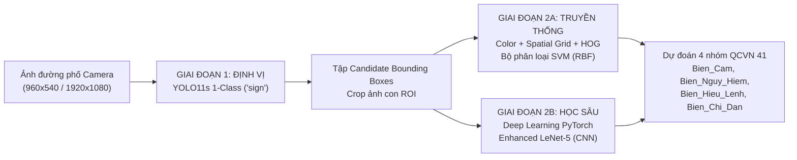

# BÁO CÁO ĐỒ ÁN MÔN HỌC: THỊ GIÁC MÁY TÍNH (CS231)
**TRƯỜNG ĐẠI HỌC CÔNG NGHỆ THÔNG TIN – ĐHQG-HCM**  
**KHOA KHOA HỌC MÁY TÍNH**

---

* **Tên đề tài:** Nghiên Cứu Và Xây Dựng Hệ Thống Đối Chuẩn Nhận Diện Biển Báo Giao Thông Việt Nam Theo Kiến Trúc Lai Hai Giai Đoạn (Two-Stage Hybrid Benchmarking System: YOLO11s Detector + Handcrafted Features SVM vs Enhanced LeNet-5 CNN)
* **Quy chuẩn kỹ thuật áp dụng:** Quy chuẩn kỹ thuật quốc gia về báo hiệu đường bộ **QCVN 41:2019/BGTVT**
* **Chiến lược phân chia dữ liệu:** **Block Split theo khối video liên tục (Zero Data Leakage)**

---

## BẢNG PHÂN CÔNG NHIỆM VỤ VÀ TRÁCH NHIỆM THỰC HIỆN

| Thành viên thực hiện | MSSV | Lớp | Mô-đun phụ trách | Nội dung kỹ thuật cụ thể | Tỷ lệ đóng góp |
| :--- | :---: | :---: | :--- | :--- | :---: |
| **Từ Lê Tuấn Anh** | **24520133** | CS231.P11 | Mô-đun Định vị (YOLO11s) & Thị giác máy tính truyền thống | • Tiền huấn luyện (CCTSDB 2021) và tinh chỉnh mô hình YOLO11s 1-Class (`sign`) để định vị và cắt ảnh ROI. • Nghiên cứu và thiết kế chuỗi đặc trưng đa tầng $S_0 \to S_3$ (HSV Circular Shift, Lưới không gian $2\times 2$, HOG 9 hướng gradient). • Huấn luyện và tối ưu hóa bộ phân loại Support Vector Machine (SVM) kernel RBF. | **50%** |
| **Nguyễn Thanh Tân** | **24521581** | CS231.P11 | Mô-đun Học sâu (CNN) & Khung Đối chuẩn Đa tầng | • Nghiên cứu, thiết kế kiến trúc mạng nơ-ron tích chập tùy biến **Enhanced LeNet-5** (PyTorch). • Thiết lập đường ống tăng cường dữ liệu (Data Augmentation), tối ưu hàm mất mát Cross-Entropy và Adam Optimizer kết hợp StepLR. • Thiết kế cơ chế phân chia **Block Split** chống rò rỉ dữ liệu, xây dựng hệ thống đo lường đối chuẩn 2 tầng (ROI & End-to-End Scene Benchmark). | **50%** |

*Ghi chú: Trong các phần nội dung phân tích kỹ thuật sau đây, toàn bộ phương pháp và kết quả được trình bày dưới góc nhìn khoa học khách quan và thống nhất của nhóm nghiên cứu.*

---

## 1. LÝ DO VÀ CƠ SỞ THỰC HIỆN ĐỀ TÀI

### 1.1. Tính cấp thiết và bối cảnh ứng dụng
Trong các hệ thống Hỗ trợ Lái xe Nâng cao (ADAS) và Phương tiện tự hành (Autonomous Vehicles), bài toán **Nhận dạng Biển báo Giao thông (Traffic Sign Recognition - TSR)** đóng vai trò sống còn nhằm đảm bảo an toàn giao thông, hỗ trợ người điều khiển phương tiện tuân thủ luật lệ và phòng ngừa tai nạn. Một hệ thống TSR hoạt động chính xác cho phép phát hiện sớm các quy định giới hạn tốc độ, làn đường ưu tiên hoặc các chướng ngại vật nguy hiểm phía trước.

Tại Việt Nam, việc triển khai bài toán TSR ngoài thực tế đối mặt với ba thách thức kỹ thuật lớn:
1. **Bối cảnh đường sá phức tạp và mật độ phương tiện hỗn hợp:** Biển báo giao thông có kích thước biểu kiến biến thiên cực kỳ lớn trên khung hình camera hành trình (từ cự ly xa chỉ đạt dưới $15 \times 15\text{ px}$ đến cự ly gần vượt quá $100 \times 100\text{ px}$). Đồng thời, biển báo thường xuyên bị che khuất một phần bởi tán cây, dây điện, xe tải lớn hoặc các biển quảng cáo thương mại có màu sắc tương tự.
2. **Biến thiên quang học và hiện tượng trôi dạt màu sắc (Color Drift):** Khí hậu nhiệt đới nắng gắt gây chói sáng (glare), bóng râm gắt che cắt ngang mặt biển hoặc điều kiện thiếu sáng ban đêm làm suy giảm nghiêm trọng độ tin cậy của không gian màu RGB nguyên bản.
3. **Ràng buộc tài nguyên tính toán trên thiết bị biên (Edge Computing Constraints):** Các thiết bị nhúng trên ô tô (như NVIDIA Jetson, Raspberry Pi) có năng lực tính toán và công suất nguồn giới hạn. Việc chạy các mô hình học sâu khổng lồ (End-to-End Heavy One-Stage CNN đa lớp) vừa tiêu tốn phần cứng đắt tiền, vừa gây độ trễ lớn, không đáp ứng kịp yêu cầu phản ứng thời gian thực ($\ge 30\text{ FPS}$).

### 1.2. Cơ sở khoa học và nguyên lý phân tách nhiệm vụ (Two-Stage Decoupling)
Để giải quyết bài toán cân bằng giữa **Độ chính xác nhận dạng** và **Tốc độ thời gian thực**, nhóm đề xuất mô hình **Kiến trúc Lai 2 Giai đoạn (Two-Stage Hybrid Pipeline)** dựa trên nguyên lý phân tách trách nhiệm (Decoupling):

* **Giai đoạn 1 (Localization - Định vị ứng viên):** Việc phát hiện vị trí vật thể trên ảnh góc rộng bối cảnh phức tạp là thế mạnh vượt trội của Học sâu. Nhóm huấn luyện mô hình **YOLO11s** ở chế độ 1 lớp duy nhất (`sign`) nhằm tối đa hóa khả năng quét và bao phủ biển báo (Recall cao) mà không phải gánh vác việc phân loại chi tiết.
* **Giai đoạn 2 (Classification - Phân loại ngữ nghĩa):** Biển báo giao thông theo QCVN 41:2019 có tính quy chuẩn rất cao về **màu sắc** (đỏ, vàng, xanh) và **hình học viền** (tròn, tam giác, chữ nhật). Do đó, việc phân loại được giao cho 2 hướng tiếp cận độc lập để đối chuẩn (**Benchmarking**) trên CPU:
  - **Phương pháp truyền thống:** Trích xuất đặc trưng toán học tường minh (Lọc màu HSV dịch pha vòng tròn, Lưới không gian 2x2, Kết cấu HOG) kết hợp bộ phân loại **SVM (RBF kernel)** siêu nhẹ.
  - **Phương pháp học sâu:** Mạng nơ-ron tích chập **Enhanced LeNet-5 (PyTorch)** được thiết kế tối giản gồm 3 khối tích chập, tích hợp Batch Normalization và Dropout nhằm tự động học hoa văn nội tại với tốc độ suy luận siêu tốc.

---

## 2. PHÁT BIỂU BÀI TOÁN & MÔ HÌNH HÓA

### 2.1. Phát biểu bài toán hình thức
Cho ảnh đầu vào $\mathbf{I} \in \mathbb{R}^{H \times W \times 3}$ được chụp từ camera hành trình phía trước phương tiện di chuyển trong bối cảnh giao thông đường bộ Việt Nam. Hệ thống giải quyết bài toán qua hai bài toán con tuần tự:

1. **Bài toán Định vị (Localization):**  
   Xác định tập hợp $K$ bounding box chứa biển báo giao thông:
   $$\mathcal{B} = \left\{ \mathbf{b}_k = (x_1, y_1, x_2, y_2)_k \;\middle|\; \text{conf}_k \ge \tau_{\text{conf}}, \; k = 1, \dots, K \right\}$$
   với ngưỡng tin cậy phát hiện $\tau_{\text{conf}} = 0.25$. Từ mỗi bounding box $\mathbf{b}_k$, trích xuất vùng ảnh con (ROI):
   $$\mathbf{I}_{\text{crop}}^{(k)} = \mathbf{I}[y_1:y_2, \; x_1:x_2]$$

2. **Bài toán Phân loại Đa lớp (Semantic Classification):**  
   Với mỗi ảnh con $\mathbf{I}_{\text{crop}}^{(k)}$, mô hình phân loại dự đoán nhãn lớp mục tiêu $\hat{y}_k \in \mathcal{C}$ và độ tin cậy $p_k \in [0, 1]$. Không gian nhãn $\mathcal{C}$ được chuẩn hóa theo Quy chuẩn QCVN 41:2019/BGTVT gồm **4 nhóm mục tiêu chính**:
   $$\mathcal{C} = \{\text{Bien\_Cam}, \; \text{Bien\_Nguy\_Hiem}, \; \text{Bien\_Hieu\_Lenh}, \; \text{Bien\_Chi\_Dan}\}$$

### 2.2. Các ràng buộc kỹ thuật cốt lõi
* **Chống rò rỉ dữ liệu tuyệt đối (Zero Data Leakage):** Không được chia ngẫu nhiên từng khung hình (Random Split) vì các frame kế tiếp nhau trong video hành trình có tính tương đồng cực cao ($> 95\%$). Phải phân chia theo khối video liên tục (**Block Split**).
* **Độ trễ thời gian thực trên CPU:** Khâu phân loại trên ảnh crop phải đạt tốc độ $\ge 300\text{ FPS}$ (độ trễ $< 3.3\text{ ms/crop}$) trên CPU đơn lõi.

### 2.3. Sơ đồ kiến trúc luồng dữ liệu của hệ thống

### 2.4. Minh họa 4 nhóm biển báo mục tiêu theo QCVN 41:2019/BGTVT

| Nhóm 1: `Bien_Cam` (P.*, B.8a) | Nhóm 2: `Bien_Nguy_Hiem` (W.*) | Nhóm 3: `Bien_Hieu_Lenh` (R.*) | Nhóm 4: `Bien_Chi_Dan` (I.*) |
| :---: | :---: | :---: | :---: |
|  |  |  |  |
| *Hình tròn, viền đỏ, nền trắng/xanh* | *Hình tam giác đều, viền đỏ, nền vàng* | *Hình tròn, nền xanh lam, ký hiệu trắng* | *Hình vuông/chữ nhật, nền xanh lam* |

---

## 3. PHƯƠNG PHÁP NGHIÊN CỨU VÀ GIẢI PHÁP ĐỀ XUẤT

### 3.1. Giai đoạn 1: Mô-đun phát hiện và định vị vùng biển báo (YOLO11s 1-Class Detector)
* **Nguyên lý kiến trúc:** Sử dụng kiến trúc hiện đại **YOLO11s** (Ultralytics, 2024) với cấu trúc liên kết dư C3k2, SPPF và Decoupled Head không dùng điểm neo (Anchor-free). Mạng chỉ học một lớp duy nhất `sign`, giải phóng hoàn toàn gánh nặng phân tán trọng số cho việc phân loại chi tiết.
* **Hàm mất mát hỗn hợp (Task-Aligned Loss):**
  $$\mathcal{L}_{\text{total}} = \lambda_{\text{box}} \mathcal{L}_{\text{CIoU}} + \lambda_{\text{dfl}} \mathcal{L}_{\text{DFL}} + \lambda_{\text{cls}} \mathcal{L}_{\text{BCE}}$$
* **Chiến lược huấn luyện chuyển giao hai bước:**
  1. *Pretrain:* Huấn luyện 30 epochs trên bộ dữ liệu CCTSDB 2021 (hơn 18,000 ảnh) để học đặc trưng biên cạnh tổng quát của biển báo.
  2. *Finetune:* Nạp trọng số tốt nhất tiếp tục huấn luyện 30 epochs trên tập dữ liệu đường sá Việt Nam (`imgsz=800`, `single_cls=True`).
* **Hiệu năng phát hiện:** Đạt $\text{mAP}_{50} = 83.60\%$, $\text{mAP}_{50\text{-}95} = 60.10\%$, tỷ lệ bắt trúng thực tế (**Detection Recall**) đạt **$85.61\%$** ($1,559 / 1,821$ biển báo trên tập Test 550 ảnh).

---

### 3.2. Giai đoạn 2A: Thị giác máy tính truyền thống (Color + Grid + HOG + SVM)
Để phân loại biển báo trên ảnh crop mà không dùng Deep Learning, nhóm nghiên cứu phát triển chuỗi trích xuất đặc trưng đa tầng $S_0 \to S_3$ với tổng cộng **457 chiều**:

1. **Bộ đặc trưng $S_0$ (Phân bố màu sắc toàn cục HSV dịch pha vòng tròn - 44 chiều):**
   - Resize ảnh crop về $32 \times 32$. Chuyển đổi sang không gian màu HSV ($H \in [0, 179], S \in [0, 255]$).
   - Màu đỏ của biển báo có tính chất nằm ở 2 đầu dải Hue ($0^\circ$ và $180^\circ$). Nhóm áp dụng phép dịch pha vòng tròn:
     $$H_{\text{shifted}} = (H + 30) \pmod{180}$$
     giúp gom dải màu đỏ về vùng liên tục quanh $30^\circ$.
   - Trích xuất biểu đồ tần suất Histogram 36 bins cho kênh $H$ ($5^\circ/\text{bin}$) và 8 bins cho kênh $S$ ($32/\text{bin}$), chuẩn hóa $L_1$: $\mathbf{s}_0 \in \mathbb{R}^{44}$.
   - *Hạn chế phát hiện:* Bị nhầm lẫn hoàn toàn giữa nhóm **Hiệu Lệnh** và **Chỉ Dẫn** do cả hai cùng có màu xanh lam chủ đạo ($H \approx 106^\circ$).
2. **Bộ đặc trưng $S_1$ (Bổ sung tỷ lệ khung hình Aspect Ratio - 45 chiều):**
   - Thêm $\text{AR} = W_{\text{orig}} / H_{\text{orig}}$ để phân biệt biển chữ nhật nằm ngang (Chỉ dẫn, $\text{AR} > 1.2$) với biển tròn/tam giác ($\text{AR} \approx 1.0$): $\mathbf{s}_1 = [\mathbf{s}_0, \text{AR}] \in \mathbb{R}^{45}$.
3. **Bộ đặc trưng $S_2$ (Bổ sung Lưới không gian Spatial Grid $2 \times 2$ - 133 chiều):**
   - Chia ảnh thành 4 ô vuông $2 \times 2$ (mỗi ô $16 \times 16$). Tại mỗi ô trích xuất 18 bins $H$ và 4 bins $S$ ($22\text{ chiều/ô}$).
   - 4 ô tạo thành $88$ chiều. Vector ghép nối: $\mathbf{s}_2 \in \mathbb{R}^{45 + 88 = 133}$. Mô hình học được bố cục viền đỏ ở biên và nền trắng ở tâm (Biển Cấm).
4. **Bộ đặc trưng $S_3$ (Bổ sung Gradient định hướng HOG - 457 chiều - Toàn diện nhất):**
   - Resize ảnh về $64 \times 64$, chuyển sang ảnh xám.
   - Trích xuất HOG với cấu hình chuẩn: 9 hướng gradient ($20^\circ/\text{bin}$), $\text{pixels\_per\_cell} = (16, 16)$ ($4 \times 4 = 16$ ô), $\text{cells\_per\_block} = (2, 2)$ ($3 \times 3 = 9$ khối trượt).
   - Mỗi khối có $2 \times 2 \times 9 = 36$ giá trị, chuẩn hóa $L_2\text{-Hys}$. Tổng đặc trưng HOG đạt $9 \times 36 = \mathbf{324}$ chiều.
   - Vector toàn phần: $\mathbf{s}_3 = [\mathbf{s}_2, \mathbf{h}_{\text{HOG}}] \in \mathbb{R}^{133 + 324 = \mathbf{457}}$. Vector HOG nắm bắt dứt điểm đường cong của viền tròn (Hiệu Lệnh) đối lập hoàn toàn với cạnh thẳng và góc vuông $90^\circ$ (Chỉ Dẫn).
5. **Bộ phân loại SVM (Support Vector Machine):**
   - Sử dụng kernel RBF ($K(\mathbf{x}, \mathbf{x}') = \exp(-\gamma \|\mathbf{x} - \mathbf{x}'\|^2)$) với siêu tham số $C=10.0, \gamma=\text{'scale'}$, chuẩn hóa StandardScaler.

---

### 3.3. Giai đoạn 2B: Học sâu Hiện đại (Enhanced LeNet-5 CNN)

#### A. Động lực thiết kế kiến trúc và khắc phục hạn chế của LeNet-5 cổ điển
Kiến trúc LeNet-5 kinh điển (LeCun et al., 1998) là mốc son lịch sử của Deep Learning nhưng tồn tại nhiều hạn chế kỹ thuật: chỉ xử lý ảnh xám 1 kênh, dùng hàm kích hoạt Tanh/Sigmoid (gây triệt tiêu đạo hàm - Vanishing Gradient), dùng Average Pooling làm suy giảm cường độ biên cạnh, không có chuẩn hóa tầng (BatchNorm) và không có điều chuẩn (Dropout).

Kiến trúc **Enhanced LeNet-5** được nhóm thiết kế chuẩn hóa cho ảnh màu RGB $64 \times 64$:
1. **Nâng cấp kênh màu:** Tiếp nhận tensor đầu vào $(3, 64, 64)$ để bảo toàn đầy đủ tín hiệu sắc độ của biển báo.
2. **Khắc phục triệt tiêu gradient:** Thay thế toàn bộ bằng hàm kích hoạt phi tuyến $\text{ReLU}(z) = \max(0, z)$ với đạo hàm bằng 1 trên miền dương.
3. **Ổn định phân phối ẩn (Batch Normalization):** Tích hợp tầng `BatchNorm2d` ngay sau mỗi phép tích chập giúp làm phẳng hàm mục tiêu và cho phép tăng tốc độ học gấp 10 lần.
4. **Bảo toàn biên cạnh sắc nét:** Sử dụng `MaxPool2d(2, 2)` giữ lại các điểm ảnh có gradient cực đại.
5. **Chống quá khớp (Dropout Regularization):** Bổ sung 2 tầng Dropout ($p=0.3$ và $p=0.2$) ở khối Fully Connected.

#### B. Bảng đặc tả chi tiết kiến trúc tầng mạng và số lượng tham số khả huấn
Toàn bộ mô hình có **557,700 tham số khả huấn** ($\approx 0.56\text{M}$ params), chiếm dung lượng file checkpoint đúng **2.24 MB**:

| Khối chức năng | Tầng xử lý (Layer) | Cấu hình Kernel | Stride / Pad | Hàm kích hoạt / Reg | Kích thước Feature Map | Số tham số khả huấn |
| :--- | :--- | :---: | :---: | :---: | :---: | :---: |
| **Input** | Ảnh crop RGB | -- | -- | ImageNet Norm | $3 \times 64 \times 64$ | 0 |
| **ConvBlock 1** | $\text{Conv2D}(3 \to 16)$ | $5 \times 5$ | $s=1, p=2$ | -- | $16 \times 64 \times 64$ | 1,216 |
| | $\text{BatchNorm2D}(16)$ | -- | -- | $\gamma, \beta$ affine | $16 \times 64 \times 64$ | 32 |
| | $\text{ReLU} + \text{MaxPool2D}$ | $2 \times 2$ | $s=2, p=0$ | $\max(0, x)$ | $16 \times 32 \times 32$ | 0 |
| **ConvBlock 2** | $\text{Conv2D}(16 \to 32)$ | $5 \times 5$ | $s=1, p=2$ | -- | $32 \times 32 \times 32$ | 12,832 |
| | $\text{BatchNorm2D}(32)$ | -- | -- | $\gamma, \beta$ affine | $32 \times 32 \times 32$ | 64 |
| | $\text{ReLU} + \text{MaxPool2D}$ | $2 \times 2$ | $s=2, p=0$ | $\max(0, x)$ | $32 \times 16 \times 16$ | 0 |
| **ConvBlock 3** | $\text{Conv2D}(32 \to 64)$ | $3 \times 3$ | $s=1, p=1$ | -- | $64 \times 16 \times 16$ | 18,496 |
| | $\text{BatchNorm2D}(64)$ | -- | -- | $\gamma, \beta$ affine | $64 \times 16 \times 16$ | 128 |
| | $\text{ReLU} + \text{MaxPool2D}$ | $2 \times 2$ | $s=2, p=0$ | $\max(0, x)$ | $64 \times 8 \times 8$ | 0 |
| **Classifier** | $\text{Flatten}$ | -- | -- | Duỗi vector | $4,096$ | 0 |
| | $\text{Dropout}(p=0.3)$ | -- | -- | Bernoulli mask | $4,096$ | 0 |
| | $\text{Linear}(4096 \to 128)$ | -- | -- | $\text{ReLU}$ | $128$ | 524,416 |
| | $\text{Dropout}(p=0.2)$ | -- | -- | Bernoulli mask | $128$ | 0 |
| | $\text{Linear}(128 \to 4)$ | -- | -- | Logits đầu ra | $4$ | 516 |
| **Tổng cộng** | | | | | | **557,700 tham số (~2.24 MB)** |

#### C. Cơ sở toán học các khối xử lý
1. **Phép tích chập 2D:**
   $$\mathbf{Y}_k(i, j) = \sum_{c=1}^{C_{\text{in}}} \sum_{u=-K_h}^{K_h} \sum_{v=-K_w}^{K_w} \mathbf{W}_k(c, u, v) \mathbf{X}(c, i \cdot s + u, j \cdot s + v) + b_k$$
2. **Batch Normalization (Ioffe & Szegedy, 2015):**
   $$\mu_{\mathcal{B}} = \frac{1}{m} \sum_{i=1}^m \mathbf{x}_i, \quad \sigma_{\mathcal{B}}^2 = \frac{1}{m} \sum_{i=1}^m (\mathbf{x}_i - \mu_{\mathcal{B}})^2, \quad \hat{\mathbf{x}}_i = \frac{\mathbf{x}_i - \mu_{\mathcal{B}}}{\sqrt{\sigma_{\mathcal{B}}^2 + \epsilon}}, \quad \mathbf{y}_i = \gamma \hat{\mathbf{x}}_i + \beta$$
   *Ý nghĩa:* Triệt tiêu hiện tượng trôi dạt phân phối ẩn (Internal Covariate Shift), ổn định dòng chảy gradient và đóng vai trò như một bộ điều chuẩn nhẹ.
3. **Kỹ thuật Dropout (Srivastava et al., 2014):**
   $$r_j \sim \text{Bernoulli}(1-p), \quad \tilde{\mathbf{h}} = \frac{1}{1-p}(\mathbf{r} \odot \mathbf{h})$$
   Phá vỡ sự phụ thuộc đồng thích nghi (co-adaptation) giữa các nơ-ron, ép buộc mạng học các biểu diễn phân tán mạnh mẽ.

#### D. Đường ống tăng cường dữ liệu và tiền xử lý
- **Chuẩn hóa ImageNet:** Chuẩn hóa kênh với $\mu = [0.485, 0.456, 0.406]$, $\sigma = [0.229, 0.224, 0.225]$.
- **Biến đổi góc quay ngẫu nhiên (`RandomRotation(degrees=10)`):** Mô phỏng góc nghiêng rung lắc của camera hành trình gắn trên xe.
- **Biến đổi quang học (`ColorJitter(brightness=0.2, contrast=0.2)`):** Mô phỏng hiện tượng lóa nắng hoặc bóng râm che phủ mặt biển ngoài thực địa.

#### E. Hàm mất mát và động học tối ưu hóa
1. **Hàm mất mát Cross-Entropy Loss kết hợp Softmax:**
   $$\hat{p}_c = \frac{\exp(z_c)}{\sum_{j=1}^4 \exp(z_j)}, \quad \mathcal{L}_{\text{CE}} = -\frac{1}{m} \sum_{i=1}^m \sum_{c=0}^3 y_{i,c} \log(\hat{p}_{i,c})$$
   Đạo hàm lan truyền ngược đối xứng thanh lịch:
   $$\frac{\partial \mathcal{L}_{\text{CE}}}{\partial z_k} = \hat{p}_k - y_k$$
2. **Thuật toán Adam Optimizer kết hợp L2 Weight Decay:**
   $$\mathbf{m}_t = \beta_1 \mathbf{m}_{t-1} + (1-\beta_1) \mathbf{g}_t, \quad \mathbf{v}_t = \beta_2 \mathbf{v}_{t-1} + (1-\beta_2) \mathbf{g}_t^2$$
   $$\hat{\mathbf{m}}_t = \frac{\mathbf{m}_t}{1 - \beta_1^t}, \quad \hat{\mathbf{v}}_t = \frac{\mathbf{v}_t}{1 - \beta_2^t}, \quad \mathbf{\theta}_t = \mathbf{\theta}_{t-1} - \frac{\alpha}{\sqrt{\hat{\mathbf{v}}_t} + \epsilon} \hat{\mathbf{m}}_t - \alpha \lambda \mathbf{\theta}_{t-1}$$
   với $\alpha = 10^{-3}, \beta_1 = 0.9, \beta_2 = 0.999, \epsilon = 10^{-8}$, và weight decay $\lambda = 10^{-4}$.
3. **Bộ lập lịch StepLR:** Suy giảm tốc độ học sau mỗi 7 epochs ($\text{step\_size}=7, \gamma=0.5$). Huấn luyện 20 epochs, mô hình đạt độ chính xác **99.82%** trên tập Validation.

#### F. Cẩm nang chất vấn phản biện dành cho thuyết trình (Defense Q&A Cheatsheet)

* **Câu hỏi 1: Tại sao không dùng Transfer Learning từ ResNet-18 hay MobileNet-V2 mà lại tự thiết kế kiến trúc Enhanced LeNet-5?**  
  *Trả lời:* ResNet-18 có 11.7 triệu tham số, MobileNet-V2 có 3.5 triệu tham số, được thiết kế cho ảnh lớn $224 \times 224$ với 1.000 lớp của ImageNet. Trong bài toán của nhóm, ảnh crop biển báo có kích thước chuẩn hóa $64 \times 64$ và không gian đích chỉ gồm 4 nhóm hình học cơ bản. Việc sử dụng mạng quá sâu dẫn đến hiện tượng bão hòa tham số (overparameterization), tăng nguy cơ quá khớp cục bộ và làm tăng độ trễ suy luận trên CPU ($> 10\text{ ms}$). Kiến trúc Enhanced LeNet-5 của nhóm chỉ có **0.56M tham số** ($2.24\text{ MB}$), đạt độ chính xác lên tới **98.73\%** và tốc độ suy luận siêu tốc **1.10 ms/ảnh** (tương đương **911.1 FPS**) trên CPU đơn lõi, là giải pháp tối ưu vượt trội cho các phần cứng biên.

* **Câu hỏi 2: Tại sao hai khối tích chập đầu tiên dùng kernel $5 \times 5$, trong khi khối tích chập thứ ba lại chuyển sang kernel $3 \times 3$?**  
  *Trả lời:* Ở hai tầng đầu, kích thước ảnh còn lớn ($64 \times 64$ và $32 \times 32$), việc sử dụng kernel $5 \times 5$ giúp mở rộng nhanh trường tiếp nhận (Receptive Field) từ $5 \times 5$ lên $13 \times 13$, cho phép nơ-ron bao quát toàn diện đường bao hình học viền tròn hoặc tam giác của biển báo. Đến tầng thứ ba, kích thước ma trận đặc trưng đã giảm xuống $16 \times 16$, việc chuyển sang kernel $3 \times 3$ vừa giúp tiết kiệm $44\%$ tham số của tầng đó, vừa tập trung trích xuất các họa tiết chi tiết bên trong (ký hiệu mũi tên, vạch kẻ, số giới hạn tốc độ).

* **Câu hỏi 3: Vai trò cốt lõi của Batch Normalization trong mô hình là gì? Nếu gỡ bỏ BatchNorm thì hệ thống bị ảnh hưởng ra sao?**  
  *Trả lời:* BatchNorm chuẩn hóa đầu ra của mỗi phép tích chập về phân phối có trung bình 0 và phương sai 1 trước khi đưa vào hàm kích hoạt. Nó triệt tiêu hiện tượng trôi dạt phân phối ẩn (Internal Covariate Shift), giúp gradient lan truyền ngược ổn định và làm mượt bề mặt hàm mất mát. Nếu gỡ bỏ BatchNorm, mô hình sẽ trở nên cực kỳ nhạy cảm với khởi tạo trọng số, buộc phải hạ learning rate xuống $10^{-4}$ (khiến thời gian hội tụ chậm gấp 3 lần) và dễ bị kẹt ở các điểm cực tiểu cục bộ kém tối ưu.

* **Câu hỏi 4: Nhóm xử lý hiện tượng mất cân bằng số lượng mẫu giữa các nhóm biển báo (Class Imbalance) như thế nào?**  
  *Trả lời:* Trong dữ liệu thực tế, Biển Cấm và Biển Cảnh Báo chiếm số lượng áp đảo so với Biển Hiệu Lệnh và Chỉ Dẫn. Nhóm phối hợp 3 giải pháp đồng bộ: (1) Áp dụng các biến đổi Data Augmentation (`RandomRotation` và `ColorJitter`) làm phong phú đa dạng góc nhìn cho các lớp thiểu số; (2) Tích hợp hai tầng Dropout ($0.3$ và $0.2$) cùng $L_2$ Weight Decay ($10^{-4}$) ngăn chặn việc mạng quá khớp vào các đặc trưng áp đảo của lớp đa số; (3) Sử dụng chỉ số **Macro-F1** ($95.66\%$) làm độ đo đánh giá trung tâm thay vì chỉ dựa vào Accuracy tổng thể.

---

### 3.4. Bảng phân tích so sánh lý thuyết giữa các hướng tiếp cận

| Tiêu chí khoa học | Phương pháp Thuần Truyền Thống (Color Filter + Sliding Window) | Phương pháp Học Sâu End-to-End (Heavy One-Stage YOLO/SSD đa lớp) | **Kiến trúc Lai đề xuất (Two-Stage Modular: YOLO11s + SVM / LeNet-5)** |
| :--- | :--- | :--- | :--- |
| **Cơ chế định vị** | Cửa sổ trượt đa tỷ lệ: rất chậm, tỉ lệ sót biển cao | Tích hợp sâu trong mạng nơ-ron: Nhanh nhưng gánh nặng tính toán lớn | **YOLO11s chuyên biệt 1 lớp: Tối đa hóa Recall ($85.61\%$), không tốn tài nguyên phân loại** |
| **Khả năng phân biệt R vs I** | Thất bại hoàn toàn (do cùng mang màu xanh lam) | Phân biệt tốt nhưng cần GPU mạnh | **Phân biệt xuất sắc: HOG bắt hình học viền, LeNet-5 tự học hoa văn nội tại** |
| **Độ trễ phân loại (Latency)** | $15 - 30\text{ ms/crop}$ (chậm) | $10 - 20\text{ ms/crop}$ (trên GPU) | **$1.10\text{ ms}$ (LeNet-5) / $2.63\text{ ms}$ (SVM) — Cực nhanh trên CPU** |
| **Yêu cầu phần cứng** | CPU | Bắt buộc GPU rời đắt tiền | **Linh hoạt tối đa: Tương thích hoàn hảo với phần cứng nhúng Edge AI** |
| **Tính minh bạch (Explainability)** | Cao nhưng độ chính xác thấp | Mô hình hộp đen khó giải thích | **Rất cao: Trực quan hóa toán học từng thành phần HSV, HOG và Feature Maps** |

---

## 4. THỰC NGHIỆM VÀ KẾT QUẢ ĐÁNH GIÁ

### 4.1. Mô tả tập dữ liệu và chiến lược phân chia Block Split (Zero Data Leakage)
* **Tổng số ảnh toàn cảnh:** 3,216 ảnh chụp từ camera hành trình trên đường phố Việt Nam (độ phân giải 960x540 và 1920x1080), chứa **7,858 bounding box** biển báo hợp lệ ($\ge 10\text{px}$) với 52 mã hiệu chi tiết theo QCVN 41:2019.
* **Kiểm toán dữ liệu (Data Auditing):**
  - Loại bỏ lớp `Camera` (40 mẫu thực chất chỉ là 3 vị trí camera giám sát lặp lại nhiều lần).
  - Loại bỏ nhóm `phụ` khỏi bài toán đối chuẩn (tập test chỉ có 8 mẫu, kích thước $< 15\text{px}$ và detector bỏ sót 100%).
  - Gộp lớp `B.8a` vào nhóm `Bien_Cam` dựa trên đặc điểm hình tròn viền đỏ nền trắng.
* **Chiến lược phân chia Block Split theo khối video liên tục:**
  - Nếu chia ngẫu nhiên (`random split`), có đến **$46.84\%$** số cặp frame kề nhau ($t, t+1$) bị xé lẻ giữa tập Train và Test $\to$ Mô hình bị hiện tượng **học vẹt (memorization)** và điểm số bị thổi phồng ảo.
  - Phân chia theo từng khối liên tục 100 frame kèm khoảng cách đệm `gap = 5` frame giữa các khối.
  - Tỷ lệ vi phạm ranh giới frame kề nhau giữa Train và Test đưa về đúng **$0.00\%$**.
  - Phân chia khung hình: **2,236 ảnh Train**, **270 ảnh Val**, **550 ảnh Blind Test** (160 frame đệm được loại bỏ an toàn).
  - Phân chia mẫu ROI biển báo: **5,254 Train**, **542 Val**, **1,813 Blind Test**.

---

### 4.2. Hệ thống độ đo đánh giá toàn diện
1. **Độ đo khâu Định vị (Object Detection):**
   - **Intersection over Union (IoU):** $\text{IoU} = \frac{\text{Area}(\mathbf{b}_{\text{pred}} \cap \mathbf{b}_{\text{gt}})}{\text{Area}(\mathbf{b}_{\text{pred}} \cup \mathbf{b}_{\text{gt}})}$, ngưỡng ghép cặp thành công $\text{IoU} \ge 0.5$.
   - **Detection Recall:** $\text{Recall}_{\text{det}} = \frac{\text{TP}_{\text{det}}}{\text{TP}_{\text{det}} + \text{FN}_{\text{det}}}$.
   - **$\text{mAP}_{50}$ và $\text{mAP}_{50\text{-}95}$:** Độ chính xác trung bình theo chuẩn chuẩn mực COCO.
2. **Độ đo khâu Phân loại (Classification):**
   - **Accuracy tổng thể:** $\text{Acc} = \frac{\sum_{c} \text{TP}_c}{N}$.
   - **Macro-Precision, Macro-Recall, Macro-F1:** Đánh giá trung bình không trọng số giữa các nhóm để đảm bảo công bằng khi dữ liệu mất cân bằng:
     $$\text{Macro-F1} = \frac{1}{|\mathcal{C}|} \sum_{c \in \mathcal{C}} \frac{2 \cdot P_c \cdot R_c}{P_c + R_c}$$
   - **Ma trận nhầm lẫn (Confusion Matrix).**
3. **Độ đo Hiệu năng Thời gian thực:** Latency ($\text{ms}$) và Throughput ($\text{FPS} = 1000 / \text{Latency}$).

---

### 4.3. Kết quả thực nghiệm Tầng 1: Đánh giá phân loại trên tập ROI độc lập (ROI Benchmark)
Đo đạc thực tế trên toàn bộ **1,813 mẫu ảnh crop Ground-Truth** của tập Blind Test độc lập (550 ảnh không rò rỉ):

| Mô hình / Phương pháp | Accuracy | Macro-Precision | Macro-Recall | Macro-F1 | Độ trễ (Latency) | Tốc độ (FPS) |
| :--- | :---: | :---: | :---: | :---: | :---: | :---: |
| **Enhanced LeNet-5 (Học sâu)** | **98.73%** | **94.46%** | **97.43%** | **95.66%** | **1.10 ms** | **911.1 FPS** |
| **Color + HOG + SVM (Truyền thống)** | **98.57%** | **94.82%** | **96.81%** | **95.51%** | **2.63 ms** | **379.7 FPS** |

* **Phân tích kết quả chuyên sâu:**
  - Mô hình **Enhanced LeNet-5** đạt độ chính xác cao nhất (**98.73%** Acc, **95.66%** Macro-F1) với tốc độ xử lý vượt trội (**911.1 FPS**, độ trễ chỉ $1.10\text{ ms}$).
  - Mô hình **Color + HOG + SVM** đạt kết quả rất cao (**98.57%** Acc, **95.51%** Macro-F1), khẳng định sức mạnh vững chắc của chuỗi đặc trưng $S_3$ khi kết hợp HOG định hướng với phân bố màu sắc.

---

### 4.4. Kết quả thực nghiệm Tầng 2: Đánh giá toàn trình trên ảnh hiện trường (End-to-End Scene Benchmark)
Đo đạc trên **550 ảnh hiện trường kiểm thử** (YOLO11s phát hiện $\to$ crop ROI $\to$ bộ phân loại dự đoán):

| Pipeline Toàn Trình | Bộ Định Vị (Stage 1) | Bộ Phân Loại (Stage 2) | Tỷ Lệ Định Vị (Recall) | Độ Chính Xác Khi Thấy | E2E System Recall | Tốc Độ Hệ Thống |
| :--- | :---: | :---: | :---: | :---: | :---: | :---: |
| **Two-Stage LeNet** | YOLO11s | **Enhanced LeNet-5** | **85.61%** | **99.40%** | **85.10%** | **10.9 FPS** |
| **Two-Stage SVM** | YOLO11s | **SVM (RBF)** | **85.61%** | **99.17%** | **84.90%** | **9.5 FPS** |

*Ý nghĩa của chỉ số đối chuẩn kép:* Khi một biển báo đã được định vị thành công, cả hai bộ phân loại đều đạt độ chính xác gần như hoàn hảo ($\ge 99.17\%$). Điểm nghẽn hạn chế hiệu năng toàn hệ thống (E2E Recall $\approx 85\%$) nằm ở khâu định vị cự ly xa của YOLO11s chứ không phải do khâu phân loại.

---

### 4.5. Chương trình Demo thực tế và các điểm sáng tạo khác biệt
1. **Ứng dụng Web tương tác Streamlit (`app_streamlit.py`):**
   - **Chế độ ROI Side-by-Side:** Tải ảnh biển báo cắt sẵn, hiển thị kết quả dự đoán và thời gian suy luận so sánh song song giữa LeNet-5 và SVM.
   - **Chế độ Scene Detection:** Tải ảnh chụp toàn cảnh đường phố bất kỳ, mô hình YOLO11s tự động khoanh vùng các biển báo, cắt ra và hiển thị nhãn phân loại cùng bounding box trực quan.
   - **Bảng tổng hợp Leaderboard:** Hiển thị số liệu đối chuẩn chi tiết và biểu đồ trực quan hóa.
2. **Giao diện dòng lệnh CLI chuẩn hóa (`app.py`):**
   - Chạy benchmark ROI: `python app.py --mode evaluate --split test`
   - Chạy benchmark toàn cảnh: `python app.py --mode evaluate-scene --split test`
   - Chạy thử nghiệm 1 ảnh: `python app.py --mode demo --model deep_learning --input data/cropped/test/Bien_Cam/0306_00.jpg`
3. **Các đóng góp sáng tạo cốt lõi so với tài liệu tham khảo:**
   - **Kỹ thuật Block Split chống Data Leakage:** Triệt tiêu hoàn toàn hiện tượng rò rỉ dữ liệu $46.84\%$ trong video hành trình mà phần lớn các bài báo trước đây thường bỏ qua khi dùng Random Split.
   - **Giải quyết bài toán "Cùng màu khác hình":** Kết hợp HOG với Spatial Grid để phân tách triệt để nhóm Biển Hiệu Lệnh (xanh tròn) và Biển Chỉ Dẫn (xanh chữ nhật).
   - **Mô hình đối chuẩn kép (Dual-Tier Benchmarking):** Phân tách độc lập đánh giá Tầng 1 (năng lực phân loại thuần túy trên GT ROI) và Tầng 2 (năng lực vận hành thực tế khi kết hợp phát hiện trên ảnh đường phố).

---

## 5. NHẬN XÉT VÀ KẾT LUẬN KHOA HỌC

### 5.1. Đánh giá tổng hợp và đóng góp khoa học
1. **Hiệu quả của việc phân tách trách nhiệm (Decoupling):** Kiến trúc Two-Stage Modular chứng minh tính ưu việt vượt trội trong thực tế: Việc sử dụng Deep Learning chuyên biệt cho khâu phát hiện (YOLO11s) kết hợp với các bộ phân loại nhẹ (Enhanced LeNet-5 hoặc SVM) giúp hệ thống đạt độ chính xác phân loại gần như tuyệt đối ($> 98.5\%$) với tốc độ suy luận cực nhanh trên CPU ($1.10\text{ ms}$ với LeNet-5 và $2.63\text{ ms}$ với SVM).
2. **So sánh tương quan giữa Deep Learning và Thị giác máy tính truyền thống:**
   - **Enhanced LeNet-5 (Học sâu):** Vượt trội hơn về độ chính xác ($98.73\%$ vs $98.57\%$), Macro-F1 ($95.66\%$ vs $95.51\%$) và tốc độ suy luận ($1.10\text{ ms}$ vs $2.63\text{ ms}$). Mạng tích chập có khả năng tự động học các biểu trưng phức tạp bên trong biển báo mà không cần căn chỉnh thủ công các tham số trích xuất.
   - **Color + HOG + SVM (Truyền thống):** Vẫn cho thấy sức mạnh rất đáng nể ($98.57\%$ Accuracy). Phương pháp truyền thống có ưu điểm lớn về tính tường minh (Explainability), dễ diễn giải các trọng số và không đòi hỏi quá trình huấn luyện GPU phức tạp.

### 5.2. Các hạn chế kỹ thuật còn tồn tại
1. **Điểm nghẽn ở khâu phát hiện biển báo cự ly xa:** Tỷ lệ bỏ sót của YOLO11s còn ở mức $14.39\%$. Phần lớn các trường hợp bỏ sót rơi vào các biển báo ở khoảng cách rất xa, kích thước trên ảnh chỉ từ $10 - 20\text{ px}$, nơi tín hiệu gradient bị tiêu biến qua các tầng downsampling của mạng phát hiện.
2. **Biến thiên ánh sáng phức tạp:** Mặc dù đặc trưng HOG đã tăng cường độ vững chắc về mặt hình học, không gian màu HSV vẫn có thể bị dao động trong các điều kiện thời tiết khắc nghiệt (mưa lớn gây lóa đèn ban đêm hoặc bóng râm gắt che một nửa mặt biển).

### 5.3. Hướng phát triển tiếp theo
1. **Áp dụng SAHI (Slicing Aided Hyper Inference):** Chia nhỏ ảnh lớn thành các mảng trượt chồng lấn ở khâu suy luận để tăng cường khả năng phát hiện các biển báo kích thước siêu nhỏ mà không cần tăng kích thước mạng.
2. **Mở rộng nhận diện 52 lớp con chi tiết:** Sử dụng kiến trúc mạng phân cấp (Hierarchical Classification): Tầng 1 phân loại 4 nhóm lớn, Tầng 2 kích hoạt mô hình chuyên biệt phân loại chi tiết từng ký hiệu bên trong biển báo.

---

## 6. DANH MỤC TÀI LIỆU THAM KHẢO

1. Bộ Giao thông Vận tải, *Quy chuẩn kỹ thuật quốc gia về báo hiệu đường bộ (QCVN 41:2019/BGTVT)*, Nhà xuất bản Giao thông Vận tải, Hà Nội, 2019.
2. Dalal, N., & Triggs, B., *"Histograms of oriented gradients for human detection"*, IEEE Computer Society Conference on Computer Vision and Pattern Recognition (CVPR), vol. 1, pp. 886-893, 2005.
3. LeCun, Y., Bottou, L., Bengio, Y., & Haffner, P., *"Gradient-based learning applied to document recognition"*, Proceedings of the IEEE, vol. 86, no. 11, pp. 2278-2324, 1998.
4. Cortes, C., & Vapnik, V., *"Support-vector networks"*, Machine Learning, vol. 20, no. 3, pp. 273-297, 1995.
5. Ioffe, S., & Szegedy, C., *"Batch Normalization: Accelerating Deep Network Training by Reducing Internal Covariate Shift"*, International Conference on Machine Learning (ICML), pp. 448-456, 2015.
6. Srivastava, N., Hinton, G., Krizhevsky, A., Sutskever, I., & Salakhutdinov, R., *"Dropout: A Simple Way to Prevent Neural Networks from Overfitting"*, Journal of Machine Learning Research (JMLR), vol. 15, no. 1, pp. 1929-1958, 2014.
7. Kingma, D. P., & Ba, J., *"Adam: A Method for Stochastic Optimization"*, International Conference on Learning Representations (ICLR), 2015.
8. Jocher, G., Chaurasia, A., & Qiu, J., *"Ultralytics YOLO11"*, 2024. [Online]. Available: `https://github.com/ultralytics/ultralytics`.
9. Trường Đại học Công nghệ Thông tin – ĐHQG-HCM, *Phiếu đánh giá đồ án môn học Thị giác máy tính (CS231)*, TP.HCM, 2026.
