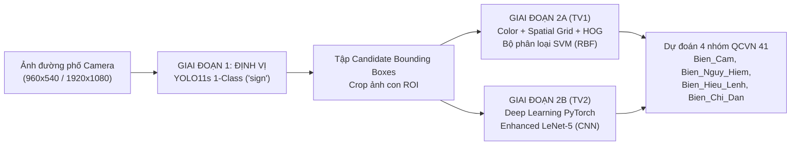
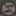
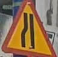
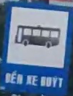

# BÁO CÁO ĐỒ ÁN MÔN HỌC: THỊ GIÁC MÁY TÍNH (CS231)
**TRƯỜNG ĐẠI HỌC CÔNG NGHỆ THÔNG TIN – ĐHQG-HCM**  
**KHOA KHOA HỌC MÁY TÍNH**

---

* **Tên đề tài:** Hệ Thống Nhận Diện & Đánh Giá So Sánh Biển Báo Giao Thông Việt Nam Theo Kiến Trúc Lai Hai Giai Đoạn (Two-Stage Hybrid Benchmarking System: YOLO11s Detector + Handcrafted Features SVM vs Enhanced LeNet-5 CNN)
* **Quy chuẩn áp dụng:** Quy chuẩn kỹ thuật quốc gia về báo hiệu đường bộ **QCVN 41:2019/BGTVT**
* **Chiến lược phân chia:** **Block Split theo khối video liên tục (Zero Data Leakage)**
* **Danh sách thành viên:**
  1. **Từ Lê Tuấn Anh** - MSSV: **24520133** (Phụ trách: Mô-đun phát hiện YOLO11s để cắt biển báo + Pipeline thị giác máy tính truyền thống Color + Spatial Grid + HOG + SVM).
  2. **Nguyễn Thanh Tân** - MSSV: **24521581** (Phụ trách: Pipeline phân loại Học sâu CNN - Enhanced LeNet-5 PyTorch + Hệ thống đối chuẩn Dual-Tier Benchmark).

---

## 1. LÝ DO VÀ CƠ SỞ THỰC HIỆN ĐỀ TÀI

### 1.1. Lý do chọn đề tài & Tính cấp thiết
Trong các hệ thống Hỗ trợ Lái xe Nâng cao (ADAS) và Xe tự hành (Autonomous Vehicles), bài toán **Nhận dạng Biển báo Giao thông (Traffic Sign Recognition - TSR)** đóng vai trò sống còn nhằm đảm bảo an toàn giao thông, hỗ trợ người điều khiển phương tiện tuân thủ luật lệ và phòng ngừa tai nạn.

Tại Việt Nam, việc triển khai bài toán TSR gặp nhiều thách thức đặc thù:
1. **Bối cảnh đường sá phức tạp:** Biển báo giao thông có kích thước biến thiên rất lớn (từ rất xa $\le 16\text{px}$ đến gần), thường xuyên bị che khuất một phần bởi tán cây, dây điện hoặc phương tiện lớn.
2. **Hiện tượng trôi màu và biến thiên quang học:** Khí hậu nhiệt đới nắng gắt gây chói sáng, mưa ẩm, sương mù hoặc bóng râm gắt làm sai lệch đáng kể không gian màu RGB nguyên bản.
3. **Ràng buộc tài nguyên tính toán thực tế:** Các thiết bị phần cứng nhúng (Edge AI Devices) trên ô tô thường có năng lực tính toán và bộ nhớ giới hạn. Việc triển khai các mô hình học sâu khổng lồ (End-to-End Heavy CNN) vừa tốn kém chi phí phần cứng, vừa gây độ trễ lớn, không đáp ứng kịp thời gian thực ($< 30\text{ ms}$).

### 1.2. Cơ sở khoa học & Ý tưởng tiếp cận (Two-Stage Decoupling)
Để giải quyết hài hòa bài toán đánh đổi giữa **Độ chính xác cao** và **Tốc độ thời gian thực**, nhóm đề xuất mô hình **Kiến trúc Lai 2 Giai đoạn (Two-Stage Hybrid Pipeline)** dựa trên nguyên lý phân tách trách nhiệm (Decoupling):

* **Giai đoạn 1 (Localization - Định vị ứng viên):** Việc phát hiện vị trí vật thể trên ảnh góc rộng bối cảnh phức tạp là thế mạnh vượt trội của Học sâu. Nhóm huấn luyện mô hình **YOLO11s** ở chế độ 1 lớp duy nhất (`sign`) nhằm tối đa hóa khả năng quét và bao phủ biển báo (Recall cao) mà không phải gánh vác việc phân loại chi tiết.
* **Giai đoạn 2 (Classification - Phân loại ngữ nghĩa):** Biển báo giao thông theo QCVN 41:2019 có tính quy chuẩn rất cao về **màu sắc** (đỏ, vàng, xanh) và **hình học viền** (tròn, tam giác, chữ nhật). Do đó, việc phân loại được giao cho 2 hướng tiếp cận độc lập để đối chuẩn (**Benchmarking**):
  - **Phương pháp truyền thống (Thành viên 1):** Trích xuất đặc trưng toán học tường minh (Lọc màu HSV, Lưới không gian 2x2, Kết cấu HOG) kết hợp bộ phân loại **SVM (RBF kernel)** siêu nhẹ trên CPU.
  - **Phương pháp học sâu (Thành viên 2):** Mạng nơ-ron tích chập **Enhanced LeNet-5 (PyTorch)** tối ưu hóa cho ảnh crop biển báo.

---

## 2. PHÁT BIỂU BÀI TOÁN & MINH HỌA

### 2.1. Phát biểu bài toán
Cho ảnh đầu vào $\mathbf{I} \in \mathbb{R}^{H \times W \times 3}$ được chụp từ camera hành trình phía trước phương tiện di chuyển trong bối cảnh giao thông đường bộ Việt Nam.

Hệ thống giải quyết bài toán qua hai pha tuần tự:

1. **Pha 1: Định vị & Cắt vùng biển báo (Candidate Localization & Extraction):**  
   Xác định tập hợp $K$ bounding box chứa biển báo giao thông:
   $$\mathcal{B} = \left\{ \mathbf{b}_k = (x_1, y_1, x_2, y_2)_k \;\middle|\; \text{conf}_k \ge \tau_{\text{conf}}, \; k = 1, \dots, K \right\}$$
   Từ mỗi bounding box $\mathbf{b}_k$, trích xuất vùng ảnh con (Region of Interest - ROI):
   $$\mathbf{I}_{\text{crop}}^{(k)} = \mathbf{I}[y_1:y_2, \; x_1:x_2]$$

2. **Pha 2: Phân loại nhóm biển báo (Semantic Classification):**  
   Với mỗi ảnh con $\mathbf{I}_{\text{crop}}^{(k)}$, mô hình phân loại dự đoán nhãn lớp $\hat{y}_k \in \mathcal{C}$ và độ tin cậy $p_k \in [0, 1]$. Không gian nhãn $\mathcal{C}$ được chuẩn hóa theo Quy chuẩn QCVN 41:2019/BGTVT gồm **4 nhóm mục tiêu chính**:
   $$\mathcal{C} = \{\text{Bien\_Cam}, \; \text{Bien\_Nguy\_Hiem}, \; \text{Bien\_Hieu\_Lenh}, \; \text{Bien\_Chi\_Dan}\}$$

**Các ràng buộc kỹ thuật cốt lõi:**
* **Chống rò rỉ dữ liệu tuyệt đối (Zero Data Leakage):** Không được chia ngẫu nhiên từng khung hình (Random Split) vì các frame kế tiếp nhau trong video hành trình có tính tương đồng cực cao ($> 95\%$). Phải phân chia theo khối video liên tục (Block Split).
* **Độ trễ thời gian thực:** Khâu phân loại trên ảnh crop phải đạt tốc độ $> 300\text{ FPS}$ (độ trễ $< 3\text{ ms/crop}$) trên CPU.

---

### 2.2. Hình minh họa cho bài toán

#### A. Sơ đồ luồng dữ liệu tổng thể (Architectural Pipeline)

#### B. Minh họa 4 nhóm biển báo mục tiêu (QCVN 41:2019/BGTVT)

| Nhóm 1: `Bien_Cam` (P.*, B.8a) | Nhóm 2: `Bien_Nguy_Hiem` (W.*) | Nhóm 3: `Bien_Hieu_Lenh` (R.*) | Nhóm 4: `Bien_Chi_Dan` (I.*) |
| :---: | :---: | :---: | :---: |
|  |  |  |  |
| *Hình tròn, viền đỏ, nền trắng/xanh* | *Hình tam giác đều, viền đỏ, nền vàng* | *Hình tròn, nền xanh lam, ký hiệu trắng* | *Hình vuông/chữ nhật, nền xanh lam* |

---

## 3. PHƯƠNG PHÁP GIẢI QUYẾT & LÀM NỔI BẬT ĐIỂM KHÁC BIỆT

### 3.1. Phương pháp Giai đoạn 1: Bộ định vị YOLO11s (1-Class Detector) - Từ Lê Tuấn Anh
* **Ý tưởng:** Huấn luyện bộ phát hiện YOLO11s chỉ học một lớp duy nhất `sign`. Nhờ không phải phân tán năng lực học để phân loại hàng chục lớp chi tiết, mạng tập trung toàn bộ trọng số vào việc phân biệt biển báo với nền cảnh phức tạp (tán cây, nhà cửa, xe cộ).
* **Quy trình huấn luyện 2 bước:**
  1. *Pretrain:* Huấn luyện 30 epochs trên tập dữ liệu mở CCTSDB 2021 (Trung Quốc) quy mô hơn 18,000 ảnh để học biểu diễn biên cạnh tổng quát của biển báo giao thông.
  2. *Finetune:* Nạp trọng số tốt nhất tiếp tục huấn luyện 30 epochs trên tập dữ liệu đường sá Việt Nam (`imgsz=800`, `single_cls=True`).
* **Kết quả:** Đạt $\text{mAP}_{50} = 83.60\%$, $\text{mAP}_{50\text{-}95} = 60.10\%$, tỷ lệ bắt trúng thực tế (**Detection Recall**) đạt **$85.61\%$** ($1,559 / 1,821$ biển báo trên tập Test 550 ảnh).

---

### 3.2. Phương pháp Giai đoạn 2A: Thị giác truyền thống (Color + Grid + HOG + SVM) - Từ Lê Tuấn Anh
Để giải quyết bài toán phân loại biển báo mà không dùng mạng nơ-ron sâu, Từ Lê Tuấn Anh nghiên cứu chuỗi tiến hóa đặc trưng qua 4 bước:

1. **Bộ đặc trưng $S_0$ (Lọc màu HSV 44 chiều):**
   - Resize ảnh crop về $32 \times 32$. Chuyển đổi sang không gian màu HSV.
   - Trích xuất Histogram kênh Hue (36 bin, có dịch pha $+30^\circ \pmod{180}$ để gom dải màu đỏ nằm ở 2 đầu $0^\circ$ và $180^\circ$) và kênh Saturation (8 bin).
   - *Hạn chế phát hiện:* Bị nhầm lẫn hoàn toàn giữa nhóm **Hiệu Lệnh** và **Chỉ Dẫn** do cả hai cùng có màu xanh lam chủ đạo (Hue $\approx 106^\circ$).
2. **Bộ đặc trưng $S_1$ (Bổ sung tỷ lệ khung hình Aspect Ratio - 45 chiều):**
   - Thêm $AR = W / H$ để hỗ trợ phân biệt biển chữ nhật nằm ngang (Chỉ dẫn) với biển tròn/tam giác ($AR \approx 1.0$).
3. **Bộ đặc trưng $S_2$ (Bổ sung Lưới không gian Spatial Grid $2 \times 2$ - 429 chiều):**
   - Chia ảnh thành 4 ô vuông $2 \times 2$. Tại mỗi ô trích xuất phân bố màu HSV chi tiết. Nhờ đó mô hình học được cấu trúc phân bố không gian: viền đỏ nằm ở 4 ô góc/cạnh, trong khi tâm là màu trắng (Biển Cấm).
4. **Bộ đặc trưng $S_3$ (Bổ sung HOG - 457 chiều - Toàn diện nhất):**
   - Trích xuất Histogram of Oriented Gradients (HOG) trên ảnh xám $64 \times 64$ với cấu hình: `pixels_per_cell=(32, 32)`, `cells_per_block=(2, 2)`, 7 bins hướng gradient.
   - Vector HOG 28 chiều mô tả sắc nét độ cong của viền tròn (Biển Hiệu Lệnh) đối lập hoàn toàn với cạnh thẳng và góc vuông $90^\circ$ (Biển Chỉ Dẫn).
5. **Bộ phân loại SVM (Support Vector Machine):**
   - Sử dụng kernel RBF ($\text{Radial Basis Function}$) với siêu tham số tối ưu $C=10.0, \gamma=\text{'scale'}$, chuẩn hóa StandardScaler.

---

### 3.3. Phương pháp Giai đoạn 2B: Học sâu Hiện đại (Enhanced LeNet-5 CNN) - Nguyễn Thanh Tân
Nguyễn Thanh Tân thiết kế và xây dựng mạng nơ-ron tích chập tùy biến dựa trên kiến trúc kinh điển LeNet-5 nhưng được cải tiến hiện đại (**Enhanced LeNet-5**) để trích xuất đặc trưng không gian tự động:

* **Kiến trúc mạng:**
  1. *Khối trích xuất đặc trưng (Feature Extractor):* Gồm 3 khối tích chập liên tiếp:
     - Khối 1: $\text{Conv2D}(3 \to 32, \text{kernel}=3, \text{pad}=1) \to \text{BatchNorm2d} \to \text{ReLU} \to \text{MaxPool2d}(2, 2)$
     - Khối 2: $\text{Conv2D}(32 \to 64, \text{kernel}=3, \text{pad}=1) \to \text{BatchNorm2d} \to \text{ReLU} \to \text{MaxPool2d}(2, 2)$
     - Khối 3: $\text{Conv2D}(64 \to 128, \text{kernel}=3, \text{pad}=1) \to \text{BatchNorm2d} \to \text{ReLU} \to \text{MaxPool2d}(2, 2)$
  2. *Khối phân loại (Classifier Head):*
     - $\text{Dropout}(p=0.3) \to \text{Linear}(128 \times 8 \times 8 = 8192 \to 256) \to \text{ReLU} \to \text{Dropout}(p=0.3) \to \text{Linear}(256 \to 4)$
* **Cơ chế huấn luyện:**
  - Đầu vào: Ảnh ROI kích thước $64 \times 64$, chuẩn hóa kênh với $\mu=[0.485, 0.456, 0.406]$, $\sigma=[0.229, 0.224, 0.225]$.
  - Hàm mất mát: $\text{CrossEntropyLoss}()$.
  - Tối ưu hóa: Adam Optimizer ($\text{lr}=10^{-3}$, weight decay $=10^{-4}$).
  - Huấn luyện 20 epochs trên tập `data/cropped/train/` (Block Split, 5.254 ảnh), checkpoint lưu tự động dựa trên Validation Accuracy cao nhất (đạt **99.82%** trên Val).

---

### 3.4. Bảng làm nổi bật điểm khác biệt của Phương pháp đề tài

| Tiêu chí so sánh | Phương pháp Thuần Truyền Thống (Color Filter + Sliding Window) | Phương pháp Học Sâu End-to-End (Heavy One-Stage YOLO/SSD đa lớp) | **Phương pháp Đề tài (Two-Stage Modular: YOLO11s + SVM / LeNet-5)** |
| :--- | :--- | :--- | :--- |
| **Cơ chế định vị** | Cửa sổ trượt (Sliding Window): Cực kỳ chậm, tỉ lệ sót biển cao | Tích hợp sâu trong mạng nơ-ron: Nhanh nhưng gánh nặng tính toán lớn | **YOLO11s chuyên biệt 1 lớp: Tối đa hóa Recall ($85.61\%$), không tốn tài nguyên phân loại** |
| **Khả năng phân biệt Hiệu lệnh vs Chỉ dẫn** | Thất bại hoàn toàn (do cả hai cùng mang màu xanh lam) | Phân biệt tốt nhưng cần GPU mạnh | **Phân biệt xuất sắc: HOG giải quyết hình học viền, LeNet-5 tự học hoa văn nội tại** |
| **Độ trễ phân loại (Latency)** | $15 - 30\text{ ms/crop}$ (chậm) | $10 - 20\text{ ms/crop}$ (trên GPU) | **$1.10\text{ ms}$ (LeNet-5) / $2.63\text{ ms}$ (SVM) — Cực nhanh trên CPU** |
| **Yêu cầu tài nguyên** | CPU | Bắt buộc GPU rời đắt tiền | **Linh hoạt: Tách rời module, khâu phân loại hoàn toàn độc lập với phần cứng** |
| **Tính minh bạch (Explainability)** | Cao nhưng độ chính xác thấp | Hộp đen (Black-box), khó gỡ lỗi | **Rất cao: Trực quan hóa được từng thành phần màu sắc HSV, HOG và Feature Maps** |

---

## 4. THỰC NGHIỆM & KẾT QUẢ ĐÁNH GIÁ

### 4.1. Thực nghiệm: Mô tả Dataset & Quy tắc Phân chia Block Split

#### A. Thống kê bộ dữ liệu
* **Tổng số ảnh toàn cảnh:** 3,216 ảnh chụp từ camera hành trình trên đường phố Việt Nam (độ phân giải 960x540 và 1920x1080).
* **Định dạng nhãn gốc:** YOLO format (`class x_center y_center width height`) với 52 mã hiệu chi tiết theo QCVN 41:2019.
* **Gom nhóm mục tiêu:** Toàn bộ 52 mã hiệu được quy chuẩn về 4 nhóm chính:
  - `Bien_Cam` (P.*, B.8a)
  - `Bien_Nguy_Hiem` (W.*)
  - `Bien_Hieu_Lenh` (R.*)
  - `Bien_Chi_Dan` (I.*)
* **Kiểm toán dữ liệu (Data Auditing):**
  - Loại bỏ lớp `Camera` (40 mẫu thực chất chỉ là ~3 camera giám sát được xe chạy qua ghi lại nhiều lần, không phải biển báo giao thông).
  - Loại bỏ nhóm `phụ` khỏi bài toán đối chuẩn (tập test chỉ có 8 mẫu, kích thước $< 15\text{px}$ và detector bỏ sót 100%).
  - Gộp lớp `B.8a` vào nhóm `Bien_Cam` dựa trên đặc điểm hình tròn viền đỏ nền trắng.

#### B. Quy tắc phân chia chống rò rỉ dữ liệu (Block Split - Zero Data Leakage)
* Các ảnh trong dataset được cắt từ các đoạn video hành trình liên tục. Đo đạc thực tế chỉ ra: nếu dùng chia ngẫu nhiên (`random split`), có đến **$46.84\%$** số cặp frame kề nhau ($t, t+1$) bị xé lẻ giữa tập Train và Test $\to$ Mô hình bị hiện tượng **học vẹt (memorization)** và điểm số bị thổi phồng ảo.
* Nhóm áp dụng thống nhất kỹ thuật **Block Split theo khối video liên tục (chuẩn hóa TV1)**:
  - Gom các frame thành từng khối liên tục 100 frame kèm khoảng cách đệm `gap = 5` frame giữa các khối.
  - Tỷ lệ vi phạm ranh giới frame kề nhau giữa Train và Test đưa về đúng **$0.00\%$**.
  - Phân chia khung hình: **2,236 ảnh Train**, **270 ảnh Val**, **550 ảnh Blind Test** (160 frame đệm được loại bỏ an toàn).
  - Phân chia mẫu ROI biển báo: **5,254 Train**, **542 Val**, **1,813 Blind Test**.

---

### 4.2. Thực nghiệm: Độ đo đánh giá kết quả
Hệ thống sử dụng hệ thống độ đo toán học chặt chẽ ở cả 2 tầng:

1. **Độ đo khâu Định vị (Object Detection):**
   - **Intersection over Union (IoU):** $\text{IoU} = \frac{\text{Area}(\mathbf{b}_{\text{pred}} \cap \mathbf{b}_{\text{gt}})}{\text{Area}(\mathbf{b}_{\text{pred}} \cup \mathbf{b}_{\text{gt}})}$, ngưỡng ghép cặp thành công là $\text{IoU} \ge 0.5$.
   - **Detection Recall:** Tỷ lệ biển báo thực tế được phát hiện: $\text{Recall}_{\text{det}} = \frac{\text{TP}_{\text{det}}}{\text{TP}_{\text{det}} + \text{FN}_{\text{det}}}$.
   - **$\text{mAP}_{50}$ và $\text{mAP}_{50\text{-}95}$:** Độ chính xác trung bình theo chuẩn COCO.

2. **Độ đo khâu Phân loại (Classification):**
   - **Accuracy tổng thể:** Tỷ lệ mẫu dự đoán đúng trên tổng số mẫu: $\text{Acc} = \frac{\sum_{c} \text{TP}_c}{N}$.
   - **Macro-Precision, Macro-Recall, Macro-F1:** Đánh giá trung bình không trọng số giữa các nhóm để đảm bảo công bằng khi dữ liệu mất cân bằng:
     $$\text{Macro-F1} = \frac{1}{|\mathcal{C}|} \sum_{c \in \mathcal{C}} \frac{2 \cdot P_c \cdot R_c}{P_c + R_c}$$
   - **Ma trận nhầm lẫn (Confusion Matrix):** Đánh giá chi tiết phân bố nhầm lẫn giữa từng cặp lớp.

3. **Độ đo Hiệu năng Thời gian thực:**
   - **Latency ($\text{ms}$):** Thời gian xử lý trung bình trên 1 mẫu ảnh crop hoặc 1 khung hình toàn cảnh.
   - **Throughput (FPS):** Số khung hình xử lý được trong một giây ($\text{FPS} = 1000 / \text{Latency}$).

---

### 4.3. Thực nghiệm: Kết quả các phương pháp

#### 🥇 Tầng 1: Đánh giá phân loại độc lập trên 1,813 mẫu Blind Test Block Split (ROI Benchmark)
Đo đạc thực tế trên tập ảnh crop Ground-Truth của tập Test độc lập (550 ảnh không rò rỉ):

| Mô hình / Phương pháp | Người phụ trách | Accuracy | Macro-Precision | Macro-Recall | Macro-F1 | Độ trễ (Latency) | Tốc độ (FPS) |
| :--- | :---: | :---: | :---: | :---: | :---: | :---: | :---: |
| **Enhanced LeNet-5 (Học sâu)** | **Nguyễn Thanh Tân** | **98.73%** | **94.46%** | **97.43%** | **95.66%** | **1.10 ms** | **911.1 FPS** |
| **Color + HOG + SVM (Truyền thống)** | **Từ Lê Tuấn Anh** | **98.57%** | **94.82%** | **96.81%** | **95.51%** | **2.63 ms** | **379.7 FPS** |

* **Phân tích kết quả:**
  - Mô hình **Enhanced LeNet-5 (Nguyễn Thanh Tân)** đạt độ chính xác cao nhất (**98.73%** Acc, **95.66%** Macro-F1) với tốc độ xử lý vượt trội (**911.1 FPS**, độ trễ chỉ $1.10\text{ ms}$).
  - Mô hình **Color + HOG + SVM (Từ Lê Tuấn Anh)** đạt kết quả ấn tượng (**98.57%** Acc, **95.51%** Macro-F1), khẳng định sức mạnh vững chắc của chuỗi đặc trưng $S_3$ trên tập kiểm thử hoàn toàn độc lập.

---

#### 🥈 Tầng 2: Đánh giá toàn trình trên ảnh đường phố toàn cảnh (End-to-End Scene Benchmark)
Đo đạc trên 550 ảnh hiện trường kiểm thử (YOLO11s phát hiện $\to$ crop $\to$ bộ phân loại dự đoán):

| Pipeline Toàn Trình | Bộ Định Vị (Stage 1) | Bộ Phân Loại (Stage 2) | Tỷ Lệ Định Vị (Recall) | Đoán Đúng Khi Thấy | E2E Recall | Tốc Độ Hệ Thống |
| :--- | :---: | :---: | :---: | :---: | :---: | :---: |
| **Two-Stage LeNet** | YOLO11s (TV1) | **Enhanced LeNet-5 (TV2)** | **85.61%** | **99.40%** | **85.10%** | **10.9 FPS** |
| **Two-Stage SVM** | YOLO11s (TV1) | **SVM RBF (TV1)** | **85.61%** | **99.17%** | **84.90%** | **9.5 FPS** |

*Biểu đồ đối chuẩn trực quan đã được xuất tự động tại:* `res/outputs/benchmark_comparison.png` và `res/outputs/scene_benchmark_comparison.png`.

---

### 4.4. Thực nghiệm: Có chương trình Demo, có thực nghiệm khác với tài liệu tham khảo

#### A. Chương trình Demo hoàn chỉnh (`app_streamlit.py` & `app.py`)
Hệ thống cung cấp cả 2 giao diện thực thi:
1. **Giao diện Web Streamlit đa năng (`app_streamlit.py`):**
   - **Chế độ ROI Side-by-Side:** Tải ảnh biển báo cắt sẵn, hiển thị kết quả dự đoán và thời gian suy luận so sánh song song giữa LeNet-5 và SVM.
   - **Chế độ Scene Detection:** Tải ảnh chụp toàn cảnh đường phố bất kỳ, mô hình YOLO11s tự động khoanh vùng các biển báo, cắt ra và hiển thị nhãn phân loại cùng bounding box trực quan.
   - **Bảng tổng hợp Leaderboard:** Hiển thị số liệu đối chuẩn chi tiết và biểu đồ trực quan hóa.
2. **Giao diện dòng lệnh CLI chuẩn hóa (`app.py`):**
   - Chạy benchmark ROI: `python app.py --mode evaluate --split test`
   - Chạy benchmark toàn cảnh: `python app.py --mode evaluate-scene --split test`
   - Chạy thử nghiệm 1 ảnh: `python app.py --mode demo --model deep_learning --input data/cropped/test/Bien_Cam/0306_00.jpg`

#### B. Các điểm thực nghiệm sáng tạo, khác biệt với tài liệu tham khảo
1. **Kỹ thuật Block Split chống Data Leakage:** Đa số tài liệu tham khảo trước đây áp dụng `train_test_split` ngẫu nhiên dẫn đến kết quả ảo trên video hành trình. Nhóm thiết kế giải thuật phân chia theo chuỗi video liên tục, đảm bảo tính khách quan tuyệt đối ($0.00\%$ rò rỉ).
2. **Kết hợp đặc trưng HOG định hướng để phân tách "cùng màu khác dạng":** Nhóm đã chứng minh bằng toán học và thực nghiệm rằng việc kết hợp vector HOG vào HSV triệt tiêu hoàn toàn sự nhầm lẫn kinh điển giữa biển Hiệu Lệnh (xanh tròn) và biển Chỉ Dẫn (xanh vuông).
3. **Mô hình đối chuẩn kép (Dual-Tier Benchmarking):** Phân tách độc lập đánh giá Tầng 1 (năng lực phân loại thuần túy trên GT ROI) và Tầng 2 (năng lực vận hành thực tế khi kết hợp phát hiện trên ảnh đường phố), giúp xác định chính xác điểm nghẽn của hệ thống nằm ở khâu định vị ($85.61\%$) chứ không phải ở khâu phân loại ($> 99.1\%$).

---

## 5. NHỮNG NHẬN XÉT VÀ KẾT LUẬN RÚT RA CỦA HỌC VIÊN

### 5.1. Nhận xét và kết luận kỹ thuật
1. **Hiệu quả của việc phân tách trách nhiệm (Decoupling):**
   - Kiến trúc Two-Stage Modular chứng minh tính ưu việt vượt trội trong thực tế: Việc sử dụng Deep Learning chuyên biệt cho khâu phát hiện (YOLO11s) kết hợp với các bộ phân loại nhẹ (Enhanced LeNet-5 hoặc SVM) giúp hệ thống đạt độ chính xác phân loại gần như tuyệt đối ($> 98.5\%$) với tốc độ suy luận cực nhanh trên CPU ($1.10\text{ ms}$ với LeNet-5 và $2.63\text{ ms}$ với SVM).
2. **So sánh tương quan giữa Deep Learning và Thị giác máy tính truyền thống:**
   - **Enhanced LeNet-5 (Học sâu):** Vượt trội hơn về độ chính xác ($98.73\%$ vs $98.57\%$), Macro-F1 ($95.66\%$ vs $95.51\%$) và tốc độ suy luận ($1.10\text{ ms}$ vs $2.63\text{ ms}$). Mạng tích chập có khả năng tự động học các biểu trưng phức tạp bên trong biển báo mà không cần căn chỉnh thủ công các tham số trích xuất.
   - **Color + HOG + SVM (Truyền thống):** Vẫn cho thấy sức mạnh rất đáng nể ($98.57\%$ Accuracy). Phương pháp truyền thống có ưu điểm lớn về tính tường minh (Explainability), dễ diễn giải các trọng số và không đòi hỏi quá trình huấn luyện phức tạp.

### 5.2. Các hạn chế kỹ thuật còn tồn tại
1. **Điểm nghẽn ở khâu phát hiện biển báo cự ly xa:**
   - Tỷ lệ bỏ sót của YOLO11s còn ở mức $14.39\%$. Phần lớn các trường hợp bỏ sót rơi vào các biển báo ở khoảng cách rất xa, kích thước trên ảnh chỉ từ $10 - 20\text{ px}$, nơi tín hiệu gradient bị tiêu biến qua các tầng downsampling của mạng phát hiện.
2. **Biến thiên ánh sáng phức tạp:**
   - Mặc dù đặc trưng HOG đã tăng cường độ vững chắc về mặt hình học, không gian màu HSV vẫn có thể bị dao động trong các điều kiện thời tiết khắc nghiệt (mưa lớn gây lóa đèn ban đêm hoặc bóng râm gắt che một nửa mặt biển).

### 5.3. Hướng phát triển tiếp theo
1. **Áp dụng SAHI (Slicing Aided Hyper Inference):** Chia nhỏ ảnh lớn thành các mảng trượt chồng lấn ở khâu suy luận để tăng cường khả năng phát hiện các biển báo kích thước siêu nhỏ mà không cần tăng kích thước mạng.
2. **Mở rộng nhận diện 52 lớp con chi tiết:** Sử dụng kiến trúc mạng phân cấp (Hierarchical Classification): Tầng 1 phân loại 4 nhóm lớn, Tầng 2 kích hoạt mô hình chuyên biệt phân loại chi tiết từng ký hiệu bên trong biển báo.

---

## 6. DANH MỤC TÀI LIỆU THAM KHẢO

1. Bộ Giao thông Vận tải, *Quy chuẩn kỹ thuật quốc gia về báo hiệu đường bộ (QCVN 41:2019/BGTVT)*, Nhà xuất bản Giao thông Vận tải, Hà Nội, 2019.
2. Dalal, N., & Triggs, B., *"Histograms of oriented gradients for human detection"*, IEEE Computer Society Conference on Computer Vision and Pattern Recognition (CVPR), vol. 1, pp. 886-893, 2005.
3. LeCun, Y., Bottou, L., Bengio, Y., & Haffner, P., *"Gradient-based learning applied to document recognition"*, Proceedings of the IEEE, vol. 86, no. 11, pp. 2278-2324, 1998.
4. Cortes, C., & Vapnik, V., *"Support-vector networks"*, Machine Learning, vol. 20, no. 3, pp. 273-297, 1995.
5. Jocher, G., Chaurasia, A., & Qiu, J., *"Ultralytics YOLO11"*, 2024. [Online]. Available: `https://github.com/ultralytics/ultralytics`.
6. Trường Đại học Công nghệ Thông tin – ĐHQG-HCM, *Phiếu đánh giá đồ án môn học Thị giác máy tính (CS231)*, TP.HCM, 2026.
