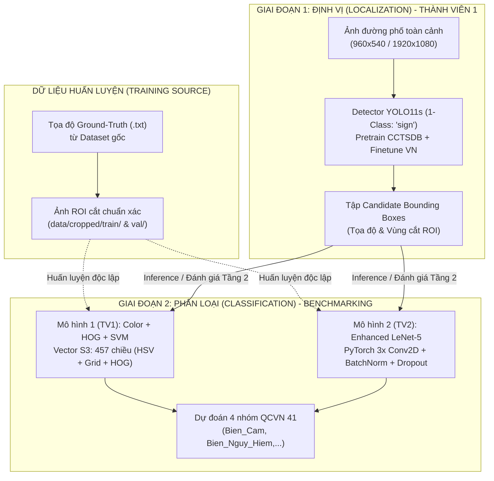

# 🚦 Hệ Thống Phân Loại & Đánh Giá Biển Báo Giao Thông (Traffic Sign Benchmarking System)

Dự án nghiên cứu, xây dựng và đánh giá so sánh (**Benchmarking**) các phương pháp nhận dạng và phân loại biển báo giao thông đường bộ Việt Nam theo Quy chuẩn kỹ thuật quốc gia **QCVN 41:2019/BGTVT**.

Hệ thống được thiết kế theo kiến trúc chuẩn hóa (**Two-Stage Modular Architecture**) cho **nhóm 2 thành viên**, cùng chạy trên **cùng một bộ dữ liệu toàn cục cố định (Global Data Split)** để đảm bảo tính khách quan và công bằng tuyệt đối:
- **Thành viên 1:** 
  - Xây dựng mô-đun phát hiện ứng viên **YOLO11s (1-Class Detector `sign`)**: Định vị biển báo trên ảnh đường phố toàn cảnh.
  - Xây dựng pipeline phân loại truyền thống **`color_hog_svm`**: Kết hợp đặc trưng đa tầng (Lọc màu HSV + Tỉ lệ AR + Lưới không gian 2x2 + HOG 64x64, vector 457 chiều) với bộ phân loại **SVM (RBF kernel)**.
- **Thành viên 2:** 
  - Xây dựng pipeline học sâu **`deep_learning` (Enhanced LeNet-5)** trên nền tảng PyTorch: Mạng nơ-ron tích chập cải tiến với 3 khối Convolution, Batch Normalization, Max Pooling và Dropout chống overfitting.

---

## 🎯 1. BÀI TOÁN & QUY CHUẨN DỮ LIỆU (DATASET CONTEXT & RULES)

### 🏷️ 4 Nhóm Biển Báo Mục Tiêu (QCVN 41:2019/BGTVT)
Dữ liệu biển báo giao thông Việt Nam gồm 52 lớp chi tiết được chuẩn hóa và gom nhóm về **4 nhóm biển báo chính**:

| STT | Tên nhóm chuẩn hóa | Tiền tố nhãn gốc | Đặc trưng Nhận dạng (Hình dáng & Màu sắc) |
| :---: | :--- | :---: | :--- |
| **1** | **`Bien_Cam`** | `P.*`, `B.8a` | Hình tròn, viền đỏ, nền trắng hoặc xanh dương |
| **2** | **`Bien_Nguy_Hiem`** | `W.*` | Hình tam giác đều, đỉnh hướng lên, viền đỏ, nền vàng |
| **3** | **`Bien_Hieu_Lenh`** | `R.*` | Hình tròn, nền xanh dương, biểu tượng màu trắng |
| **4** | **`Bien_Chi_Dan`** | `I.*` | Hình vuông hoặc chữ nhật, nền xanh dương, biểu tượng màu trắng |

> 📌 **Quyết định kiểm toán nhãn đặc biệt:**
> - **Lớp `Camera` (ID 31):** Thực tế chỉ có 40 mẫu từ ~3 camera giám sát được ghi hình liên tục; bản chất không phải biển báo giao thông nên được **loại bỏ (ignored)** khỏi bài toán phân loại để tránh gây nhiễu mô hình.
> - **Lớp `phụ` (biển phụ `S.*`):** Chỉ có 8 mẫu trong tập test (kích thước quá nhỏ $< 15$px khiến detector bỏ sót hoàn toàn 8/8 mẫu); do đó hệ thống tập trung đối chuẩn trên **4 nhóm chính**.
> - **Lớp `B.8a` (ID 34):** Biển cấm xe sơ-mi rơ-moóc (hình tròn viền đỏ) được gộp chuẩn xác vào nhóm **`Bien_Cam`**.

---

### 🛡️ Chiến Lược Phân Chia Dữ Liệu (Zero Data Leakage)
Toàn bộ 3,216 ảnh đường phố trong dataset được trích xuất từ chuỗi video hành trình xe chạy liên tục. Nếu phân chia ngẫu nhiên từng frame (`random split`), có tới **46.84%** số cặp frame liên tiếp sẽ bị xé lẻ giữa train và test, gây hiện tượng **rò rỉ dữ liệu (Data Leakage)** nghiêm trọng khiến mô hình "học vẹt".

Hệ thống áp dụng cơ chế phân chia **Block Split theo chuỗi video liên tục**:
- Chia thành từng khối 100 frame kèm khoảng cách đệm `gap = 5` frame.
- Đưa tỷ lệ vi phạm ranh giới rò rỉ về đúng **0.00%**.
- Tỷ lệ phân chia: **70% Train - 15% Validation - 15% Blind Test**.

---

## 🏗️ 2. KIẾN TRÚC TỔNG THỂ HỆ THỐNG (SYSTEM ARCHITECTURE)

Hệ thống hoạt động theo mô hình **Pipeline 2 giai đoạn (Two-Stage Pipeline)** linh hoạt và rõ ràng:



> [!IMPORTANT]
> **LÀM RÕ RANH GIỚI HUẤN LUYỆN (TRAINING) VÀ SUY LUẬN (INFERENCE):**
> 1. **Khi Huấn luyện (Training):** Cả mô hình **LeNet-5** (Thành viên 2) và **SVM** (Thành viên 1) đều được huấn luyện trên tập **ảnh ROI cắt chuẩn xác theo tọa độ Ground-Truth** (`data/cropped/train/`). **Tuyệt đối không huấn luyện bộ phân loại trên bounding box do YOLO tự cắt** để tránh nhiễu tọa độ và lệch viền.
> 2. **Khi Đánh giá Tầng 1 (ROI Benchmarking):** Đo đạc thuần túy năng lực phân loại của LeNet-5 vs SVM trên tập **1,136 ảnh Blind Test Ground-Truth** (`data/cropped/test/`).
> 3. **Khi Đánh giá Tầng 2 (End-to-End Scene) & Demo:** Nhận ảnh đường phố toàn cảnh, lúc này **YOLO11s** quét tìm vị trí biển báo, cắt ra và gửi cho LeNet-5 hoặc SVM dự đoán nhãn.

---

## 👥 3. PHÂN CÔNG TRÁCH NHIỆM & CÔNG NGHỆ (TEAM WORKFLOW)

| Thành Viên | Phụ Trách Mô-đun | Phương Pháp & Công Nghệ | Trọng Số Lưu Trữ |
| :---: | :--- | :--- | :--- |
| **Thành viên 1** | **Stage 1 (Localization)** &<br/>**Stage 2 (Traditional ML)** | • **YOLO11s (1-class):** Phát hiện bounding box biển báo.<br/>• **Color + HOG + SVM:** Trích xuất đặc trưng S3 (HSV 44d + Aspect Ratio 1d + Spatial Grid 2x2 384d + HOG 28d = 457 chiều) + SVM RBF ($C=10.0, \gamma=\text{scale}$). | `checkpoints/yolo/best.pt`<br/>`checkpoints/color_hog_svm/stage2_best.joblib` |
| **Thành viên 2** | **Stage 2 (Deep Learning)** | • **Enhanced LeNet-5 (PyTorch):** Mạng CNN 3 khối tích chập `Conv2D(3, 32)` $\to$ `Conv2D(32, 64)` $\to$ `Conv2D(64, 128)` kết hợp `BatchNorm2d`, `MaxPool2d(2, 2)`, `Dropout(0.3)` và 2 lớp `Linear`. Huấn luyện với CrossEntropyLoss và Adam optimizer. | `checkpoints/deep_learning/best_cnn.pth` |

---

## 📂 4. CẤU TRÚC THƯ MỤC CHUẨN HÓA (CLEAN REPOSITORY STRUCTURE)

```text
traffic-sign-classification/
├── app.py                          # CLI Runner chính: evaluate, evaluate-scene, demo, train
├── app_streamlit.py                # Web Dashboard tương tác (Side-by-Side, Scene Detection, EDA)
├── requirements.txt                # Danh sách thư viện phụ thuộc (torch, ultralytics, scikit-image,...)
├── README.md                       # Báo cáo tổng quan dự án & hướng dẫn chạy
│
├── checkpoints/                    # Thư mục chứa trọng số mô hình đã huấn luyện (.gitignore)
│   ├── color_hog_svm/              # Trọng số SVM Stage 2 S3 (stage2_best.joblib)
│   ├── deep_learning/              # Trọng số Enhanced LeNet-5 PyTorch (best_cnn.pth)
│   └── yolo/                       # Trọng số YOLO11s Detector (best.pt)
│
├── src/                            # Mã nguồn mô-đun hóa
│   ├── config.py                   # Cấu hình tập trung (Classes, Paths, Hyperparameters)
│   ├── utils.py                    # Tiện ích đọc/ghi ảnh Unicode tiếng Việt an toàn
│   ├── detection/                  # Mã nguồn các phương pháp nhận dạng
│   │   ├── base_detector.py        # Interface chuẩn hóa BaseDetector
│   │   ├── color_hog_svm/          # TV1: Bộ trích xuất S3 (457 dims) & SVM Classifier
│   │   └── deep_learning/          # TV2: Enhanced LeNet-5 Model, DataLoader & Training script
│   └── evaluation/                 # Bộ đánh giá đối chuẩn (Benchmark Engine)
│       ├── eval_metrics.py         # Đo đạc Accuracy, F1, Latency, FPS, Leaderboard
│       ├── plotter.py              # Vẽ biểu đồ so sánh cột & Heatmap Confusion Matrix
│       └── scene_eval.py           # Đánh giá toàn trình ảnh đường phố (YOLO11s + Classifier)
│
├── docs/                           # Báo cáo thực nghiệm & nghiên cứu chi tiết
│   ├── TWO_STAGE_HYBRID.md         # Báo cáo tổng quan hệ thống Hybrid 2 giai đoạn
│   ├── STAGE1_REPORT.md            # Báo cáo thực nghiệm Stage 1 (Lọc màu HSV 44 chiều)
│   ├── STAGE2_REPORT.md            # Báo cáo thực nghiệm Stage 2 (Spatial Grid + HOG + SVM)
│   ├── YOLO_DETECT.md              # Báo cáo mô-đun phát hiện YOLO11s 1-class
│   ├── JOURNEY.md                  # Nhật ký hành trình 2 tuần nghiên cứu và khắc phục rò rỉ dữ liệu
│   ├── SPLIT_NOTES.md              # Phân tích kỹ thuật Block Split vs Random Split
│   ├── WEIGHTS.md                  # Hướng dẫn tải weights Google Drive & Checksum SHA-256
│   └── assets/                     # Biểu đồ mAP, confusion matrix, ảnh minh họa thực nghiệm
│
├── notebooks/                      # Jupyter Notebooks trực quan hóa
│   ├── eda_dataset.py              # Script thống kê khám phá dữ liệu (EDA)
│   ├── eda_traffic_signs.ipynb     # Notebook phân tích trực quan dataset
│   └── tsr_walkthrough.ipynb       # Notebook walkthrough toàn bộ pipeline
│
├── res/                            # Kết quả đo đạc và ảnh đầu ra
│   ├── experiments/                # Dữ liệu JSON metric, log huấn luyện
│   └── outputs/                    # Biểu đồ benchmark và ảnh demo đã vẽ box
│
├── data/                           # Dữ liệu phân chia và ROI crops
│   ├── cropped/                    # Ảnh biển báo cắt chuẩn theo Ground-Truth (train/val/test)
│   └── global_splits/              # Danh sách ID phân chia toàn cục (train_ids, test_ids,...)
└── dataset/                        # Dataset gốc ảnh lớn đường phố Việt Nam (.gitignore)
```

---

## ⚙️ 5. HƯỚNG DẪN CÀI ĐẶT & THỰC THI (QUICKSTART RUNBOOK)

### Bước 1: Khởi tạo môi trường & Cài đặt thư viện
```bash
# Tạo môi trường ảo
python -m venv venv

# Kích hoạt môi trường (Windows PowerShell)
.\venv\Scripts\Activate.ps1

# Cài đặt toàn bộ thư viện cần thiết
pip install -r requirements.txt
```

### Bước 2: Huấn luyện mô hình Deep Learning (Thành viên 2)
> Huấn luyện mạng Enhanced LeNet-5 trên tập ảnh ROI Ground-Truth (`data/cropped/`):
```bash
python -m src.detection.deep_learning.train --epochs 20 --batch-size 32 --lr 0.001
```

### Bước 3: Chạy Đánh giá Đối chuẩn (Benchmarking) qua CLI
```bash
# 1. Đánh giá TẦNG 1 (ROI Benchmark) trên 1,136 mẫu Blind Test (So sánh LeNet-5 vs SVM):
python app.py --mode evaluate --split test

# 2. Đánh giá TẦNG 2 (End-to-End Scene Benchmark) trên ảnh đường phố (YOLO11s + Classifier):
python app.py --mode evaluate-scene --split test

# 3. Đánh giá riêng từng mô hình:
python app.py --mode evaluate --model deep_learning --split test
python app.py --mode evaluate --model color_hog_svm --split test
```

### Bước 4: Chạy Demo dự đoán ảnh
```bash
# Demo trên 1 ảnh biển báo cắt sẵn (ROI Mode):
python app.py --mode demo --model deep_learning --input data/cropped/test/Bien_Cam/0002_00.jpg
python app.py --mode demo --model color_hog_svm --input data/cropped/test/Bien_Cam/0002_00.jpg

# Demo trên 1 ảnh đường phố toàn cảnh (Scene Mode - YOLO11s tự động định vị + Phân loại):
python app.py --mode demo --model deep_learning --input dataset/images/0001.jpg --scene
```

### Bước 5: Khởi chạy Giao diện Web tương tác (Streamlit)
```bash
streamlit run app_streamlit.py
```
*Giao diện cung cấp chế độ so sánh song song (**Side-by-Side**) giữa LeNet-5 và SVM trên cùng một ảnh, chế độ quét toàn cảnh ảnh lớn (**Full Scene**), và bảng tổng hợp Leaderboard đối chuẩn.*

---

## 🏆 6. KẾT QUẢ THỰC NGHIỆM ĐỐI CHUẨN (BENCHMARK RESULTS)

### 🥇 Tầng 1: Đánh Giá Năng Lực Phân Loại Trên Ảnh Cắt Sẵn (Blind Test - 1,136 Mẫu)
Đo đạc độc lập trên tập **Blind Test** ($1,136$ mẫu ROI biển báo Ground-Truth chưa từng xuất hiện trong quá trình huấn luyện):

| Mô Hình / Phương Pháp | Thành Viên Phụ Trách | Accuracy | Macro-Precision | Macro-Recall | Macro-F1 | Độ Trễ (Latency) | Tốc Độ (FPS) |
| :--- | :---: | :---: | :---: | :---: | :---: | :---: | :---: |
| **Enhanced LeNet-5 (Học Sâu)** | **Thành viên 2** | **99.74%** | **99.49%** | **99.69%** | **99.59%** | **1.30 ms** | **768.4 FPS** |
| **Color + HOG + SVM (Truyền Thống)** | **Thành viên 1** | **99.47%** | **98.14%** | **98.96%** | **98.51%** | **2.79 ms** | **357.9 FPS** |

*Biểu đồ đối chuẩn ROI được tự động xuất tại:* `res/outputs/benchmark_comparison.png`  
*Ma trận nhầm lẫn chi tiết được lưu tại:* `res/outputs/confusion_matrix_deep_learning.png`

---

### 🥈 Tầng 2: Đánh Giá Toàn Trình Trên Ảnh Chụp Đường Phố Toàn Cảnh (End-to-End Scene Benchmark)
Đo đạc hệ thống Two-Stage hoàn chỉnh (Stage 1: YOLO11s định vị ứng viên + Stage 2: Bộ phân loại) trên ảnh đường phố thực tế:

| Phương Pháp / Pipeline | Định Vị (Stage 1) | Phân Loại (Stage 2) | Tỷ Lệ Định Vị (Recall) | Độ Chính Xác Khi Tìm Thấy | E2E Recall | Tốc Độ Toàn Cảnh (FPS) |
| :--- | :---: | :---: | :---: | :---: | :---: | :---: |
| **Two-Stage LeNet** | YOLO11s (TV1) | **LeNet-5 (TV2)** | **85.61%** | **99.40%** | **85.10%** | **10.9 FPS** |
| **Two-Stage SVM** | YOLO11s (TV1) | **SVM RBF (TV1)** | **85.61%** | **99.17%** | **84.90%** | **9.5 FPS** |

*Biểu đồ đối chuẩn toàn cảnh được tự động xuất tại:* `res/outputs/scene_benchmark_comparison.png`

---

## 📚 7. DANH MỤC TÀI LIỆU KỸ THUẬT CHI TIẾT (DOCUMENTATION INDEX)

Mọi chi tiết lý thuyết, báo cáo thực nghiệm và số liệu toán học được trình bày đầy đủ trong thư mục [`docs/`](docs/):
1. [**`docs/TWO_STAGE_HYBRID.md`**](docs/TWO_STAGE_HYBRID.md): Tổng quan kiến trúc 2 giai đoạn kết hợp Deep Learning và Thị giác truyền thống.
2. [**`docs/YOLO_DETECT.md`**](docs/YOLO_DETECT.md): Báo cáo chi tiết mô-đun phát hiện YOLO11s 1-class, hiệu năng mAP và phân tích 14.39% biển bỏ sót.
3. [**`docs/STAGE1_REPORT.md`**](docs/STAGE1_REPORT.md): Báo cáo thực nghiệm phân loại Stage 1 dựa trên lược đồ màu HSV 44 chiều.
4. [**`docs/STAGE2_REPORT.md`**](docs/STAGE2_REPORT.md): Báo cáo thực nghiệm Stage 2 tiến hóa chuỗi đặc trưng đa tầng (HSV + Grid + HOG) và SVM.
5. [**`docs/JOURNEY.md`**](docs/JOURNEY.md): Báo cáo nhật ký hành trình nghiên cứu, giải quyết rò rỉ dữ liệu và tối ưu hóa hệ thống.
6. [**`docs/SPLIT_NOTES.md`**](docs/SPLIT_NOTES.md): Báo cáo phân tích hiện tượng Data Leakage trên chuỗi video và phương pháp Block Split.
7. [**`docs/WEIGHTS.md`**](docs/WEIGHTS.md): Danh mục liên kết tải trọng số mô hình từ Google Drive kèm mã băm SHA-256.
