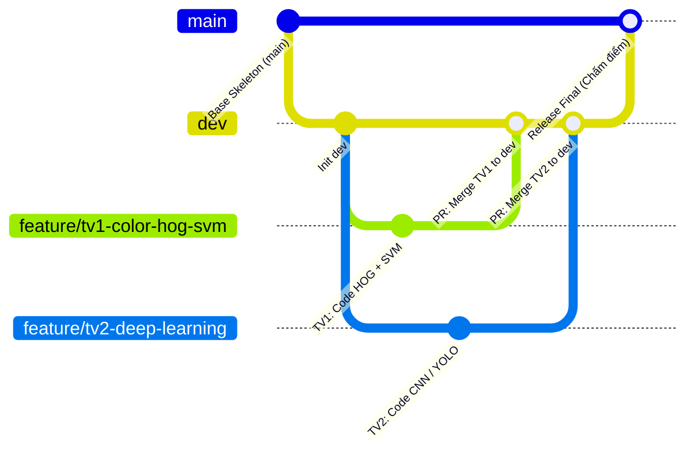

# 🚦 Hệ Thống Phân Loại & Đánh Giá Biển Báo Giao Thông (Traffic Sign Benchmarking System)

Dự án nghiên cứu và đánh giá so sánh (**Benchmarking**) các phương pháp nhận dạng biển báo giao thông Việt Nam (theo Quy chuẩn kỹ thuật quốc gia QCVN 41:2019/BGTVT).

Hệ thống được thiết kế theo kiến trúc chuẩn hóa (Framework Base Skeleton) cho **nhóm 2 thành viên**, tất cả cùng chạy trên **cùng một bộ dữ liệu toàn cục cố định (Global Data Split)** để đảm bảo tính khách quan và công bằng tuyệt đối:
- **Thành viên 1:** Phương pháp Thị giác máy tính truyền thống (**`color_hog_svm`** - Lọc màu HSV + Hình thái học + HOG + SVM).
- **Thành viên 2:** Phương pháp Học sâu Hiện đại (**`deep_learning`** - Linh hoạt lựa chọn **Custom CNN** hoặc **YOLOv8**).

---

## 📋 1. DỮ LIỆU & QUY TẮC PHÂN CHIA (DATA CONTEXT & RULES)

### 🎯 4 Nhóm Biển Báo Mục Tiêu (QCVN 41:2019/BGTVT)
Dữ liệu biển báo giao thông Việt Nam gồm 52 lớp chi tiết được gom nhóm tự động về 4 nhóm biển báo chính:

| STT | Tên nhóm | Tiền tố dataset | Đặc trưng Nhận dạng (Hình dáng & Màu sắc) |
| :---: | :--- | :---: | :--- |
| **1** | **`Bien_Cam`** | `P.*` | Hình tròn, viền đỏ, nền trắng hoặc xanh dương |
| **2** | **`Bien_Nguy_Hiem`** | `W.*` | Hình tam giác đều, viền đỏ, nền vàng |
| **3** | **`Bien_Hieu_Lenh`** | `R.*` | Hình tròn, nền xanh dương |
| **4** | **`Bien_Chi_Dan`** | `I.*` | Hình vuông hoặc chữ nhật, nền xanh dương |

> ⚠️ **Lớp loại trừ (Ignored):** Nhóm biển phụ (`S.*`, `B.8a`) và camera giám sát ngoại cảnh (`Camera`) được tự động loại bỏ để tránh gây nhiễu cho mô hình phân loại và phát hiện.

---

### 📊 Thống Kê Bộ Dữ Liệu (Dataset Overview)
- **Tổng số ảnh toàn cảnh:** 3,216 ảnh chụp thực tế đường sá Việt Nam (độ phân giải 960x540 và 1920x1080).
- **Định dạng nhãn gốc:** YOLO format (`<class_id> <x_center> <y_center> <width> <height>`).
- **Tổng số bounding box được gán nhãn:** 8,334 boxes thuộc 52 lớp chuẩn.
- **Tổng số bounding box mục tiêu sau lọc:** ~7,858 boxes biển báo (đạt chuẩn kích thước $\ge 10$px và thuộc 4 nhóm chính).

---

### 🛡️ Cơ Chế Global Data Split (Chống Data Leakage Tuyệt Đối)
Để đảm bảo so sánh công bằng giữa 2 thành viên:
1. **Phân chia ở cấp độ ẢNH (Image-level split):** Nếu một ảnh có nhiều biển báo, toàn bộ biển trong ảnh đó sẽ cùng vào 1 tập duy nhất, tuyệt đối không bị rò rỉ dữ liệu giữa tập Train và Test (Zero Data Leakage).
2. **Tỉ lệ phân chia toàn cục:**
   - **Tập Train (70%):** Huấn luyện trọng số mô hình.
   - **Tập Validation (15%):** Tinh chỉnh siêu tham số (Hyperparameter tuning / Validation loss).
   - **Tập Test (15%):** **TẬP ĐÁNH GIÁ MÙ (BLIND TEST SET)** — Dùng một lần duy nhất lúc chấm điểm Benchmarking cuối cùng.

3. **Hỗ trợ 2 luồng dữ liệu song song cho 2 thành viên:**
   - **Luồng Phân loại ROI (Classification - Dùng cho HOG+SVM hoặc CNN):** Tự động cắt 7,858 vùng chứa biển báo lưu tại `data/cropped/{train,val,test}/{category}/` và định danh qua 3 file text trong `data/global_splits/`:
     * `data/global_splits/train_ids.txt`
     * `data/global_splits/val_ids.txt`
     * `data/global_splits/test_ids.txt`
   - **Luồng Phát hiện Toàn cảnh (Object Detection - Dùng cho YOLOv8):** Cung cấp danh sách ảnh và cấu hình YOLO chuẩn:
     * `data/global_splits/yolo_train.txt`
     * `data/global_splits/yolo_val.txt`
     * `data/global_splits/yolo_test.txt`
     * `data/traffic_signs_4cls.yaml`

---

## 🏗️ 2. KIẾN TRÚC MÃ NGUỒN (REPOSITORY STRUCTURE)

```text
traffic-sign-classification/
├── checkpoints/                        # Trọng số tất cả mô hình [ĐÃ IGNORE TRÊN GIT]
│   ├── color_hog_svm/                  # Checkpoint SVM Stage 2 S3 (stage2_best.joblib)
│   ├── deep_learning/                  # Checkpoint LeNet-5 PyTorch (best_cnn.pth)
│   └── yolo/                           # Checkpoint YOLO11s Detector (best.pt)
├── data/                               # Dữ liệu phân chia và cấu hình
│   ├── cropped/                        # Ảnh ROI biển báo cắt sẵn (train, val, test)
│   ├── global_splits/                  # Danh sách split toàn cục (test_ids.txt, val_ids.txt, yolo_*.txt)
│   └── traffic_signs_4cls.yaml         # File config huấn luyện YOLO (4 lớp QCVN 41:2019)
├── dataset/                            # Dataset gốc (YOLO Format) [IMAGES & LABELS ĐÃ IGNORE]
│   ├── images/                         # 3,216 ảnh đường phố (.jpg)
│   ├── labels/                         # 3,216 file nhãn YOLO (.txt)
│   ├── classes.txt                     # 52 mã hiệu biển báo
│   ├── classes_vie.txt                 # Tên tiếng Việt của 52 biển báo
│   └── classes_en.txt                  # Tên tiếng Anh của 52 biển báo
├── docs/                               # Toàn bộ tài liệu báo cáo nghiên cứu & Lý thuyết
│   ├── assets/                         # Hình ảnh minh họa, sơ đồ kiến trúc, crops thực nghiệm
│   ├── JOURNEY.md                      # Báo cáo hành trình thực nghiệm
│   ├── SPLIT_NOTES.md                  # Phân tích kỹ thuật rò rỉ dữ liệu (Block Split 0% Leakage)
│   ├── STAGE1_REPORT.md                # Báo cáo Giai đoạn 1 (Lọc màu HSV)
│   ├── STAGE2_REPORT.md                # Báo cáo Giai đoạn 2 (Spatial Grid + HOG + SVM)
│   ├── TWO_STAGE_HYBRID.md             # Tài liệu tổng quan kiến trúc 2 giai đoạn kết hợp
│   ├── WEIGHTS.md                      # Hướng dẫn tải trọng số Google Drive & Checksum SHA-256
│   └── YOLO_DETECT.md                  # Báo cáo mô-đun phát hiện YOLO11s (Single Class)
├── notebooks/                          # Jupyter Notebooks nghiên cứu & trực quan hóa
│   ├── eda_dataset.py                  # Script phân tích khám phá dữ liệu (EDA)
│   ├── eda_traffic_signs.ipynb         # Notebook EDA trực quan
│   └── tsr_walkthrough.ipynb           # Notebook Walkthrough tương tác đối chuẩn toàn hệ thống
├── res/                                # Kết quả, biểu đồ & tài nguyên đối chuẩn
│   ├── experiments/                    # Dữ liệu đo đạc chi tiết (JSON metrics, CSVs)
│   └── outputs/                        # Biểu đồ đối chuẩn tự động (benchmark charts, confusion matrix)
├── src/                                # Mã nguồn hệ thống (Module hóa chuyên nghiệp)
│   ├── config.py                       # Cấu hình tập trung (Context, Paths, Classes, Seed)
│   ├── detection/                      # CÁC PHƯƠNG PHÁP NHẬN DẠNG (2 THÀNH VIÊN)
│   │   ├── base_detector.py            # [RULE] Lớp trừu tượng chuẩn hóa Interface (BaseDetector)
│   │   ├── color_hog_svm/              # 👉 THÀNH VIÊN 1: HSV + Lưới không gian + HOG + SVM
│   │   │   ├── detector.py             # Lớp suy luận ColorHogSvmDetector (BaseDetector)
│   │   │   ├── features.py             # Trích xuất vector đặc trưng S3 (457 chiều)
│   │   │   └── pipeline/               # Toàn bộ kịch bản huấn luyện, chuẩn bị data & đánh giá
│   │   └── deep_learning/              # 👉 THÀNH VIÊN 2: Deep Learning (Enhanced LeNet-5)
│   │       ├── detector.py             # Lớp suy luận DeepLearningDetector (BaseDetector)
│   │       ├── lenet_model.py          # Kiến trúc PyTorch Enhanced LeNet
│   │       ├── train_cnn.py            # Huấn luyện Custom CNN trên data/cropped
│   │       └── train.py                # Entrypoint thống nhất
│   ├── evaluation/                     # BỘ ĐÁNH GIÁ CHUNG (BENCHMARKING ENGINE 2 TẦNG)
│   │   ├── eval_metrics.py             # Tính Accuracy, Precision, Recall, F1, Latency, FPS, Leaderboard
│   │   ├── plotter.py                  # Xuất biểu đồ so sánh & Heatmap Confusion Matrix
│   │   └── scene_eval.py               # Đối chuẩn toàn cảnh đường phố (Two-Stage: YOLO11s + Classifier)
│   └── utils/                          # Tiện ích đọc/ghi ảnh Unicode tiếng Việt an toàn
├── app.py                              # CLI thực thi trung tâm (Evaluate Benchmark ROI & Scene, Demo ảnh)
├── app_streamlit.py                    # Giao diện Web tương tác đa năng (Streamlit Live Dashboard)
├── requirements.txt                    # Danh sách thư viện phụ thuộc
├── .gitignore                          # Chặn commit dataset ảnh và checkpoints nặng
└── README.md                           # Tài liệu hướng dẫn & Quy tắc nhóm
```

---

## 🔬 3. ĐẶC TẢ KỸ THUẬT CHI TIẾT 2 PHƯƠNG PHÁP (METHODOLOGY SPECIFICATIONS)

### 👤 THÀNH VIÊN 1: Phương Pháp Truyền Thống (`color_hog_svm`)
* **Thư mục làm việc:** `src/detection/color_hog_svm/`
* **File chính:**
  * `detector.py`: Kế thừa `BaseDetector`, triển khai `preprocess()`, `inference()`, `postprocess()`.
  * `train.py`: Huấn luyện mô hình SVM và xuất checkpoint `checkpoints/color_hog_svm/best_svm.pkl`.
* **Pipeline kỹ thuật 4 bước:**
  1. **Tiền xử lý (Preprocessing):** Nhận ảnh ROI biển báo kích thước $64 \times 64$, chuyển sang ảnh xám (`GRAY`) hoặc không gian màu `HSV`, cân bằng lược đồ sáng bằng `cv2.equalizeHist` hoặc CLAHE để triệt tiêu ảnh hưởng của bóng râm.
  2. **Trích xuất đặc trưng HOG (Feature Extraction):** Sử dụng `skimage.feature.hog` để nắm bắt đặc trưng biên cạnh hình học (đường viền tròn của biển cấm/hiệu lệnh, tam giác của biển nguy hiểm, góc vuông của biển chỉ dẫn). Trả về vector đặc trưng 1 chiều.
  3. **Huấn luyện phân loại (SVM Classifier):** Sử dụng `sklearn.svm.SVC` (kernel `rbf` hoặc `linear`), tinh chỉnh siêu tham số $C$ (mức phạt lỗi) và $\gamma$ (phạm vi ảnh hưởng).
  4. **Hậu xử lý (Postprocessing):** Trả về dict chuẩn hóa: `{"class_name": ..., "class_id": ..., "confidence": ..., "bbox": None}`.

---

### 👤 THÀNH VIÊN 2: Phương Pháp Deep Learning (`deep_learning`)
Thành viên 2 linh hoạt lựa chọn 1 trong 2 hướng tiếp cận sau:

#### 🔹 Lựa chọn A: Mạng Nơ-ron Tích Chập (Custom CNN / LeNet)
* **Thư mục làm việc:** `src/detection/deep_learning/` (sử dụng `train_cnn.py` và `detector.py`)
* **Dữ liệu đầu vào:** Tập ảnh ROI đã cắt sẵn trong `data/cropped/train/` và `val/`.
* **Kiến trúc mạng:**
  * **Feature Extractor:** 3 khối Convolution: `Conv2d(3, 32)` $\to$ `BatchNorm` $\to$ `ReLU` $\to$ `MaxPool2d(2, 2)` $\to$ `Conv2d(32, 64)` $\to$ `BatchNorm` $\to$ `ReLU` $\to$ `MaxPool2d(2, 2)` $\to$ `Conv2d(64, 128)` $\to$ `BatchNorm` $\to$ `ReLU` $\to$ `MaxPool2d(2, 2)`.
  * **Classifier Head:** `Dropout(0.3)` $\to$ `Linear(128*8*8, 256)` $\to$ `ReLU` $\to$ `Dropout(0.3)` $\to$ `Linear(256, 4)`.
* **Huấn luyện:** Loss function `CrossEntropyLoss`, Optimizer `Adam(lr=0.001)`. Tự động lưu checkpoint tốt nhất vào `checkpoints/deep_learning/best_cnn.pth`.

#### 🔹 Lựa chọn B: Mô hình Phát hiện Đối tượng End-to-End (YOLOv8)
* **Thư mục làm việc:** `src/detection/deep_learning/` (sử dụng `train_yolo.py` và `detector.py`)
* **Dữ liệu đầu vào:** Toàn cảnh ảnh đường phố qua file cấu hình `data/traffic_signs_4cls.yaml`.
* **Cơ chế hoạt động:** Sử dụng mạng `yolov8n.pt` (hoặc `yolov8s.pt`) từ thư viện `ultralytics` để vừa xác định Bounding Box vừa phân loại 4 nhóm biển báo trong 1 bước duy nhất.
* **Huấn luyện:** Tự động huấn luyện qua 25 epochs và sao chép trọng số tốt nhất về `checkpoints/deep_learning/best_yolo.pt`.

---

## 📜 4. QUY TRÌNH LÀM VIỆC NHÓM & GIT WORKFLOW



1. **Phân chia trách nhiệm:**
   - **Thành viên 1:** Phụ trách `src/detection/color_hog_svm/`.
   - **Thành viên 2:** Phụ trách `src/detection/deep_learning/`.

2. **Quy tắc Git Branching:**
   - **Nhánh `main`:** Chỉ lưu trữ **Bộ khung chuẩn (Base Skeleton)** và các phiên bản Release ổn định cuối kỳ.
   - **Nhánh `dev`:** Nhánh tích hợp chung của nhóm.
   - Mỗi thành viên tạo nhánh tính năng riêng từ `dev`:
     * Thành viên 1: `git checkout -b feature/tv1-color-hog-svm`
     * Thành viên 2: `git checkout -b feature/tv2-deep-learning`
   - Khi hoàn thành và test xong trên máy cục bộ, tạo Pull Request (PR) merge vào `dev`.

3. **Quy tắc Interface (Bắt buộc):**
   - Mọi detector tại `src/detection/<tên_model>/detector.py` **bắt buộc phải kế thừa class `BaseDetector`** từ `src/detection/base_detector.py`.
   - Kết quả trả về của hàm `postprocess()` bắt buộc phải tuân theo cấu trúc dict:
     ```python
     {
         "class_name": str,       # Nhãn lớp ('Bien_Cam', 'Bien_Nguy_Hiem', ...)
         "class_id": int,         # ID nhãn (0, 1, 2, 3)
         "confidence": float,     # Độ tin cậy từ 0.0 đến 1.0
         "bbox": tuple | None     # (x1, y1, x2, y2) nếu có
     }
     ```

4. **Quy tắc Dữ liệu:**
   - Tuyệt đối không commit ảnh `dataset/images/`, `dataset/labels/` hay `data/cropped/` lên GitHub (đã được cấu hình tự động chặn trong `.gitignore`).

---

## ⚙️ 5. HƯỚNG DẪN CÀI ĐẶT & THỰC THI (STEP-BY-STEP QUICKSTART)

### Bước 1: Khởi tạo môi trường ảo & Cài đặt thư viện
```bash
# Tạo môi trường ảo
python -m venv venv

# Kích hoạt môi trường (Windows PowerShell)
.\venv\Scripts\Activate.ps1

# Cài đặt thư viện
pip install -r requirements.txt
```

### Bước 2: Chuẩn bị dữ liệu & Huấn luyện mô hình Deep Learning (Enhanced LeNet-5)
> **Lưu ý:** Tập dữ liệu ảnh ROI biển báo được lưu trữ tại `data/cropped/`. Đảm bảo dữ liệu đã được giải nén hoặc tạo sẵn vào `data/cropped/{train,val,test}/` trước khi chạy lệnh huấn luyện.

```bash
# Huấn luyện Enhanced LeNet trên tập ROI biển báo (data/cropped/)
python -m src.detection.deep_learning.train --arch cnn --epochs 20
```

### Bước 3: Chạy Đánh giá Đối chuẩn (Benchmarking) & Demo qua `app.py`
```bash
# 1. Chạy Đối chuẩn phân loại (Classification) trên toàn bộ tập Test (So sánh cả 2 mô hình):
python app.py --mode evaluate --split test

# 2. Chạy Đối chuẩn toàn trình trên ảnh đường phố toàn cảnh (Two-Stage: YOLO11s + Classifier):
python app.py --mode evaluate-scene --split test

# 3. Chạy đánh giá từng mô hình riêng lẻ:
python app.py --mode evaluate --model deep_learning --split test
python app.py --mode evaluate --model color_hog_svm --split test

# 4. Chạy thử nghiệm Demo qua CLI:
# Chế độ ảnh ROI biển báo cắt sẵn:
python app.py --mode demo --model deep_learning --input data/cropped/test/Bien_Cam/0002_00.jpg
python app.py --mode demo --model color_hog_svm --input data/cropped/test/Bien_Cam/0002_00.jpg
# Chế độ ảnh toàn cảnh đường phố (YOLO11s tự động phát hiện + đóng khung + phân loại):
python app.py --mode demo --model deep_learning --input dataset/images/0001.jpg --scene

# 5. Khởi chạy Giao diện Web tương tác (Streamlit):
streamlit run app_streamlit.py
```

---

## 🏆 6. KẾT QUẢ BENCHMARKING THỰC TẾ (2 TẦNG ĐỐI CHUẨN)

### 🥇 Tầng 1: Đánh Giá Năng Lực Phân Loại Trên Ảnh Cắt Sẵn (Blind Test - 1.136 Mẫu)
Đánh giá độc lập trên tập **Blind Test** ($1,136$ mẫu ROI biển báo chưa từng xuất hiện trong quá trình huấn luyện):

| Mô Hình / Phương Pháp | Thành Viên Phụ Trách | Accuracy | Precision | Recall | Macro F1 | Độ Trễ (Latency) | Tốc Độ (FPS) |
| :--- | :---: | :---: | :---: | :---: | :---: | :---: | :---: |
| **Enhanced LeNet-5 (Học Sâu)** | **Thành viên 2** | **99.74%** | **99.49%** | **99.69%** | **99.59%** | **1.30 ms** | **768.4 FPS** |
| **Color + HOG + SVM (Cổ Điển)** | **Thành viên 1** | **99.47%** | **98.14%** | **98.96%** | **98.51%** | **2.79 ms** | **357.9 FPS** |

*Biểu đồ so sánh trực quan được xuất tự động tại:* `res/outputs/benchmark_comparison.png`  
*Ma trận nhầm lẫn chi tiết được lưu tại:* `res/outputs/confusion_matrix_deep_learning.png`

### 🥈 Tầng 2: Đánh Giá Toàn Trình Trên Ảnh Chụp Đường Phố Toàn Cảnh (End-to-End Scene Benchmark)
Đánh giá hệ thống Two-Stage hoàn chỉnh (Định vị ứng viên qua YOLO11s + Phân loại mô hình) trên tập ảnh đường phố toàn cảnh:

| Phương Pháp / Pipeline | Người Phụ Trách | Tỷ Lệ Định Vị (%) | Đoán Đúng Khi Tìm Thấy (%) | E2E Recall (%) | Độ Trễ Toàn Cảnh | Tốc Độ (FPS) |
| :--- | :---: | :---: | :---: | :---: | :---: | :---: |
| **Two-Stage LeNet (YOLO11s + LeNet)** | **Thành viên 2** | **85.61%** | **99.40%** | **85.10%** | **91.45 ms** | **10.9 FPS** |
| **Two-Stage SVM (YOLO11s + SVM RBF)** | **Thành viên 1** | **85.61%** | **99.17%** | **84.90%** | **105.20 ms** | **9.5 FPS** |

*Biểu đồ đối chuẩn toàn cảnh được xuất tự động tại:* `res/outputs/scene_benchmark_comparison.png`
