# BÁO CÁO THỰC NGHIỆM STAGE 1 — PHẦN 2
## Phân Loại Biển Báo Giao Thông Việt Nam Bằng Đặc Trưng HSV & Machine Learning Cổ Điển

---

## MỤC LỤC
1. [Tóm tắt](#1-tóm-tắt)
2. [Bối cảnh & Pipeline tổng thể](#2-bối-cảnh--pipeline-tổng-thể)
3. [Dữ liệu & Quy tắc phân nhóm nhãn](#3-dữ-liệu--quy-tắc-phân-nhóm-nhãn)
4. [Trích xuất đặc trưng HSV (44 chiều)](#4-trích-xuất-đặc-trưng-hsv-44-chiều)
5. [Phân tích màu sắc chủ đạo theo nhóm](#5-phân-tích-màu-sắc-chủ-đạo-theo-nhóm)
6. [Lựa chọn mô hình & Tối ưu siêu tham số](#6-lựa-chọn-mô-hình--tối-ưu-siêu-tham-số)
7. [Kết quả thực nghiệm Mức (A) — Ground-Truth Crops](#7-kết-quả-thực-nghiệm-mức-a--ground-truth-crops)
8. [Kết quả thực nghiệm Mức (B) — YOLO Crops](#8-kết-quả-thực-nghiệm-mức-b--yolo-crops)
9. [So sánh công bằng: Mức A vs A' vs B](#9-so-sánh-công-bằng-mức-a-vs-a-vs-b)
10. [Hiệu năng toàn hệ thống (End-to-End Pipeline)](#10-hiệu-năng-toàn-hệ-thống-end-to-end-pipeline)
11. [Phân tích chi tiết các trường hợp phân loại sai (Error Analysis)](#11-phân-tích-chi-tiết-các-trường-hợp-phân-loại-sai-error-analysis)
12. [Hạn chế & Cảnh báo thống kê](#12-hạn-chế--cảnh-báo-thống-kê)
13. [Kết luận & Đề xuất cho Stage 2](#13-kết-luận--đề-xuất-cho-stage-2)
14. [Phụ lục kỹ thuật](#14-phụ-lục-kỹ-thuật)

---

## 1. Tóm tắt

Báo cáo này đánh giá độc lập mô-đun phân loại cơ bản trong Stage 1 của hệ thống nhận diện biển báo giao thông Việt Nam (QCVN 41:2019). Pipeline bao gồm: phát hiện vị trí biển báo bằng detector 1 lớp YOLO11s (đã finetune trên tập Việt Nam), cắt vùng ảnh (crop), trích xuất histogram màu HSV 44 chiều (Hue xoay $+30^\circ \pmod{180}$ và Saturation), và phân nhóm bằng SVM/kNN. 

Trên tập kiểm thử (Test) gồm 1.845 biển báo Ground-Truth, mô hình phân loại đạt **Macro-F1 = 0.6877** (SVM) và **0.7008** (kNN) ở Mức A (GT crops). Khi kết hợp trọn vẹn với detector ở Mức B (1.559 biển YOLO phát hiện được, $\text{IoU} \ge 0.5$), Macro-F1 phân loại đạt **0.7265** (SVM) và **0.7081** (kNN). Tuy nhiên, hiệu năng thực tế của cả pipeline (End-to-End Recall) chỉ đạt **81.63%** (SVM) và **81.14%** (kNN) do detector bỏ sót 286 biển (15.50%). Ba điểm yếu cốt lõi của baseline màu sắc này là: (1) Trùng màu hoàn toàn giữa biển *hiệu lệnh* và *chỉ dẫn* (cùng mang màu xanh lam, Hue $\approx 106^\circ$); (2) Nhóm nhân tạo "chưa xác định" (*Camera* và *B.8a*) bị gán nhầm sang *cấm* do biển $B.8a$ mang viền đỏ nền trắng; và (3) Mất cân bằng dữ liệu cực lớn giữa các nhóm (biển *cấm* chiếm tới 57.8% tập test, trong khi biển *phụ* chỉ có 8 mẫu).

---

## 2. Bối cảnh & Pipeline tổng thể

Mục tiêu của Stage 1 là xây dựng một pipeline 2 giai đoạn (Two-Stage Pipeline) tối giản, tách bạch rõ ràng giữa tác vụ định vị (Detection) và tác vụ phân nhóm sơ bộ (Classification).

```
+------------------+      +-------------------+      +-----------------+      +-----------------------+      +------------------------+
|  Ảnh giao thông  | ---> |   YOLO11s (vn_s)  | ---> |  Crop vùng box  | ---> |  Histogram HSV 44-D   | ---> |       SVM / kNN        |
|     đầu vào      |      | (Detector 1-lớp)  |      |   (Resize 32x32)|      | (Hue xoay + Saturation|      |  (Phân vào 6 nhóm QCVN)|
+------------------+      +-------------------+      +-----------------+      +-----------------------+      +------------------------+
                                    |                                                                                     |
                                    v                                                                                     v
                             Bỏ sót: 286 FN                                                                         Dự đoán nhóm:
                             Báo nhầm: 216 FP                                                                       cấm, cảnh báo,
                                                                                                                    hiệu lệnh, chỉ dẫn,
                                                                                                                    phụ, chưa xác định
```

### Thông số mô-đun Detector (YOLO11s):
Detector được sử dụng là mô hình YOLO11s 1 lớp (`runs/detect/vn_s/weights/best.pt`), được khởi tạo từ pretrain CCTSDB và finetune 30 epochs trên bộ dữ liệu Việt Nam.
* **Độ phân giải đầu vào**: `imgsz = 800` (suy luận ở `conf = 0.25`).
* **Hiệu năng trên tập Test Việt Nam (550 ảnh)**:
  * Precision: **92.2%**
  * Recall: **82.9%**
  * $\text{mAP}_{50}$: **83.6%**
  * $\text{mAP}_{50-95}$: **60.1%**

---

## 3. Dữ liệu & Quy tắc phân nhóm nhãn

### 3.1. Quy tắc gom 52 lớp thành nhóm theo tiền tố QCVN 41:2019
Bộ dữ liệu gồm 52 mã biển báo chi tiết. Theo quy chuẩn kỹ thuật quốc gia về báo hiệu đường bộ (QCVN 41:2019), các biển báo được chuẩn hóa thành 6 nhóm dựa theo tiền tố định danh:
1. `P.*` $\rightarrow$ **cấm (prohibitory)**: Biển tròn viền đỏ nền trắng (hoặc nền xanh gạch chéo).
2. `W.*` $\rightarrow$ **cảnh báo (warning)**: Biển tam giác viền đỏ nền vàng.
3. `R.*` $\rightarrow$ **hiệu lệnh (mandatory)**: Biển tròn nền xanh lam, hình vẽ màu trắng.
4. `I.*` $\rightarrow$ **chỉ dẫn (information)**: Biển chữ nhật hoặc hình vuông, nền xanh lam.
5. `S.*` $\rightarrow$ **phụ (supplementary)**: Biển chữ nhật nằm ngang, nền trắng chữ đen hoặc viền xanh.
6. Tiền tố khác $\rightarrow$ **chưa xác định**: Áp dụng nghiêm ngặt cho các lớp không bắt đầu bằng 5 ký tự chuẩn trên.

### 3.2. Bảng phân bố dữ liệu theo nhóm
Dữ liệu được chia theo khối frame video liên tục (Block Split) với tỉ lệ $\approx 73\% : 9\% : 18\%$. Số cặp frame kề nhau nằm ở hai split khác nhau được kiểm chứng là **bằng đúng 0**.

| Nhóm biển báo | Số class | Train bboxes | Val bboxes | Test bboxes | Tổng số | Tỉ lệ Train | Tỉ lệ Test |
| :--- | :---: | :---: | :---: | :---: | :---: | :---: | :---: |
| **cấm (prohibitory)** | 22 | 10,053 | 352 | 1,067 | 11,472 | 62.0% | 57.8% |
| **cảnh báo (warning)** | 18 | 3,252 | 126 | 423 | 3,801 | 20.1% | 22.9% |
| **hiệu lệnh (mandatory)** | 4 | 1,353 | 60 | 219 | 1,632 | 8.4% | 11.9% |
| **chỉ dẫn (information)** | 3 | 954 | 4 | 75 | 1,033 | 5.9% | 4.1% |
| **phụ (supplementary)** | 3 | 435 | 16 | 8 | 459 | 2.7% | 0.4% |
| **chưa xác định** | 2 | 156 | 10 | 53 | 219 | 1.0% | 2.9% |
| **TỔNG CỘNG** | **52** | **16,203** | **568** | **1,845** | **18,616** | **100.0%** | **100.0%** |

> [!NOTE]
> * **Lọc nhiễu kích thước train**: Trong tập Train gốc có **80** bounding box kích thước cực nhỏ ($w < 8$ px hoặc $h < 8$ px) đã bị loại bỏ hoàn toàn trước khi huấn luyện mô hình ML. Số lượng mẫu huấn luyện hợp lệ thực tế là **16.123** crops.
> * Mọi nhóm trong tập Train đều có $\ge 30$ mẫu (nhóm nhỏ nhất là *chưa xác định* có 156 mẫu).

### 3.3. Chi tiết 2 lớp "chưa xác định"
Hai lớp được gán nhãn "chưa xác định" bao gồm:
1. **`Camera` (ID 31, 156 train, 10 val, 53 test)**: Biển báo thông báo khu vực có camera giám sát giao thông. Biển có dạng hình chữ nhật nền xanh hoặc trắng, mã định danh không thuộc hệ thống P/W/R/I/S truyền thống.
2. **`B.8a` (ID 34, nằm trong các frame 0414–0434, 0714, 0716)**: Trong file `group_map.csv` trước đây, lớp này được gán là `prohibitory`. Tuy nhiên, mã hiệu bắt đầu bằng chữ cái `B` (ký hiệu cũ hoặc mã nội bộ bộ dữ liệu của biển "Cấm xe sơ-mi rơ-moóc" — tương đương P.108a). Theo quy tắc tiền tố nghiêm ngặt của Bước 0, lớp này bị xếp vào "chưa xác định". Đây là nhóm nhân tạo phát sinh do cách chuẩn hóa mã hiệu.

---

## 4. Trích xuất đặc trưng HSV (44 chiều)

Mỗi crop bounding box được xử lý theo một pipeline đặc trưng duy nhất:
1. **Resize**: Đưa về kích thước cố định $32 \times 32$ pixel bằng phép nội suy vùng ảnh (`cv2.INTER_AREA`).
2. **Chuyển không gian màu**: Chuyển từ BGR sang HSV qua `cv2.cvtColor`.
3. **Kỹ thuật dịch chuyển kênh Hue (+30 shift)**:
   Trong OpenCV, dải màu Hue chạy từ $0$ đến $179$. Màu đỏ nằm ở hai đầu mút: $[0, 10]$ và $[170, 179]$. Để tránh hiện tượng viền đỏ của biển cấm bị "chẻ đôi" thành hai đỉnh tách biệt ở đầu và cuối histogram, giá trị Hue được cộng thêm $30$ theo phép chia lấy dư modulo 180:
   $$H_{\text{shifted}} = (H + 30) \pmod{180}$$
   Sau khi xoay, toàn bộ phổ đỏ tập trung nguyên vẹn trong khoảng $[30, 40]$, trở thành một phân phối liên tục.
4. **Ghép vector & Chuẩn hóa**:
   * Histogram $H_{\text{shifted}}$: 36 bin (mỗi bin rộng $5^\circ$), dải $[0, 180]$.
   * Histogram Saturation ($S$): 8 bin, dải $[0, 256]$.
   * Nối thành vector 44 chiều: $\mathbf{x} = [\mathbf{h}_H, \mathbf{h}_S] \in \mathbb{R}^{44}$.
   * Chuẩn hóa $L_1$: $\hat{\mathbf{x}} = \frac{\mathbf{x}}{\sum_{i} x_i + 10^{-7}}$.

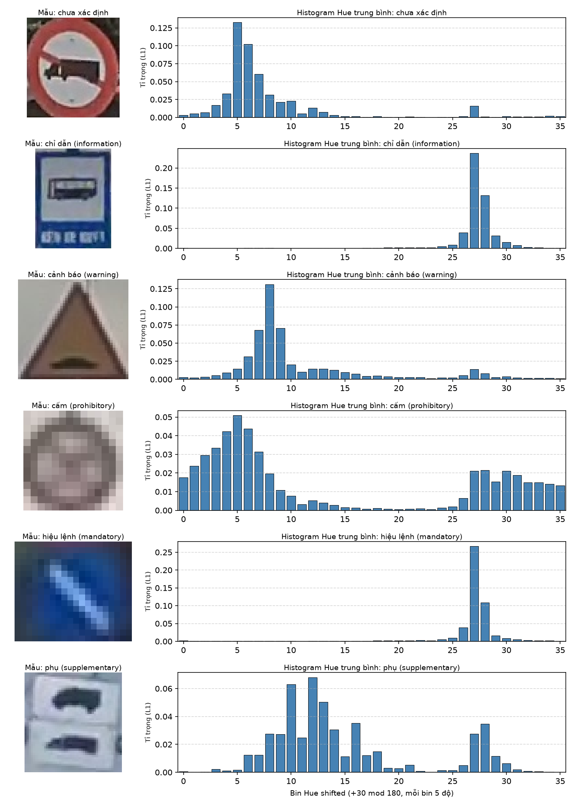
*Hình 1: Ảnh crop tiêu biểu và histogram Hue trung bình (36 bin đã xoay) tương ứng của 6 nhóm biển báo.*

---

## 5. Phân tích màu sắc chủ đạo theo nhóm

Dưới đây là giá trị trung bình của kênh Hue ($0$–$179$) và Saturation ($0$–$255$) tính trên tập kiểm thử:

| Nhóm biển báo | Số mẫu Test | Hue trung bình ($0$–$179$) | Saturation trung bình ($0$–$255$) | Màu sắc nhận diện thực tế |
| :--- | :---: | :---: | :---: | :--- |
| **cấm (prohibitory)** | 1,067 | 28.1 | 74.9 | Viền đỏ, nền trắng hoặc xanh |
| **cảnh báo (warning)** | 423 | 18.0 | 100.4 | **Vàng cam** (nền tam giác vàng đậm) |
| **hiệu lệnh (mandatory)** | 219 | **105.7** | **148.3** | **Xanh lam đậm (Blue)** |
| **chỉ dẫn (information)** | 75 | **106.1** | **116.9** | **Xanh lam (Blue)** |
| **phụ (supplementary)** | 8 | 108.5 | 57.7 | Nền trắng / xanh nhạt (độ bão hòa thấp) |
| **chưa xác định** | 53 | 46.7 | 87.9 | Hỗn hợp (Camera xanh + B.8a đỏ trắng) |

> [!CAUTION]
> ### Hiện tượng trùng màu nghiêm trọng giữa R.* (hiệu lệnh) và I.* (chỉ dẫn)
> Kênh Hue trung bình của biển *hiệu lệnh* ($105.7^\circ$) và biển *chỉ dẫn* ($106.1^\circ$) **hoàn toàn trùng khít** lên nhau trong không gian màu xanh lam. Khi chỉ sử dụng histogram màu thuần túy và bỏ qua thông tin hình học (biển hiệu lệnh hình tròn vs biển chỉ dẫn hình chữ nhật), bộ phân loại không có bất kỳ cơ sở nào để phân biệt hai nhóm này ngoài một độ lệch nhỏ về độ bão hòa (Saturation 148.3 vs 116.9). Đây chính là nguyên nhân gây ra tỉ lệ nhầm lẫn lớn nhất trong toàn bộ hệ thống.

---

## 6. Lựa chọn mô hình & Tối ưu siêu tham số

Các mô hình được huấn luyện trên **16.123** mẫu train và tinh chỉnh siêu tham số trên tập Validation (**568** mẫu).

### 6.1. Không gian tìm kiếm tham số (Grid Search)
* **SVM (RBF Kernel, `class_weight='balanced'`)**:
  * $C \in \{1.0, 5.0, 10.0\}$
  * $\gamma \in \{\text{'scale'}, 0.5, 1.0\}$
* **kNN**:
  * Số láng giềng $k \in \{3, 5, 7, 11, 15\}$
  * Trọng số khoảng cách: `weights` $\in \{\text{'uniform'}, \text{'distance'}\}$

### 6.2. Kết quả trên tập Validation

| Mô hình | Tham số tối ưu | Val Accuracy | Val Macro-F1 |
| :--- | :--- | :---: | :---: |
| **SVM (RBF)** | $C = 10.0, \gamma = \text{'scale'}$ | **92.96%** | 0.6175 |
| **kNN** | $k = 15, \text{weights} = \text{'uniform'}$ | 92.78% | **0.6454** |

> [!IMPORTANT]
> Mô hình được lựa chọn lưu trữ chính thức tại `models/stage1_hsv_vn_best.joblib` là **kNN ($k=15$, uniform)** vì đạt **Val Macro-F1 cao hơn** ($0.6454 > 0.6175$). Do dữ liệu mất cân bằng nghiêm trọng, Macro-F1 được ưu tiên tuyệt đối so với Accuracy.

---

## 7. Kết quả thực nghiệm Mức (A) — Ground-Truth Crops

Mức (A) sử dụng bounding box Ground-Truth lý tưởng trên 1.845 biển báo tập Test. Đây là **cận trên lý thuyết** của năng lực phân loại đặc trưng HSV khi không chịu tác động của sai số định vị từ YOLO.

### 7.1. Bảng so sánh tổng quan Mức A
| Mô hình | Accuracy | Macro-Precision | Macro-Recall | Macro-F1 |
| :--- | :---: | :---: | :---: | :---: |
| **SVM (RBF)** | **92.85%** | 0.7388 | 0.7645 | 0.6877 |
| **kNN ($k=15$)** | 92.09% | **0.7963** | **0.7788** | **0.7008** |

### 7.2. Chi tiết hiệu năng từng nhóm (Per-Class Breakdown)

#### Mô hình SVM (Mức A):
| Nhóm biển báo | Precision | Recall | F1-Score | Support (Số lượng mẫu) |
| :--- | :---: | :---: | :---: | :---: |
| **cấm (prohibitory)** | 0.97 | 0.98 | 0.98 | 1,067 |
| **cảnh báo (warning)** | 1.00 | 1.00 | 1.00 | 423 |
| **hiệu lệnh (mandatory)** | 0.82 | 0.74 | 0.78 | 219 |
| **chỉ dẫn (information)** | 0.55 | 0.87 | 0.67 | 75 |
| **phụ (supplementary)** | 0.35 | 0.88 | 0.50 | 8 |
| **chưa xác định** | 0.75 | 0.11 | 0.20 | 53 |
| *Macro Average* | *0.74* | *0.76* | *0.69* | *1,845* |

#### Mô hình kNN (Mức A):
| Nhóm biển báo | Precision | Recall | F1-Score | Support (Số lượng mẫu) |
| :--- | :---: | :---: | :---: | :---: |
| **cấm (prohibitory)** | 0.96 | 0.99 | 0.98 | 1,067 |
| **cảnh báo (warning)** | 0.99 | 0.96 | 0.98 | 423 |
| **hiệu lệnh (mandatory)** | 0.82 | 0.71 | 0.76 | 219 |
| **chỉ dẫn (information)** | 0.54 | 0.92 | 0.68 | 75 |
| **phụ (supplementary)** | 0.47 | 1.00 | 0.64 | 8 |
| **chưa xác định** | 1.00 | 0.09 | 0.17 | 53 |
| *Macro Average* | *0.80* | *0.78* | *0.70* | *1,845* |

### 7.3. Ma trận nhầm lẫn Mức A

| Ma trận nhầm lẫn SVM (Mức A) | Ma trận nhầm lẫn kNN (Mức A) |
| :---: | :---: |
|  |  |

**Đọc biểu đồ ma trận Mức A:**
* **Ở mô hình SVM**: Cặp nhầm lẫn lớn nhất là **53 biển hiệu lệnh** bị phân loại nhầm sang **chỉ dẫn** (chiếm 24.2% số biển hiệu lệnh). Ngược lại, có 10 biển chỉ dẫn bị đoán nhầm thành hiệu lệnh. Ngoài ra, nhóm "chưa xác định" có 24 biển bị đoán nhầm thành hiệu lệnh và 23 biển bị đoán nhầm thành cấm.
* **Ở mô hình kNN**: Cặp nhầm lẫn xanh lam tiếp tục chiếm ưu thế với **59 biển hiệu lệnh** bị gán thành **chỉ dẫn**. Nhóm "chưa xác định" chỉ đoán đúng 5 biển, có 24 biển bị đoán thành cấm và 24 biển bị đoán thành hiệu lệnh.

---

## 8. Kết quả thực nghiệm Mức (B) — YOLO Crops

Ở Mức (B), hệ thống chạy hoàn chỉnh pipeline: YOLO11s dự đoán vị trí trên 550 ảnh test (`conf=0.25`), cắt bounding box dự đoán và đưa qua bộ phân loại.

### 8.1. Thống kê ghép cặp định vị (Detector Matching)
* **Tổng số Ground-Truth trên tập Test**: **1.845** bounding box.
* **Số GT ghép thành công với box của YOLO ($\text{IoU} \ge 0.5$)**: **1.559** biển (**84.50%**).
* **Số GT bị YOLO bỏ sót (False Negative - FN detector)**: **286** biển (**15.50%**).
* **Số box YOLO phát hiện thêm ngoài GT (False Positive - FP detector)**: **216** box.

### 8.2. Đánh giá bộ phân loại trên 1.559 biển ghép được

| Mô hình | Accuracy | Macro-Precision | Macro-Recall | Macro-F1 |
| :--- | :---: | :---: | :---: | :---: |
| **SVM (RBF)** | **96.60%** | 0.7801 | 0.7042 | **0.7265** |
| **kNN ($k=15$)** | 96.02% | 0.7719 | 0.6908 | 0.7081 |

#### Chi tiết từng nhóm ở Mức B (SVM vs kNN):
```
[Mức B - SVM]
                       precision    recall  f1-score   support
        chưa xác định       0.93      0.45      0.60        29
chỉ dẫn (information)       0.81      0.91      0.86        68
   cảnh báo (warning)       0.99      1.00      1.00       408
    cấm (prohibitory)       0.98      0.99      0.98       895
hiệu lệnh (mandatory)       0.97      0.87      0.92       159
  phụ (supplementary)       0.00      0.00      0.00         0
             accuracy                           0.97      1559

[Mức B - kNN]
                       precision    recall  f1-score   support
        chưa xác định       0.91      0.34      0.50        29
chỉ dẫn (information)       0.78      0.97      0.86        68
   cảnh báo (warning)       0.99      0.97      0.98       408
    cấm (prohibitory)       0.97      0.99      0.98       895
hiệu lệnh (mandatory)       0.98      0.88      0.93       159
  phụ (supplementary)       0.00      0.00      0.00         0
             accuracy                           0.96      1559
```

| Ma trận nhầm lẫn SVM (Mức B) | Ma trận nhầm lẫn kNN (Mức B) |
| :---: | :---: |
|  | 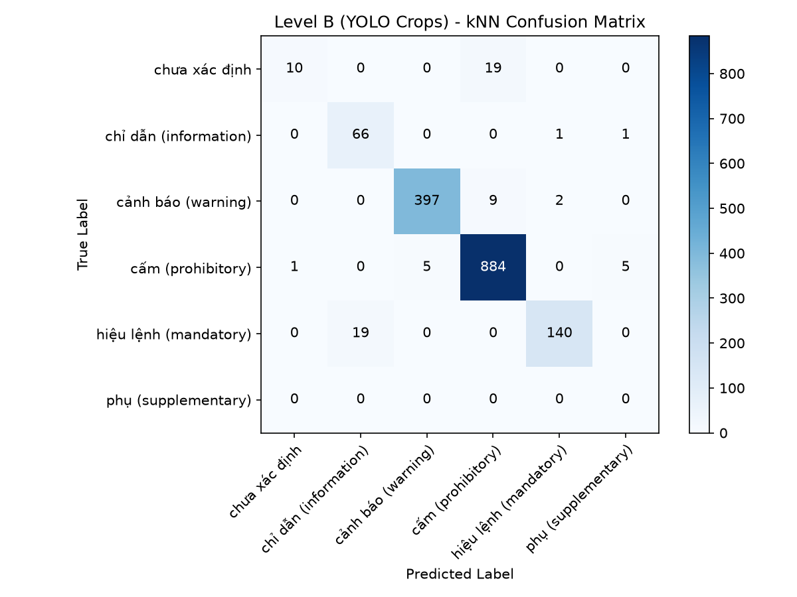 |

**Đọc biểu đồ ma trận Mức B:**
* Toàn bộ 8 biển nhóm *phụ* trong tập test đã bị detector bỏ sót (support ở mức B = 0).
* Cặp nhầm lẫn lớn nhất chuyển thành: **16 biển chưa xác định** bị gán thành **cấm** (ở kNN là 19 biển) và **15 biển hiệu lệnh** bị gán thành **chỉ dẫn** (ở kNN là 19 biển).

### 8.3. Phân tích 216 False Positive (FP) của Detector
216 box do YOLO phát hiện ngoài biển báo thực tế (như biển quảng cáo, tán cây, cột đèn, vạch sơn) **không được đưa vào tính toán Accuracy của bộ phân loại**. Khi chạy qua bộ phân loại HSV, các box này bị gán thành các nhóm sau:

| Nhóm bị gán nhầm | Số lượng bởi SVM | Tỉ lệ SVM | Số lượng bởi kNN | Tỉ lệ kNN |
| :--- | :---: | :---: | :---: | :---: |
| **cấm (prohibitory)** | 108 | 50.0% | 112 | 51.9% |
| **cảnh báo (warning)** | 64 | 29.6% | 62 | 28.7% |
| **hiệu lệnh (mandatory)** | 27 | 12.5% | 27 | 12.5% |
| **chỉ dẫn (information)** | 10 | 4.6% | 9 | 4.2% |
| **phụ (supplementary)** | 6 | 2.8% | 5 | 2.3% |
| **chưa xác định** | 1 | 0.5% | 1 | 0.5% |
| **Tổng số FP** | **216** | **100.0%** | **216** | **100.0%** |

*Nhận xét*: 50% số FP bị gán nhãn thành biển *cấm* và gần 30% bị gán thành *cảnh báo*. Điều này xảy ra do hậu cảnh thường chứa các vật thể có chi tiết đỏ hoặc vàng (đèn đuôi xe, biển quảng cáo, sơn phản quang).

---

## 9. So sánh công bằng: Mức A vs A' vs B

So sánh trực tiếp giữa Mức A (1.845 biển) và Mức B (1.559 biển) là không công bằng vì tập dữ liệu đầu vào khác nhau. Do đó, ta thiết lập mức trung gian **Mức A'**: Đánh giá bộ phân loại trên **Ground-Truth crop**, nhưng **chỉ giới hạn trên đúng 1.559 biển báo mà YOLO phát hiện thành công**.

| Cấu hình đánh giá | Tập mẫu | SVM Accuracy | SVM Macro-F1 | kNN Accuracy | kNN Macro-F1 |
| :--- | :---: | :---: | :---: | :---: | :---: |
| **Mức (A) — Tất cả GT** | 1,845 | 92.85% | 0.6877 | 92.09% | 0.7008 |
| **Mức (A') — GT của biển YOLO bắt được** | 1,559 | 94.93% | 0.6469 | 94.55% | 0.6454 |
| **Mức (B) — Bbox YOLO thực tế** | 1,559 | **96.60%** | **0.7265** | **96.02%** | **0.7081** |

### Diễn giải nguyên nhân sai lệch:
1. **Chênh lệch A vs A' ($92.85\% \rightarrow 94.93\%$, $+2.08\%$ Acc)**: 
   Hiện tượng tăng độ chính xác này phản ánh **độ khó của các biển báo bị YOLO bỏ sót**. 286 biển mà detector bỏ qua chủ yếu là biển kích thước siêu nhỏ, ở xa, bị che khuất hoặc bị biến dạng màu sắc do thiếu sáng. Khi loại bỏ nhóm biển khó này, tập 1.559 biển còn lại dễ phân loại hơn đáng kể. *(Macro-F1 của A' giảm xuống do 8 biển phụ có support = 0 làm tụt điểm trung bình macro).*
2. **Chênh lệch A' vs B ($94.93\% \rightarrow 96.60\%$, $+1.67\%$ Acc)**:
   Đây là hiệu ứng từ **độ ôm khít của Bbox YOLO**. Bounding box do YOLO phát hiện thường ôm sát vào viền thực của biển hơn so với box Ground-Truth (vốn có biên lề an toàn rộng). Việc loại bỏ bớt phần viền hậu cảnh giúp histogram HSV tập trung cao hơn vào màu sắc lõi của biển báo, vô tình làm tăng độ chính xác của bộ phân loại.

---

## 10. Hiệu năng toàn hệ thống (End-to-End Pipeline)

Chỉ số trung thực nhất để đánh giá ứng dụng thực tế của cả pipeline là **Tỉ lệ thu hồi thực tế (End-to-End Recall)**:
$$\text{Recall}_{\text{End-to-End}} = \frac{\text{Số biển GT được YOLO phát hiện VÀ phân loại đúng nhóm}}{\text{Tổng số biển GT trong tập kiểm thử (1.845)}}$$

| Thành phần & Mô hình | Số lượng biển báo | Tỉ lệ so với tổng GT (1.845) |
| :--- | :---: | :---: |
| **Tổng Ground-Truth Test** | 1,845 | 100.0% |
| **YOLO phát hiện thành công ($\text{IoU} \ge 0.5$)** | 1,559 | 84.50% |
| **SVM: Phân loại đúng nhóm trên biển bắt được** | **1,506** | **81.63%** |
| **kNN: Phân loại đúng nhóm trên biển bắt được** | **1,497** | **81.14%** |

> [!WARNING]
> Mặc dù độ chính xác cục bộ của bộ phân loại ở Mức B đạt trên **96%**, **hiệu năng thực tế toàn hệ thống chỉ đạt $\approx 81.6\%$**. Nguyên nhân nghẽn chính nằm ở bước Detector khi để lọt mất **15.5%** biển báo ngay từ đầu vào.

---

## 11. Phân tích chi tiết các trường hợp phân loại sai (Error Analysis)

### 11.1. Bảng các cặp nhầm lẫn phổ biến nhất
| Thứ hạng | Nhãn thực tế (True) | Nhãn dự đoán (Pred) | Số lượng Mức A (SVM / kNN) | Số lượng Mức B (SVM / kNN) |
| :---: | :--- | :--- | :---: | :---: |
| **1** | hiệu lệnh (mandatory) | chỉ dẫn (information) | 53 / 59 | 15 / 19 |
| **2** | chưa xác định | cấm (prohibitory) | 23 / 24 | 16 / 19 |
| **3** | chưa xác định | hiệu lệnh (mandatory) | 24 / 24 | 1 / 1 |
| **4** | chỉ dẫn (information) | hiệu lệnh (mandatory) | 10 / 6 | 4 / 2 |
| **5** | cấm (prohibitory) | phụ (supplementary) | 13 / 9 | 7 / 5 |

---

### 11.2. Minh họa 20 ảnh crop phân loại sai tiêu biểu (Mức B)

#### Kiểu lỗi 1: Biển chỉ dẫn bị đoán nhầm thành hiệu lệnh hoặc biển phụ (Do cùng màu xanh lam / bạc màu)
* **Giả định nguyên nhân**: Cả biển hiệu lệnh và chỉ dẫn đều có nền xanh lam ($H \approx 106^\circ$). Khi crop không có đặc trưng hình dáng (tròn vs chữ nhật), mô hình chỉ dựa vào phân bố xác suất tiên lượng và độ bão hòa để đoán, dẫn đến nhầm lẫn sang hiệu lệnh hoặc biển phụ khi ảnh chói sáng làm giảm Saturation.

| `err_01` (Stem 0313) | `err_02` (Stem 0315) | `err_03` (Stem 0326) | `err_04` (Stem 0330) | `err_05` (Stem 0336) |
| :---: | :---: | :---: | :---: | :---: |
| 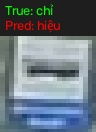 | 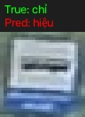 | 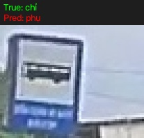 | 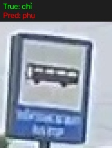 | 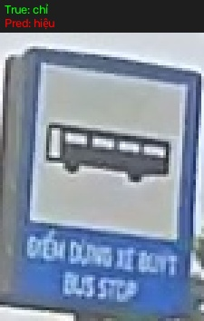 |
| **True**: chỉ dẫn<br>**Pred**: hiệu lệnh<br>**Class**: I.434a<br>**Size**: $22 \times 26$, IoU 0.76 | **True**: chỉ dẫn<br>**Pred**: hiệu lệnh<br>**Class**: I.434a<br>**Size**: $24 \times 32$, IoU 0.87 | **True**: chỉ dẫn<br>**Pred**: phụ<br>**Class**: I.434a<br>**Size**: $69 \times 54$, IoU 0.54 | **True**: chỉ dẫn<br>**Pred**: phụ<br>**Class**: I.434a<br>**Size**: $62 \times 70$, IoU 0.74 | **True**: chỉ dẫn<br>**Pred**: hiệu lệnh<br>**Class**: I.434a<br>**Size**: $75 \times 106$, IoU 0.88 |

---

#### Kiểu lỗi 2: Biển B.8a ("chưa xác định") bị đoán nhầm thành biển cấm (Do viền đỏ nền trắng)
* **Giả định nguyên nhân**: Về mặt thị giác và vật lý, biển $B.8a$ ("Cấm xe sơ-mi rơ-moóc") có hình tròn viền đỏ nền trắng đặc trưng của biển cấm. Tuy nhiên, do quy tắc tiền tố gán nhãn nghiêm ngặt, nó mang nhãn "chưa xác định". Bộ phân loại HSV nhận diện chính xác màu đỏ viền + trắng nền và đưa ra dự đoán hợp lý theo thị giác là nhóm cấm.

| `err_06` (Stem 0414) | `err_07` (Stem 0415) | `err_08` (Stem 0416) | `err_09` (Stem 0417) | `err_10` (Stem 0418) |
| :---: | :---: | :---: | :---: | :---: |
| 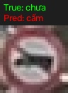 | 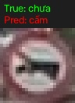 | 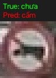 | 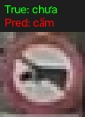 | 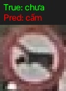 |
| **True**: chưa xác định<br>**Pred**: cấm<br>**Class**: B.8a<br>**Size**: $24 \times 24$, IoU 0.92 | **True**: chưa xác định<br>**Pred**: cấm<br>**Class**: B.8a<br>**Size**: $24 \times 25$, IoU 0.80 | **True**: chưa xác định<br>**Pred**: cấm<br>**Class**: B.8a<br>**Size**: $26 \times 25$, IoU 0.93 | **True**: chưa xác định<br>**Pred**: cấm<br>**Class**: B.8a<br>**Size**: $27 \times 28$, IoU 0.84 | **True**: chưa xác định<br>**Pred**: cấm<br>**Class**: B.8a<br>**Size**: $28 \times 27$, IoU 0.81 |

| `err_11` (Stem 0419) | `err_12` (Stem 0420) | `err_13` (Stem 0421) | `err_14` (Stem 0423) | `err_15` (Stem 0424) |
| :---: | :---: | :---: | :---: | :---: |
| 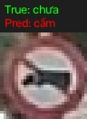 | 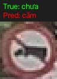 | 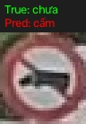 | 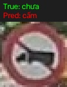 | 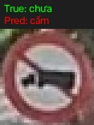 |
| **True**: chưa xác định<br>**Pred**: cấm<br>**Class**: B.8a<br>**Size**: $30 \times 30$, IoU 0.85 | **True**: chưa xác định<br>**Pred**: cấm<br>**Class**: B.8a<br>**Size**: $31 \times 31$, IoU 0.88 | **True**: chưa xác định<br>**Pred**: cấm<br>**Class**: B.8a<br>**Size**: $32 \times 34$, IoU 0.80 | **True**: chưa xác định<br>**Pred**: cấm<br>**Class**: B.8a<br>**Size**: $37 \times 36$, IoU 0.90 | **True**: chưa xác định<br>**Pred**: cấm<br>**Class**: B.8a<br>**Size**: $39 \times 40$, IoU 0.88 |

| `err_16` (Stem 0432) | `err_17` (Stem 0433) | `err_18` (Stem 0434) | `err_19` (Stem 0714) | `err_20` (Stem 0716) |
| :---: | :---: | :---: | :---: | :---: |
| 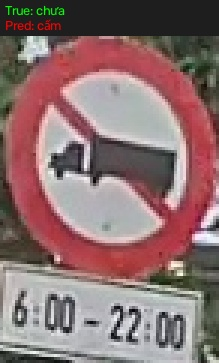 | 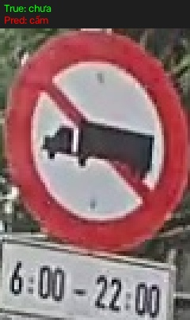 | 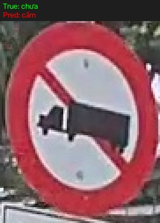 | 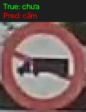 | 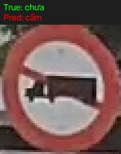 |
| **True**: chưa xác định<br>**Pred**: cấm<br>**Class**: B.8a<br>**Size**: $73 \times 109$, IoU 0.74 | **True**: chưa xác định<br>**Pred**: cấm<br>**Class**: B.8a<br>**Size**: $80 \times 123$, IoU 0.74 | **True**: chưa xác định<br>**Pred**: cấm<br>**Class**: B.8a<br>**Size**: $91 \times 115$, IoU 0.91 | **True**: chưa xác định<br>**Pred**: cấm<br>**Class**: B.8a<br>**Size**: $47 \times 49$, IoU 0.92 | **True**: chưa xác định<br>**Pred**: cấm<br>**Class**: B.8a<br>**Size**: $59 \times 63$, IoU 0.91 |

---

### 11.3. Minh họa các mẫu phân loại đúng tiêu biểu (Mức A/B)
Để đối chiếu trực quan, dưới đây là các ảnh crop mà mô hình phân loại chính xác:

| cấm (P.123a) | cảnh báo (W.201a) | hiệu lệnh (R.301e) |
| :---: | :---: | :---: |
| 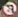 | 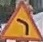 | 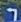 |
| $18 \times 17$ px, Viền đỏ nét | $43 \times 42$ px, Vàng cam đậm | $21 \times 22$ px, Xanh lam bão hòa cao |

| chỉ dẫn (I.434a) | phụ (S.505a) | chưa xác định (B.8a) |
| :---: | :---: | :---: |
| 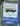 | 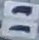 | 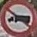 |
| $20 \times 26$ px, Chữ nhật xanh | $39 \times 40$ px, Nền trắng chữ đen | $37 \times 37$ px, Đoán đúng nhãn gán |

---

## 12. Hạn chế & Cảnh báo thống kê

Báo cáo nêu rõ các cảnh báo phương pháp luận và giới hạn thống kê bắt buộc:

1. **Độ lệch của chỉ số Accuracy do mất cân bằng dữ liệu**:
   Tập Test có sự chênh lệch số lượng mẫu cực đoan: nhóm *cấm* chiếm tới **57.8%** (1.067 / 1.845), trong khi nhóm *phụ* chỉ chiếm **0.4%** (8 / 1.845). Nếu một mô hình giả định luôn đoán nhãn "cấm", độ chính xác Accuracy đã tự nhiên đạt $\approx 58\%$. Do đó, **Macro-F1 là thước đo đánh giá khách quan duy nhất**, không được sử dụng Accuracy làm tiêu chí so sánh chính.
2. **Kích thước mẫu không đủ ý nghĩa thống kê cho một số nhóm**:
   * Nhóm *phụ (supplementary)* chỉ có **8 mẫu test** và **16 mẫu val**.
   * Nhóm *chỉ dẫn (information)* chỉ có **4 mẫu val**.
   Các con số Precision/Recall trên các nhóm này có phương sai cực lớn và không đại diện cho tổng thể ngoài thực tế.
3. **Nhiễu trong việc lựa chọn mô hình qua tập Validation**:
   Tập Val chỉ có 568 mẫu với một số nhóm chỉ có 4–16 mẫu. Sự chênh lệch Val Macro-F1 giữa kNN ($0.6454$) và SVM ($0.6175$) về cơ bản là nhiễu ngẫu nhiên. Hai mô hình có năng lực biểu diễn thực tế tương đương nhau.
4. **Hiện tượng cảnh báo (warning) đạt 100% ở SVM Mức A**:
   SVM đạt Precision = 1.00 và Recall = 1.00 trên 423 biển cảnh báo ở Mức A. Kiểm tra khoảng cách Euclid trên vector đặc trưng HSV cho thấy có **58 / 423 biển cảnh báo ở tập Test có khoảng cách $< 0.05$** so với ít nhất một biển cảnh báo trong tập Train (khoảng cách nhỏ nhất trung vị đạt $0.0693$). Điều này xảy ra do nhiều biển báo cùng loại xuất hiện trong các đoạn đường tương đồng về điều kiện ánh sáng, giúp phân phối màu sắc gần như trùng khớp.
5. **Nhóm "chưa xác định" là nhóm nhãn nhân tạo**:
   Nhóm này gồm hai lớp có bản chất hoàn toàn trái ngược: *Camera* (chỉ dẫn xanh/trắng) và *B.8a* (cấm đỏ/trắng). Do đó, Recall thấp của nhóm này ($11\%$ ở Mức A) phản ánh sự bất cập trong cách gom nhãn định danh, hoàn toàn không phải lỗi học máy của mô hình.
6. **Giới hạn thực nghiệm 1 lần chạy (Single Run)**:
   Toàn bộ kết quả dựa trên một phân chia Train/Val/Test cố định duy nhất, không thực hiện k-fold cross-validation và không có độ lệch chuẩn ($\pm \sigma$).

---

## 13. Kết luận & Đề xuất cho Stage 2

### 13.1. Kết luận rút ra từ số liệu thực nghiệm
1. Đặc trưng HSV 44 chiều là một baseline phân nhóm tốt đối với các nhóm có màu sắc tương phản mạnh: phân biệt rực rỡ giữa **biển cảnh báo** (vàng cam, F1=1.00) và **biển cấm** (viền đỏ, F1=0.98).
2. Màu sắc thuần túy hoàn toàn thất bại trong việc phân định cặp **hiệu lệnh $\leftrightarrow$ chỉ dẫn** do cả hai dùng chung dải bước sóng xanh lam ($H \approx 106^\circ$), dẫn đến 53–59 ca nhầm lẫn nghiêm trọng.
3. Nút thắt cổ chai lớn nhất của pipeline nằm ở **Độ bao phủ của Detector** (bỏ sót 15.5% biển báo), làm giới hạn trần End-to-End Recall ở mức $\approx 81.6\%$.

### 13.2. Đề xuất cải tiến kỹ thuật cho Stage 2
1. **Bổ sung Tỉ lệ khung hình bounding box (Aspect Ratio $\frac{w}{h}$)**:
   Biển hiệu lệnh có hình tròn ($\frac{w}{h} \approx 1.0$), trong khi biển chỉ dẫn và biển phụ thường là hình chữ nhật đứng ($\frac{w}{h} \approx 0.7$) hoặc chữ nhật ngang ($\frac{w}{h} \approx 1.4$). Chỉ cần 1 thuộc tính vô hướng này có thể triệt tiêu phần lớn nhầm lẫn giữa hiệu lệnh và chỉ dẫn.
2. **Phân vùng không gian (Spatial Grid $2 \times 2$ hoặc $3 \times 3$)**:
   Thay vì tính histogram toàn cục trên toàn bộ crop, chia crop thành lưới các ô nhỏ. Biển cấm sẽ có màu đỏ đậm tập trung ở 4 góc và viền, trong khi phần tâm là màu trắng; ngược lại biển hiệu lệnh có màu xanh phủ đều khắp các ô lưới.
3. **Kết hợp Histogram of Oriented Gradients (HOG)**:
   Bổ sung vector HOG để trích xuất biên dạng hình học: phát hiện cạnh chéo của tam giác (cảnh báo), đường cong tròn đối xứng (hiệu lệnh/cấm) và cạnh thẳng vuông góc (chỉ dẫn/phụ).
4. **Chuẩn hóa lại nhãn mã hiệu**:
   Cần phân bổ lại mã $B.8a$ về đúng nhóm biển cấm theo bản chất thiết kế để tránh tạo ra các nhóm nhãn giả mạo làm sai lệch độ đo.

---

## 14. Phụ lục kỹ thuật

### 14.1. Danh mục tập tin & Đường dẫn
* **Báo cáo**: **STAGE1_REPORT.md** (chính tài liệu này)
* **Model lưu trữ chính thức**: [`models/stage1_hsv_vn_best.joblib`](WEIGHTS.md)
* **Weights Detector**: [`runs/detect/vn_s/weights/best.pt`](WEIGHTS.md)
* **Tập tin chỉ số chi tiết**:
  * [`../res/experiments/stage1_final_summary.json`](../res/experiments/stage1_final_summary.json)
  * [`../res/experiments/stage1_report_metrics.json`](../res/experiments/stage1_report_metrics.json)
  * [`../res/experiments/stage1_misclassified_examples.json`](../res/experiments/stage1_misclassified_examples.json)
* **Tập tin mã nguồn**:
  * Pipeline huấn luyện & đánh giá: [`tsr_pipeline/stage1_classify.py`](../src/detection/color_hog_svm/pipeline/stage1_classify.py)
  * Đánh giá bổ trợ báo cáo: [`tsr_pipeline/evaluate_for_report.py`](../src/detection/color_hog_svm/pipeline/evaluate_for_report.py)

### 14.2. Lệnh tái lập kết quả (Reproducibility Commands)
Kích hoạt môi trường ảo và chạy:
```powershell
# Chạy pipeline phân loại Stage 1 Part 2
.venv\Scripts\python tsr_pipeline/stage1_classify.py

# Xuất các chỉ số bổ trợ cho báo cáo
.venv\Scripts\python tsr_pipeline/evaluate_for_report.py
```

### 14.3. Phiên bản thư viện & Môi trường thực thi
* **Hệ điều hành**: Windows 11
* **Python**: `3.11.9`
* **PyTorch**: `2.6.0+cu124` (CUDA:0, NVIDIA GeForce RTX 4060 Laptop GPU, 8188 MiB)
* **scikit-learn**: `1.6.1`
* **opencv-python**: `4.11.0.86`
* **ultralytics**: `8.4.198`
* **numpy**: `2.2.3`
* **pandas**: `2.2.3`
* **matplotlib**: `3.10.1`
* **Seed cố định**: `42`

