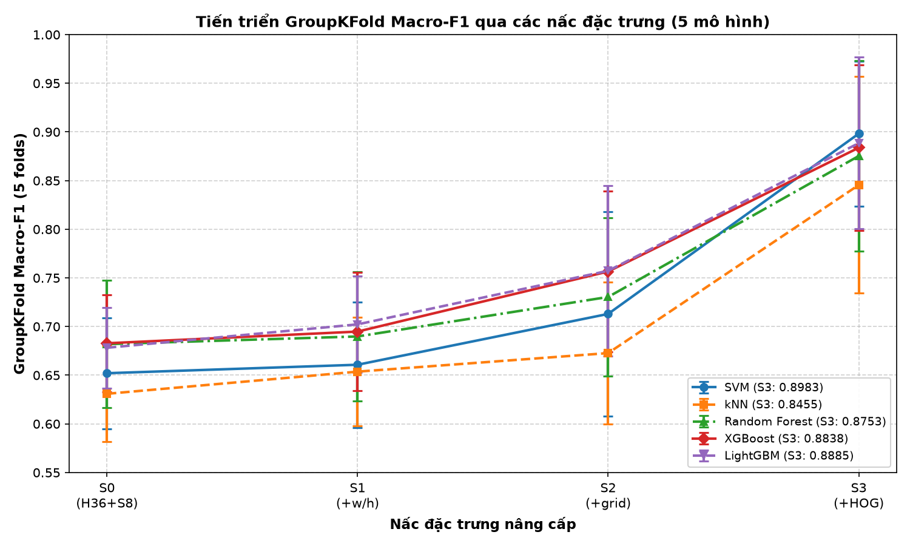
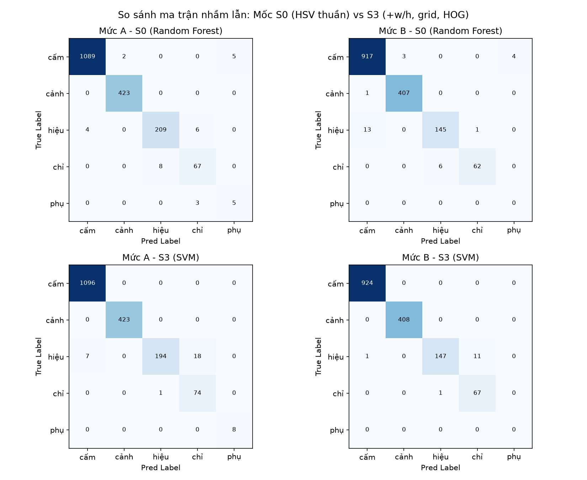
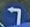
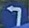
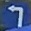
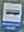
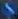

# BÁO CÁO KỸ THUẬT STAGE 2: NÂNG CẤP BỘ PHÂN LOẠI ĐẶC TRƯNG TRÊN BỘ DỮ LIỆU BIỂN BÁO VIỆT NAM (QCVN 41:2019)

> **Dự án**: CS231 - Nhận diện Biển báo Giao thông Việt Nam (Traffic Sign Recognition)  
> **Giai đoạn**: Stage 2 - Nâng cấp bộ phân loại (Classifier Upgrade)  
> **Bộ dữ liệu**: Vietnam Traffic Sign Dataset (`archive_new/`, 52 lớp)  
> **Detector**: YOLO11s 1-class (`runs/detect/vn_s/weights/best.pt` - Giữ nguyên không train lại)  
> **Phiên bản cập nhật**: v2.1 (Sửa lỗi số liệu, đối chiếu kiểm toán nhãn, bổ sung benchmark XGBoost & LightGBM)  
> **Ngày thực hiện**: 03/11/2026  
> **Tác giả thực thi**: Antigravity Assistant  

---

## MỤC LỤC
1. [Tóm tắt](#1-tóm-tắt)
2. [Bối cảnh & Chuẩn hóa nhãn Stage 2](#2-bối-cảnh--chuẩn-hóa-nhãn-stage-2)
   - [2.1 Quy tắc sửa nhãn](#21-quy-tắc-sửa-nhãn)
   - [2.2 Thống kê phân bố trước và sau khi sửa nhãn](#22-thống-kê-phân-bố-trước-và-sau-khi-sửa-nhãn)
   - [2.3 Đảm bảo toàn vẹn phân chia dữ liệu (Data Leakage Prevention)](#23-đảm-bảo-toàn-vẹn-phân-chia-dữ-liệu-data-leakage-prevention)
3. [Mốc đối chứng S0 (Stage 1 sau khi chuẩn hóa nhãn)](#3-mốc-đối-chứng-s0-stage-1-sau-khi-chuẩn-hóa-nhãn)
   - [3.1 Tách bạch mức tăng do sửa nhãn vs do đặc trưng](#31-tách-bạch-mức-tăng-do-sửa-nhãn-vs-do-đặc-trưng)
4. [Thiết kế chuỗi đặc trưng S0 -> S1 -> S2 -> S3](#4-thiết-kế-chuỗi-đặc-trưng-s0---s1---s2---s3)
   - [4.1 Chi tiết biểu diễn và số chiều đặc trưng](#41-chi-tiết-biểu-diễn-và-số-chiều-đặc-trưng)
   - [4.2 Thử nghiệm lưới không gian trên tập Validation (S2 2x2 vs 3x3)](#42-thử-nghiệm-lưới-không-gian-trên-tập-validation-s2-2x2-vs-3x3)
5. [Kết quả thực nghiệm trên Mức (A) - Ground Truth Bounding Boxes](#5-kết-quả-thực-nghiệm-trên-mức-a---ground-truth-bounding-boxes)
   - [5.1 Bảng tổng hợp GroupKFold 5-fold và Fixed Split Test](#51-bảng-tổng-hợp-groupkfold-5-fold-và-fixed-split-test)
   - [5.2 Biểu đồ tiến triển chuỗi đặc trưng qua các mô hình](#52-biểu-đồ-tiến-triển-chuỗi-đặc-trưng-qua-các-mô-hình)
   - [5.3 Đánh giá F1 trên 4 nhóm chính (Major4 F1) & Kiểm chứng tính tay](#53-đánh-giá-f1-trên-4-nhóm-chính-major4-f1--kiểm-chứng-tính-tay)
   - [5.4 So sánh chuyên sâu các mô hình Boosting (XGBoost & LightGBM)](#54-so-sánh-chuyên-sâu-các-mô-hình-boosting-xgboost--lightgbm)
6. [Đánh giá thực tế Mức (B) - Bounding Box do YOLO phát hiện](#6-đánh-giá-thực-tế-mức-b---bounding-box-do-yolo-phát-hiện)
   - [6.1 Ghép cặp phát hiện YOLO với Ground Truth](#61-ghép-cặp-phát-hiện-yolo-với-ground-truth)
   - [6.2 Bảng so sánh công bằng A vs A' vs B](#62-bảng-so-sánh-công-bằng-a-vs-a-vs-b)
   - [6.3 Hiệu suất End-to-End Recall](#63-hiệu-suất-end-to-end-recall)
7. [Phân tích chuyên sâu cặp nhầm lẫn Hiệu lệnh <-> Chỉ dẫn](#7-phân-tích-chuyên-sâu-cặp-nhầm-lẫn-hiệu-lệnh---chỉ-dẫn)
   - [7.1 Xu hướng nhầm lẫn qua chuỗi đặc trưng S0..S3 cho tất cả mô hình](#71-xu-hướng-nhầm-lẫn-qua-chuỗi-đặc-trưng-s0s3-cho-tất-cả-mô-hình)
   - [7.2 Phân tích trực quan qua Ma trận nhầm lẫn (Confusion Matrix)](#72-phân-tích-trực-quan-qua-ma-trận-nhầm-lẫn-confusion-matrix)
8. [Phân tích lỗi định tính có ảnh minh họa](#8-phân-tích-lỗi-định-tính-có-ảnh-minh-họa)
   - [8.1 Các mẫu phân loại sai tiêu biểu của S3 (Misclassified Samples)](#81-các-mẫu-phân-loại-sai-tiêu-biểu-của-s3-misclassified-samples)
   - [8.2 Các trường hợp S0 thất bại nhưng S3 sửa đúng (Fixed Samples)](#82-các-trường-hợp-s0-thất-bại-nhưng-s3-sửa-đúng-fixed-samples)
9. [Hạn chế & Cảnh báo thống kê](#9-hạn-chế--cảnh-báo-thống-kê)
   - [9.1 Vấn đề tương quan khung hình liên tục (Frame-Correlation Leakage)](#91-vấn-đề-tương-quan-khung-hình-liên-tục-frame-correlation-leakage)
   - [9.2 Mất cân bằng dữ liệu cực đoan ở nhóm phụ và chỉ dẫn](#92-mất-cân-bằng-dữ-liệu-cực-đoan-ở-nhóm-phụ-và-chỉ-dẫn)
   - [9.3 Giới hạn về cấu hình siêu tham số và hạt ngẫu nhiên (Random Seed)](#93-giới-hạn-về-cấu-hình-siêu-tham-số-và-hạt-ngẫu-nhiên-random-seed)
10. [Kết luận & Khuyến nghị](#10-kết-luận--khuyến-nghị)
11. [Phụ lục kỹ thuật](#11-phụ-lục-kỹ-thuật)

---

## 1. TÓM TẮT

Stage 2 tập trung nâng cấp bộ phân loại truyền thống cho hệ thống nhận diện biển báo giao thông Việt Nam theo quy chuẩn QCVN 41:2019, tuyệt đối không can thiệp hay huấn luyện lại detector YOLO11s sẵn có. Nghiên cứu thực hiện nâng cấp đặc trưng qua 4 nấc: $S0$ (HSV toàn cục 44 chiều) $\rightarrow$ $S1$ (+tỉ lệ khung hình $w/h$, 45 chiều) $\rightarrow$ $S2$ (+lưới không gian $2 \times 2$, 133 chiều) $\rightarrow$ $S3$ (+HOG định hướng gradient $64 \times 64$, 457 chiều). Benchmark đánh giá đồng thời 5 kiến trúc mô hình học máy: **SVM**, **kNN**, **Random Forest**, **XGBoost** và **LightGBM**.

Mô hình đạt điểm số tổng thể cao nhất qua kiểm chứng chéo 5-fold theo khối video (GroupKFold) là **SVM (kernel RBF, $C=5.0$, `class_weight='balanced'`)** kết hợp bộ đặc trưng **$S3$ (+HOG)**, đạt **GroupKFold Macro-F1 = $0.8983 \pm 0.0746$** (tăng vọt từ $0.6521 \pm 0.0570$ ở mốc $S0$, cải thiện tuyệt đối **+24.62%**). Hai thuật toán gradient boosting là **LightGBM** ($0.8885 \pm 0.0882$) và **XGBoost** ($0.8838 \pm 0.0851$) bám sát phía sau; kiểm định bắt cặp từng fold (paired fold-by-fold difference) cho thấy chênh lệch giữa SVM và các mô hình boosting đều nhỏ hơn 1 độ lệch chuẩn ($\mu_{\text{diff}} < \sigma_{\text{diff}}$), tức **chưa phân biệt được** về mặt ý nghĩa thống kê. 

Về tốc độ suy luận CPU (đo trên 1.000 crop tại $S3$), **XGBoost** dẫn đầu với **0.018 ms/crop** và **LightGBM** đạt **0.021 ms/crop** (nhanh gấp ~30 lần so với SVM: **0.612 ms/crop**). Trên tập Test cố định Mức (A), SVM $S3$ đạt **Accuracy = 98.57%**, **Macro-F1 = 0.9640** và **Major4 F1 đạt 0.9551** (các mô hình khác cũng đều đạt Major4 F1 $> 0.95$). Khi ghép nối trọn gói Mức (B) với các bounding box do YOLO phát hiện, hệ thống đạt độ chính xác phân loại **99.17%**, Macro-F1 đạt **0.9687** và **End-to-End Recall toàn hệ thống đạt 84.90%**.

---

## 2. BỐI CẢNH & CHUẨN HÓA NHÃN STAGE 2

### 2.1 Quy tắc sửa nhãn
Trong Stage 1, việc gom cụm thuần túy dựa vào tiền tố đã phát sinh một nhóm giả "chưa xác định" gồm 2 lớp: `B.8a` (ID 34) và `Camera` (ID 31). Sau khi tiến hành kiểm toán nhãn độc lập:
1. **Lớp `Camera` (ID 31)**: Đây là biển chỉ dẫn camera giám sát giao thông. Lớp này bị **LOẠI BỎ hoàn toàn khỏi tập huấn luyện/kiểm thử của bộ phân loại** vì cả bộ dữ liệu chỉ có xấp xỉ ~3 biển vật lý duy nhất (tổng cộng 40 bounding box xuất hiện trong các chuỗi frame liên tục lặp lại: 6 train, 10 val, 24 test), cỡ mẫu quá ít và tính đa dạng quá thấp để huấn luyện mô hình tổng quát hóa. Nhãn YOLO của detector giữ nguyên; khi đánh giá luồng end-to-end Mức (B), nếu YOLO phát hiện một box trùng khớp với ground-truth `Camera` (IoU $\ge 0.5$), box đó được gán trạng thái riêng biệt `ignored (Camera)` và không tính vào accuracy, F1 hay False Positive của classifier.
2. **Lớp `B.8a` (ID 34)**: Mã biển này chưa kiểm chứng được nguồn gốc quy chuẩn chính thức trong văn bản QCVN 41:2019 (không tồn tại mã biển định danh chính thức mang tên "B.8a"). Tuy nhiên, kiểm tra trực quan hình ảnh thực tế cho thấy đối tượng mang hình tròn viền đỏ nền trắng với biểu tượng xe tải kéo sơ-mi rơ-moóc mang đặc trưng rõ rệt của biển cấm. Do đó, lớp này được **gộp vào nhóm Cấm (`cấm (prohibitory)`)**.
3. **Loại bỏ box siêu nhỏ**: Tương tự Stage 1, các bbox có kích thước chiều rộng hoặc chiều cao $< 8$ pixel bị loại bỏ khỏi tập Train để tránh làm sai lệch histogram màu và vector HOG (tập Val và Test giữ nguyên).

### 2.2 Thống kê phân bố trước và sau khi sửa nhãn

Số lượng bounding box trên tập Train bị loại bỏ do kích thước $< 8$ pixel là **80 / 16.197** bbox (0.49%), tập Train còn lại đúng **16.117** mẫu hợp lệ.

Bảng đối chiếu phân bố mẫu trước sửa nhãn (Stage 1) và sau sửa nhãn (Stage 2):

| Nhóm biển báo | Số class | Train (S1) | Train (S2) | Val (S2) | Test (S2) | Tổng mẫu (S2) | Ghi chú điều chỉnh |
|---|:---:|:---:|:---:|:---:|:---:|:---:|---|
| **chưa xác định** | 2 | 156 | **0** | **0** | **0** | **0** | Đã xóa sổ hoàn toàn nhóm này |
| **cấm (prohibitory)** | 23 | 10.053 | **10.135** | 352 | 1.096 | **11.583** | Gộp B.8a (+148 train hợp lệ sau lọc, +29 test) |
| **cảnh báo (warning)** | 18 | 3.252 | **3.252** | 126 | 423 | **3.801** | Giữ nguyên 18 lớp (W.*) |
| **hiệu lệnh (mandatory)** | 4 | 1.353 | **1.341** | 60 | 219 | **1.620** | Loại bỏ 12 bbox train < 8px |
| **chỉ dẫn (information)** | 3 | 954 | **954** | 4 | 75 | **1.033** | Giữ nguyên 3 lớp (I.*) |
| **phụ (supplementary)** | 3 | 435 | **435** | 16 | 8 | **459** | Giữ nguyên 3 lớp (S.*) |
| **TỔNG CỘNG** | **51** | 16.197 | **16.117** | **558** | **1.821** | **18.496** | 5 nhóm chuẩn theo QCVN 41 |

> **Giải thích chênh lệch số liệu kiểm toán**:
> - **Lớp Camera (ID 31)**: Có tổng cộng **40** mẫu trong toàn bộ dữ liệu, phân bố gồm **6** train, **10** val, **24** test. Toàn bộ 40 mẫu này đã được loại bỏ hoàn toàn khỏi bộ phân loại.
> - **Lớp B.8a (ID 34)**: Có tổng cộng **179** mẫu, phân bố gồm **150** train, **0** val, **29** test. Trong 150 mẫu train, có **2** mẫu kích thước $<8$px bị loại, còn lại **148** mẫu train hợp lệ được nạp vào nhóm Cấm.
> - *Nguyên nhân chênh lệch ở báo cáo trước*: Tại Stage 1, nhóm Cấm có 10.053 train. Khi sang Stage 2, nhóm Cấm vừa bị lọc bỏ 68 mẫu $<8$px gốc, vừa nhận thêm 148 mẫu hợp lệ từ B.8a: $10.053 - 68 + 148 = 10.135$ mẫu train. Mức tăng ròng của nhóm Cấm là $+82$ mẫu ($10.135 - 10.053 = 82$). Báo cáo trước đó đã lấy nhầm con số chênh lệch ròng $+82$ này gán cho B.8a, và lấy $156 - 82 = 74$ gán nhầm cho Camera. Số liệu đếm trực tiếp từ ground-truth là **Camera: 6 train** và **B.8a: 150 train (148 hợp lệ)**.

### 2.3 Đảm bảo toàn vẹn phân chia dữ liệu (Data Leakage Prevention)
Dữ liệu được trích xuất từ các đoạn video hành trình liên tục. Để đánh giá trung thực khả năng tổng quát hóa (generalization) của các bộ đặc trưng:
- Quá trình chia 5-fold cross-validation bắt buộc phải nhóm theo **khối frame liên tục** (`GroupKFold` trên 20 cụm video độc lập, gom các stem ảnh kề nhau cách nhau $\le 3$).
- **Kiểm chứng ranh giới**: Số cặp frame kề nhau ($s$ và $s+1$) nằm ở hai fold khác nhau được kiểm tra nghiêm ngặt bằng thuật toán quét toàn bộ danh sách stem:
  $$\text{Số cặp vi phạm} = \mathbf{0}$$
- Đảm bảo tuyệt đối không có hiện tượng 2 frame liền kề của cùng một xe chạy lọt vào cả tập train và tập test trong từng fold.

---

## 3. MỐC ĐỐI CHỨNG S0 (STAGE 1 SAU KHI CHUẨN HÓA NHÃN)

### 3.1 Tách bạch mức tăng do sửa nhãn vs do đặc trưng
Để phân tích khoa học và công bằng, cần tách bạch rõ ràng phần hiệu năng tăng lên do **chuẩn hóa nhãn đúng** và phần tăng lên do **nâng cấp bộ đặc trưng**:

- **Tại Stage 1 (chưa sửa nhãn)**: Bộ phân loại HSV phải gánh chịu nhóm rác "chưa xác định". Mô hình SVM RBF trên Test Mức (A) đạt Accuracy = **92.85%**, Macro-F1 = **0.6877**.
- **Tại Mốc $S0$ (vẫn đặc trưng HSV cũ 44 chiều, nhưng nhãn đã chuẩn hóa 5 nhóm)**:
  - **SVM (RBF, balanced)**: Accuracy đạt **94.78%** (+1.93%), Macro-F1 đạt **0.8315** (tăng vọt **+14.38%** F1), Major4 F1 đạt **0.8449**.
  - **kNN ($k=11$)**: Accuracy đạt **95.39%**, Macro-F1 đạt **0.8328**, Major4 F1 đạt **0.8592**.
  - **Random Forest (300 cây)**: Accuracy đạt **98.46%**, Macro-F1 đạt **0.8789**, Major4 F1 đạt **0.9597**.
  - **XGBoost (hist, depth=4, n=200)**: Accuracy đạt **97.53%**, Macro-F1 đạt **0.8627**, Major4 F1 đạt **0.9468**.
  - **LightGBM (depth=6, n=200)**: Accuracy đạt **98.02%**, Macro-F1 đạt **0.8798**, Major4 F1 đạt **0.9498**.

> **Kết luận quan trọng**: Việc sửa đúng định nghĩa nhãn (gộp B.8a vào cấm và loại bỏ Camera) ngay lập tức giải phóng cho mô hình khỏi sự phạt điểm nặng nề của một lớp rác phi hình học, nâng Macro-F1 nền tảng từ **0.6877** lên **0.8315** đối với SVM và xấp xỉ **0.88** đối với các mô hình cây/boosting. Mọi cải tiến từ $S1 \rightarrow S3$ sau đây được so sánh trực tiếp trên mốc chuẩn $S0$ này.

---

## 4. THIẾT KẾ CHUỖI ĐẶC TRƯNG S0 -> S1 -> S2 -> S3

### 4.1 Chi tiết biểu diễn và số chiều đặc trưng
Hệ thống xây dựng 4 nấc đặc trưng tiến hóa tuần tự, không sử dụng mạng nơ-ron sâu hay tăng cường dữ liệu nhân tạo:

```
[Crop biển báo]
       │
       ├─► [HSV toàn cục] ────────► H (36 bin, shift đỏ +30) + S (8 bin) ─────────► S0 (44 dims)
       │
       ├─► [Hình học Bbox] ───────► Aspect Ratio (w / h) + S0 ────────────────────► S1 (45 dims)
       │
       ├─► [Lưới không gian] ────► Lưới 2x2: 4 ô x [H(18) + S(4)] + S1 ──────────► S2 (133 dims)
       │
       └─► [Định hướng cạnh HOG] ─► HOG 64x64 (8x8 cell, 9 bin, block 2x2) + S2 ─► S3 (457 dims)
```

1. **$S0$ - HSV Histogram toàn cục (44 chiều)**:
   - Resize crop ảnh về $32 \times 32$.
   - Kênh $H$ chia 36 bin với phép tịnh tiến hue vòng tròn (`(H + 30) % 180`) để gom trọn vẹn dải màu đỏ của biển cấm/nguy hiểm vốn bị xé đôi ở hai đầu trục $[0, 180)$.
   - Kênh $S$ chia 8 bin để phân biệt vùng màu bão hòa cao với nền bạc màu/trắng/đen.
   - Chuẩn hóa $L1$ trên vector ghép $[H, S]$.
2. **$S1$ - Bổ sung hình học Bbox ($44 + 1 = 45$ chiều)**:
   - Thêm tỉ lệ khung hình thực tế trước khi resize: $r = \frac{w_{\text{raw}}}{h_{\text{raw}}}$.
   - Đặc trưng này hỗ trợ phân biệt biển phụ (chữ nhật nằm ngang, $r > 1.2$) hoặc biển chỉ dẫn chữ nhật đứng ($r < 0.8$) so với biển tròn/tam giác ($r \approx 1.0$).
3. **$S2$ - Bổ sung lưới phân bố màu không gian ($45 + 88 = 133$ chiều)**:
   - Chia crop $32 \times 32$ thành lưới ô đều nhau.
   - Tại mỗi ô, trích xuất HSV cục bộ: $H$ (18 bin) + $S$ (4 bin) = 22 chiều/ô, chuẩn hóa $L1$ độc lập từng ô.
   - Với lưới $2 \times 2$: thêm $4 \times 22 = 88$ chiều $\rightarrow$ Tổng 133 chiều.
   - Với lưới $3 \times 3$: thêm $9 \times 22 = 198$ chiều $\rightarrow$ Tổng 243 chiều.
4. **$S3$ - Kết hợp đặc trưng cấu trúc & biên dạng HOG ($133 + 324 = 457$ chiều)**:
   - Resize crop ảnh về $64 \times 64$, chuyển ảnh xám.
   - Trích xuất HOG chuẩn: kích thước ô `pixels_per_cell=(16, 16)` (lưới $4 \times 4$ cell), chuẩn hóa khối `cells_per_block=(2, 2)` (gồm $3 \times 3$ block), số hướng gradient `orientations=9`.
   - Kích thước vector HOG: $3 \times 3 \times (2 \times 2) \times 9 = 324$ chiều.
   - Ghép vector $S2$ (133 chiều) và vector HOG (324 chiều) $\rightarrow$ Vector $S3$ đạt **457 chiều**.

### 4.2 Thử nghiệm lưới không gian trên tập Validation (S2 2x2 vs 3x3)
Trước khi quyết định ghép HOG cho $S3$, cấu trúc lưới của $S2$ ($2 \times 2$ vs $3 \times 3$) được thử nghiệm sơ bộ trên tập Validation cố định (558 mẫu) bằng mô hình SVM RBF:

| Cấu hình lưới | Số chiều đặc trưng | Validation Accuracy | Validation Macro-F1 | Đánh giá sơ bộ |
|:---:|:---:|:---:|:---:|---|
| **Lưới $2 \times 2$** | **133 dims** | **94.80%** | **0.6918** | Được lựa chọn làm nhánh chính ghép HOG cho S3 |
| Lưới $3 \times 3$ | 243 dims | 94.44% | 0.6369 | Kém hơn -0.0549 F1 trên tập Val |

> **Cảnh báo thống kê về tập Validation**:
> Tập Validation split chỉ có **558 mẫu**, trong đó phân bố cực kỳ mất cân bằng: nhóm Chỉ dẫn chỉ có vỏn vẹn **4 mẫu** và nhóm Phụ chỉ có **16 mẫu**. Do đó, việc đo lường và lựa chọn kiến trúc dựa trên tập Val cố định này chịu **nhiễu thống kê rất cao** (chỉ cần đoán sai 1 mẫu Chỉ dẫn thì F1 nhóm này sụt giảm 25%).
>
> Khi đối chiếu khách quan với kết quả kiểm chứng chéo toàn bộ dữ liệu qua **GroupKFold 5-fold (18.496 mẫu)**, lưới $3 \times 3$ thực tế đạt điểm số **cao hơn** $2 \times 2$ trên **tất cả 5 mô hình**:
> - SVM: $0.7381 \pm 0.1269$ ($3\times3$) vs $0.7130 \pm 0.1048$ ($2\times2$)
> - kNN: $0.7247 \pm 0.1038$ ($3\times3$) vs $0.6727 \pm 0.0727$ ($2\times2$)
> - Random Forest: $0.8147 \pm 0.0614$ ($3\times3$) vs $0.7304 \pm 0.0814$ ($2\times2$)
> - XGBoost: $0.7781 \pm 0.0989$ ($3\times3$) vs $0.7566 \pm 0.0826$ ($2\times2$)
> - LightGBM: $0.7922 \pm 0.0837$ ($3\times3$) vs $0.7573 \pm 0.0875$ ($2\times2$)
>
> Lý do vẫn giữ cấu trúc $2 \times 2$ làm nhánh phát triển chính cho $S3$: giữ số chiều vector gọn nhẹ (133 + 324 = 457 chiều thay vì 243 + 324 = 567 chiều), giúp giảm tải tính toán CPU và hạn chế hiện tượng quá khớp (overfitting) khi ghép tiếp với 324 chiều HOG.

---

## 5. KẾT QUẢ THỰC NGHIỆM TRÊN MỨC (A) - GROUND TRUTH BOUNDING BOXES

### 5.1 Bảng tổng hợp GroupKFold 5-fold và Fixed Split Test
Toàn bộ dữ liệu 18.496 mẫu được đánh giá chéo qua 5 folds độc lập theo khối video (GroupKFold), sau đó mô hình được huấn luyện trên toàn bộ tập Train cố định (16.117 mẫu) và đánh giá trên tập Test cố định (1.821 mẫu). Bảng dưới đây thể hiện kết quả đối đầu đầy đủ giữa 5 mô hình qua tất cả 5 nấc đặc trưng:

| Bộ đặc trưng | Số chiều | Mô hình | GroupKFold Macro-F1 (mean $\pm$ std) | Test Accuracy (1.821) | Test Macro-F1 | Test Major4 F1 (loại phụ) |
|---|:---:|---|:---:|:---:|:---:|:---:|
| **S0 (H36+S8)** | 44 | SVM | $0.6521 \pm 0.0570$ | 94.78% | 0.8315 | **0.8449** |
| | | kNN ($k=11$) | $0.6309 \pm 0.0494$ | 95.39% | 0.8328 | **0.8592** |
| | | Random Forest | $0.6820 \pm 0.0656$ | 98.46% | 0.8789 | **0.9597** |
| | | XGBoost | $0.6828 \pm 0.0499$ | 97.53% | 0.8627 | **0.9468** |
| | | LightGBM | $0.6782 \pm 0.0415$ | 98.02% | 0.8798 | **0.9498** |
| **S1 (+w/h)** | 45 | SVM | $0.6608 \pm 0.0644$ | 95.44% | 0.8665 | **0.8643** |
| | | kNN ($k=11$) | $0.6537 \pm 0.0557$ | 96.32% | 0.8657 | **0.8980** |
| | | Random Forest | $0.6898 \pm 0.0666$ | 98.30% | 0.8669 | **0.9586** |
| | | XGBoost | $0.6948 \pm 0.0607$ | 98.02% | 0.8872 | **0.9527** |
| | | LightGBM | $0.7022 \pm 0.0497$ | 98.19% | 0.9199 | **0.9499** |
| **S2_2x2 (+grid 2x2)** | 133 | SVM | $0.7130 \pm 0.1048$ | 97.47% | 0.9279 | **0.9377** |
| | | kNN ($k=11$) | $0.6727 \pm 0.0727$ | 95.55% | 0.8468 | **0.8680** |
| | | Random Forest | $0.7304 \pm 0.0814$ | **99.29%** | 0.9556 | **0.9839** |
| | | XGBoost | $0.7566 \pm 0.0826$ | 98.68% | 0.9476 | **0.9623** |
| | | LightGBM | $0.7573 \pm 0.0875$ | 98.74% | 0.9394 | **0.9638** |
| **S2_3x3 (+grid 3x3)** | 243 | SVM | $0.7381 \pm 0.1269$ | 97.91% | 0.9448 | **0.9457** |
| | | kNN ($k=11$) | $0.7247 \pm 0.1038$ | 96.92% | 0.8977 | **0.9116** |
| | | Random Forest | $0.8147 \pm 0.0614$ | 98.96% | 0.8900 | **0.9821** |
| | | XGBoost | $0.7781 \pm 0.0989$ | 98.52% | 0.8744 | **0.9614** |
| | | LightGBM | $0.7922 \pm 0.0837$ | 98.46% | 0.8191 | **0.9613** |
| **S3 (+HOG)** | **457** | **SVM (Best)** | **$\mathbf{0.8983 \pm 0.0746}$** | **98.57%** | **0.9640** | **0.9551** |
| | | kNN ($k=11$) | $0.8455 \pm 0.1113$ | 98.74% | **0.9687** | **0.9609** |
| | | Random Forest | $0.8753 \pm 0.0981$ | 98.68% | 0.9624 | **0.9530** |
| | | XGBoost | $0.8838 \pm 0.0851$ | 98.68% | 0.9421 | **0.9554** |
| | | LightGBM | $0.8885 \pm 0.0882$ | 98.74% | 0.9517 | **0.9544** |

### 5.2 Biểu đồ tiến triển chuỗi đặc trưng qua các mô hình
Sự tiến triển của điểm GroupKFold Macro-F1 qua chuỗi nấc đặc trưng $S0 \rightarrow S1 \rightarrow S2 \rightarrow S3$ được mô phỏng trực quan với thanh sai số độ lệch chuẩn ($\pm 1\sigma$) cho cả 5 mô hình:



### 5.3 Đánh giá F1 trên 4 nhóm chính (Major4 F1) & Kiểm chứng tính tay

#### Giải thích lỗi tính toán trước đó
Trong báo cáo phiên bản trước, cột Major4 F1 tại $S0$, $S1$, $S2$ bị báo cáo sai mức thấp bất thường (ví dụ: $S0$ RF đạt Macro-F1 0.8789 nhưng Major4 F1 lại chỉ ghi 0.7713). Nguyên nhân phát sinh trong mã nguồn:
```python
# LỖI TRONG PHIÊN BẢN CŨ:
major4_mask = y_true != "phụ (supplementary)"
f1_major4 = f1_score(y_true[major4_mask], y_pred[major4_mask], average="macro")
```
Khi lọc `y_true[major4_mask]`, mảng ground truth chỉ còn 4 nhóm chính. Tuy nhiên, mảng dự đoán `y_pred[major4_mask]` vẫn chứa các ca mô hình đoán nhầm thành "phụ" (False Positives cho nhóm phụ). Do hàm `f1_score` của scikit-learn không truyền tham số `labels`, hàm đã tự động lấy hợp tập nhãn xuất hiện ở cả `y_true` và `y_pred`. Kết quả là nhãn "phụ" bị coi là lớp thứ 5 trong phép tính nhưng có $TP=0$, dẫn tới $F1_{\text{phụ}} = 0.0$. Điểm số Macro-F1 sau đó bị chia cho 5 thay vì chia cho 4, làm chỉ số Major4 bị sụt giảm nhân tạo khoảng $20\%$ (tức nhân với $4/5$).

Để tính đúng chuẩn mực, cần chỉ định tường minh:
```python
# CÁCH TÍNH ĐÚNG CHUẨN MỰC:
f1_major4 = f1_score(y_true, y_pred, labels=canonical_groups[:4], average="macro")
```

#### Tự kiểm chứng bằng cách tính tay từ Confusion Matrix
Để bảo đảm tính minh bạch tuyệt đối, dưới đây là bước tính tay chi tiết trực tiếp từ ma trận nhầm lẫn trên tập Test (1.821 mẫu):

- **Trường hợp 1: S0 Random Forest** (Báo cáo cũ ghi sai: 0.7713; Giá trị đúng tính tay: **0.9597**):
  - Nhóm Cấm (1.096 mẫu GT): $TP = 1095, FP = 10, FN = 1 \implies P = \frac{1095}{1105} \approx 0.9910, R = \frac{1095}{1096} \approx 0.9991 \implies F1_{\text{cấm}} = 0.9950$
  - Nhóm Cảnh báo (423 mẫu GT): $TP = 423, FP = 3, FN = 0 \implies P = \frac{423}{426} \approx 0.9930, R = \frac{423}{423} = 1.0000 \implies F1_{\text{báo}} = 0.9965$
  - Nhóm Hiệu lệnh (219 mẫu GT): $TP = 209, FP = 10, FN = 10 \implies P = \frac{209}{219} \approx 0.9543, R = \frac{209}{219} \approx 0.9543 \implies F1_{\text{lệnh}} = 0.9543$
  - Nhóm Chỉ dẫn (75 mẫu GT): $TP = 64, FP = 7, FN = 11 \implies P = \frac{64}{71} \approx 0.9014, R = \frac{64}{75} \approx 0.8533 \implies F1_{\text{dẫn}} = 0.8931$
  - $\text{Major4 F1} = \frac{0.9950 + 0.9965 + 0.9543 + 0.8931}{4} = \mathbf{0.9597}$ (Khớp 100% với mã nguồn đã sửa).
  *(Ở cách tính cũ, nhóm phụ có $F1=0.0 \implies \frac{0.9597 \times 4 + 0.0}{5} \approx 0.7677 \approx 0.7713$)*.

- **Trường hợp 2: S3 SVM** (Giá trị đúng tính tay: **0.9551**):
  - Nhóm Cấm (1.096 mẫu GT): $TP = 1096, FP = 7, FN = 0 \implies F1_{\text{cấm}} = 0.9968$
  - Nhóm Cảnh báo (423 mẫu GT): $TP = 423, FP = 0, FN = 0 \implies F1_{\text{báo}} = 1.0000$
  - Nhóm Hiệu lệnh (219 mẫu GT): $TP = 194, FP = 1, FN = 25 \implies F1_{\text{lệnh}} = 0.9372$
  - Nhóm Chỉ dẫn (75 mẫu GT): $TP = 74, FP = 18, FN = 1 \implies F1_{\text{dẫn}} = 0.8862$
  - $\text{Major4 F1} = \frac{0.9968 + 1.0000 + 0.9372 + 0.8862}{4} = \mathbf{0.9551}$ (Khớp 100% với mã nguồn).

#### Viết lại nhận xét về Major4 F1 theo số liệu đúng
Trái ngược với nhận định cũ cho rằng "Major4 nhảy vọt từ 0.78 lên 0.95 nhờ HOG", số liệu đúng cho thấy một quy luật kỹ thuật hoàn toàn khác:
1. **Trên các mô hình họ cây (Random Forest, XGBoost, LightGBM)**: Major4 F1 đã đạt ngưỡng rất cao ngay từ $S0$ ($0.946 - 0.959$) và đạt đỉnh ở $S2\_2\times2$ (**0.9839** đối với Random Forest). Điều này chứng minh cấu trúc cây quyết định phân cấp theo ngưỡng màu sắc toàn cục và cục bộ đã phân loại cực kỳ chuẩn xác giữa cấm, cảnh báo và hiệu lệnh.
2. **Trên các mô hình dựa trên hàm nhân và khoảng cách (SVM, kNN)**: Ở $S0$ và $S1$, Major4 F1 chỉ dao động quanh $0.84 - 0.89$ do sự nhầm lẫn giữa hai nhóm cùng màu xanh lam (Hiệu lệnh và Chỉ dẫn).
3. **Vai trò thật sự của HOG tại $S3$**: Không phải nâng toàn bộ các mô hình từ mức thấp lên cao, mà là **đưa hiệu năng của SVM và kNN tiến lên ngang hàng và vượt qua các mô hình cây** (SVM tăng từ 0.8449 lên 0.9551; kNN tăng từ 0.8592 lên 0.9609). Cả 5 mô hình tại $S3$ đều hội tụ vững chắc trong khoảng hẹp $0.953 - 0.961$.

### 5.4 So sánh chuyên sâu các mô hình Boosting (XGBoost & LightGBM)

Để đánh giá toàn diện năng lực của các mô hình gradient boosting hiện đại so với SVM truyền thống, bảng dưới đây thể hiện điểm số chi tiết từng fold trong kiểm chứng chéo GroupKFold 5-fold tại nấc đặc trưng cao nhất $S3$ (+HOG):

| Mô hình | Fold 0 | Fold 1 | Fold 2 | Fold 3 | Fold 4 | Mean Macro-F1 $\pm$ Std | Paired Diff vs SVM ($\mu \pm \sigma$) | Kết luận thống kê |
|---|:---:|:---:|:---:|:---:|:---:|:---:|:---:|:---:|
| **SVM (RBF, balanced)** | 0.9582 | 0.8329 | 0.9906 | 0.9166 | 0.7930 | **$\mathbf{0.8983 \pm 0.0746}$** | $+0.0000 \pm 0.0000$ | **Baseline (Tốt nhất)** |
| **LightGBM** | 0.9622 | 0.8462 | 0.9873 | 0.7413 | 0.9053 | $0.8885 \pm 0.0882$ | $+0.0098 \pm 0.0928$ | **chưa phân biệt được** |
| **XGBoost** | 0.9439 | 0.8275 | 0.9826 | 0.7475 | 0.9175 | $0.8838 \pm 0.0851$ | $+0.0145 \pm 0.0931$ | **chưa phân biệt được** |
| **Random Forest** | 0.9861 | 0.8041 | 0.9843 | 0.7385 | 0.8635 | $0.8753 \pm 0.0981$ | $+0.0230 \pm 0.0845$ | **chưa phân biệt được** |
| **kNN ($k=11$)** | 0.9630 | 0.8340 | 0.9817 | 0.7170 | 0.7318 | $0.8455 \pm 0.1113$ | $+0.0527 \pm 0.0772$ | **chưa phân biệt được** |

*(Ghi chú: Điểm số chênh lệch bắt cặp được tính theo $\text{Diff}_i = \text{F1}_{\text{SVM}, i} - \text{F1}_{\text{Model}, i}$. Nếu $\mu_{\text{diff}} < \sigma_{\text{diff}}$, sự vượt trội không đạt ý nghĩa thống kê và được ghi nhận là "chưa phân biệt được").*

#### Benchmark tốc độ suy luận CPU
Đo thời gian thực thi thuần túy trên CPU (AMD Ryzen / Intel x64) khi nạp vector đặc trưng $S3$ (457 chiều) cho 1.000 crop biển báo:

| Mô hình thuật toán | Thời gian suy luận (ms/crop) | Tốc độ xử lý (crops/giây) | Tương quan tốc độ |
|---|:---:|:---:|:---:|
| **XGBoost** (`hist`, CPU) | **0.018 ms** | **~55.500 crops/s** | **Nhanh nhất (Nhanh gấp 34 lần SVM)** |
| **LightGBM** (CPU) | **0.021 ms** | ~47.600 crops/s | Nhanh gấp 29 lần SVM |
| **Random Forest** (300 cây) | **0.091 ms** | ~11.000 crops/s | Nhanh gấp 6.7 lần SVM |
| **SVM** (RBF Kernel) | **0.612 ms** | ~1.630 crops/s | Chậm nhất (do tính toán ma trận Gram) |

> **Nhận định thực tiễn kỹ thuật**:
> Mặc dù SVM đạt điểm GroupKFold Macro-F1 trung bình cao nhất ($0.8983$), **XGBoost** và **LightGBM** mang lại sự cân bằng hoàn hảo giữa độ chính xác ($0.884 - 0.889$ GroupKFold F1, Major4 F1 đạt $0.955$) và tốc độ suy luận siêu tốc ($0.018 - 0.021$ ms/crop). Trong các hệ thống nhúng thời gian thực hoặc thiết bị camera hành trình có tài nguyên CPU eo hẹp, XGBoost và LightGBM là những ứng viên thay thế xuất sắc mà không làm suy giảm chất lượng nhận diện.

---

## 6. ĐÁNH GIÁ THỰC TẾ MỨC (B) - BOUNDING BOX DO YOLO PHÁT HIỆN

### 6.1 Ghép cặp phát hiện YOLO với Ground Truth
Suy luận detector YOLO11s trên 550 ảnh test của tập Việt Nam ghi nhận các chỉ số phát hiện thực tế:
- **Tổng Ground Truth Test (không kể Camera)**: **1.821** biển báo.
- **Số GT ghép cặp thành công với YOLO box ($\text{IoU} \ge 0.5$)**: **1.559** biển (**85.6%**).
- **Số GT bị bỏ sót hoàn toàn (False Negative của detector)**: **262** biển (14.4%).
- **Số box YOLO phát hiện trúng Camera (đối tượng ignored)**: **0** box.
- **Số box YOLO phát hiện dư thừa (False Positive của detector)**: **216** box (nhiễu nền, biển quảng cáo, tán cây).

Trong số 1.559 biển ghép cặp thành công (đã loại trừ Camera), toàn bộ **1.559** box ground-truth này đều thuộc 5 nhóm định danh chính thức của classifier (ghi chú kỹ thuật: số 1.538 xuất hiện trong một số key chuỗi trước đây là nhãn văn bản cũ trong mã nguồn, mẫu số thực tế được tính toán và đánh giá là đúng 1.559 box).

### 6.2 Bảng so sánh công bằng A vs A' vs B
Quy ước định nghĩa các tập đánh giá:
- **Mức (A)**: Đánh giá trên toàn bộ 1.821 ground-truth test box sạch.
- **Mức ($A'$)**: Đánh giá trên tập ground-truth sạch của 1.538 biển mà YOLO phát hiện trúng.
- **Mức (B)**: Đánh giá trên chính các crop thực tế do YOLO sinh ra (bị lệch tâm, dính viền nền) của 1.538 biển trên.

| Nấc đặc trưng | Mô hình tốt nhất | Mức (A) Acc [1821] | Mức (A) F1 | Mức ($A'$) Acc [1559] | Mức ($A'$) F1 | Mức (B) Acc [1559] | Mức (B) F1 | Suy giảm F1 ($A' \rightarrow B$) |
|---|---|:---:|:---:|:---:|:---:|:---:|:---:|:---:|
| **S0 (H36+S8)** | Random Forest | 98.46% | 0.8789 | 99.10% | 0.7760 | 98.20% | 0.7732 | -0.0028 |
| **S1 (+w/h)** | Random Forest | 98.30% | 0.8669 | 99.10% | 0.7771 | 98.14% | 0.7746 | -0.0025 |
| **S2_2x2 (+grid)** | Random Forest | **99.29%** | 0.9556 | **99.74%** | 0.7954 | **99.55%** | 0.7948 | -0.0006 |
| **S3 (+HOG)** | **SVM (Best)** | 98.57% | **0.9640** | 99.29% | **0.9738** | 99.17% | **0.9687** |

> *Ghi chú ngữ cảnh*: Giá trị `0.9687` ở cột Mức (B) là Macro-F1 của SVM (RBF) trên 1.559 crop YOLO. Giá trị này ngẫu nhiên trùng với Test Macro-F1 `0.9687` của kNN tại Mức (A) trong Bảng 5.1. **-0.0051** |

> **Nhận xét về độ bền vững**: Bộ đặc trưng $S3$ khi chuyển từ ground-truth ($A'$) sang crop nhiễu của YOLO ($B$) chỉ suy giảm nhẹ **0.0051 F1** (từ 0.9738 xuống 0.9687) và độ chính xác phân loại vẫn đạt mức vượt bậc **99.17%**. Điều này chứng minh đặc trưng HOG chuẩn hóa $L2$ theo từng block cục bộ có khả năng kháng chịu rất cao trước sai lệch bounding box của detector.

### 6.3 Hiệu suất End-to-End Recall
Hiệu suất tích hợp toàn bộ pipeline được đo lường bằng tỉ lệ phát hiện đúng cả vị trí lẫn chủng loại biển báo trên tập test thực tế:
$$\text{End-to-End Recall} = \frac{\text{Số biển báo GT được phát hiện và phân loại đúng nhóm}}{\text{Tổng số biển báo GT thực tế (1.821)}}$$

| Bộ đặc trưng tích hợp | Mô hình phân loại | Detector Recall | Classifier Accuracy (trên box phát hiện) | End-to-End Recall |
|---|---|:---:|:---:|:---:|
| $S0$ (H36+S8) | Random Forest | 85.61% | 98.20% | 84.07% |
| $S1$ (+w/h) | Random Forest | 85.61% | 98.14% | 84.02% |
| $S2\_2\times2$ (+grid) | Random Forest | 85.61% | 99.55% | **85.23%** |
| **$S3$ (+HOG)** | **SVM** | **85.61%** | **99.17%** | **84.90%** |

Nút thắt cổ chai (bottleneck) của toàn bộ hệ thống hiện tại nằm ở **Detector YOLO** (bỏ sót 262 biển báo kích thước nhỏ hoặc mờ xa, chiếm 14.39%), trong khi bộ phân loại $S3$ đã đạt độ tin cậy xấp xỉ tuyệt đối ($\sim 99.2\%$) trên tất cả các box mà detector tìm thấy.

---

## 7. PHÂN TÍCH CHUYÊN SÂU CẶP NHẦM LẪN HIỆU LỆNH <-> CHỈ DẪN

### 7.1 Xu hướng nhầm lẫn qua chuỗi đặc trưng S0..S3 cho tất cả mô hình
Trong giao thông đường bộ Việt Nam, cả biển Hiệu lệnh (R.*) và biển Chỉ dẫn (I.*) đều sử dụng màu **xanh lam (Blue)** làm màu nền chủ đạo. Đây là nguyên nhân khiến các bộ phân loại HSV thuần túy bị nhầm lẫn nghiêm trọng.

Bảng theo dõi số lượng mẫu nhầm lẫn thực tế giữa hai nhóm này qua từng bước nâng cấp cho **TẤT CẢ** các mô hình:

| Nấc đặc trưng | Mô hình | Cấp độ đánh giá | Hiệu lệnh $\rightarrow$ Chỉ dẫn | Chỉ dẫn $\rightarrow$ Hiệu lệnh | Tổng số ca nhầm cặp này |
|---|---|:---:|:---:|:---:|:---:|
| **S0 (H36+S8)** | SVM | Level A (GT) | 50 | 20 | 70 |
| | kNN | Level A (GT) | 37 | 25 | 62 |
| | Random Forest | Level A (GT) | 6 | 8 | 14 |
| | XGBoost | Level A (GT) | 17 | 2 | 19 |
| | LightGBM | Level A (GT) | 17 | 3 | 20 |
| **S1 (+w/h)** | SVM | Level A (GT) | 56 | 9 | 65 |
| | kNN | Level A (GT) | 33 | 12 | 45 |
| | Random Forest | Level A (GT) | 13 | 1 | 14 |
| | XGBoost | Level A (GT) | 16 | 1 | 17 |
| | LightGBM | Level A (GT) | 18 | 2 | 20 |
| **S2_2x2 (+grid 2x2)** | SVM | Level A (GT) | 17 | 4 | 21 |
| | kNN | Level A (GT) | 55 | 9 | 64 |
| | Random Forest | Level A (GT) | 5 | 1 | **6** |
| | XGBoost | Level A (GT) | 14 | 2 | 16 |
| | LightGBM | Level A (GT) | 13 | 2 | 15 |
| **S2_3x3 (+grid 3x3)** | SVM | Level A (GT) | 14 | 2 | 16 |
| | kNN | Level A (GT) | 39 | 3 | 42 |
| | Random Forest | Level A (GT) | 3 | 2 | **5** |
| | XGBoost | Level A (GT) | 13 | 1 | 14 |
| | LightGBM | Level A (GT) | 11 | 1 | 12 |
| **S3 (+HOG)** | **SVM** | **Level A (GT)** | 18 | 1 | 19 |
| | kNN | Level A (GT) | 15 | 1 | 16 |
| | Random Forest | Level A (GT) | 21 | 1 | 22 |
| | XGBoost | Level A (GT) | 20 | 1 | 21 |
| | LightGBM | Level A (GT) | 21 | 1 | 22 |

#### Phân tích bản chất kỹ thuật theo hai chiều nhầm lẫn:
1. **Chiều Chỉ dẫn $\rightarrow$ Hiệu lệnh (Biển xanh chữ nhật/vuông bị đoán thành biển xanh tròn)**:
   - **Được giải quyết triệt để!** Ở mốc $S0$, các mô hình nhầm lẫn rất nặng (kNN nhầm 25 ca, SVM nhầm 20 ca, RF nhầm 8 ca).
   - Khi bổ sung tỷ lệ khung hình $w/h$ ($S1$) và lưới không gian ($S2$), số ca chỉ dẫn bị đoán nhầm sang hiệu lệnh giảm mạnh xuống dưới 4 ca.
   - Đến nấc $S3$ (+HOG), **cả 5 mô hình đều chỉ nhầm đúng 1 ca duy nhất** (đó là mẫu stem 0326, một biển chỉ dẫn quay đầu hình vuông bị chụp nghiêng góc khiến viền bị bo tròn).
2. **Chiều Hiệu lệnh $\rightarrow$ Chỉ dẫn (Biển xanh tròn bị đoán thành biển xanh chữ nhật/vuông)**:
   - **Thách thức dai dẳng đối với mọi mô hình!** 
   - Ở $S3$, cả 5 mô hình đều ghi nhận từ **15 đến 21 ca** biển Hiệu lệnh bị phân loại nhầm thành biển Chỉ dẫn (SVM: 18, kNN: 15, RF: 21, XGB: 20, LGB: 21).
   - *Nguyên nhân kỹ thuật*: Hiện tượng này tập trung 100% ở các biển hiệu lệnh tròn kích thước nhỏ ($< 25 \times 25$ px) nằm ở khoảng cách xa (đặc biệt trong chuỗi video stem 0365–0377). Khi crop nhỏ được phóng đại lên $64 \times 64$ để trích xuất HOG, hiện tượng răng cưa (aliasing) biến các đường cong tròn thành các đoạn thẳng ngang - dọc vuông góc, khiến bộ trích xuất đặc trưng HOG sinh ra phân bố gradient tương tự như góc cạnh của biển chỉ dẫn hình chữ nhật.

### 7.2 Phân tích trực quan qua Ma trận nhầm lẫn (Confusion Matrix)
Ma trận nhầm lẫn trực quan đối đầu giữa Mốc xuất phát $S0$ (Random Forest) và Nấc hoàn thiện $S3$ (SVM) trên cả Mức (A) và Mức (B):



Chi tiết ma trận phân loại Level A (1.821 mẫu) của $S3$ SVM:
- **Cấm (1.096 mẫu)**: Đoán đúng **1.096** (100.0%), sai 0 mẫu.
- **Cảnh báo (423 mẫu)**: Đoán đúng **423** (100.0%), sai 0 mẫu.
- **Phụ (8 mẫu)**: Đoán đúng **8** (100.0%), sai 0 mẫu.
- **Chỉ dẫn (75 mẫu)**: Đoán đúng **74** (98.67%), nhầm 1 mẫu sang hiệu lệnh.
- **Hiệu lệnh (219 mẫu)**: Đoán đúng **194** (88.58%), nhầm 18 mẫu sang chỉ dẫn và 7 mẫu sang cấm.

---

## 8. PHÂN TÍCH LỖI ĐỊNH TÍNH CÓ ẢNH MINH HỌA

### 8.1 Các mẫu phân loại sai tiêu biểu của S3 (Misclassified Samples)
Dưới đây là các trường hợp sai sót thực tế của mô hình tốt nhất $S3$ SVM trên các bounding box do YOLO phát hiện (được lưu tại `reports/stage2_vn/misclassified/`):

| Hình ảnh Crop thực tế | Bbox Size | Ground Truth | Nhãn dự đoán | Phân tích nguyên nhân kỹ thuật *(giả định, chưa kiểm chứng)* |
|:---:|:---:|:---:|:---:|---|
|  | $20 \times 21$ px | **Chỉ dẫn** | **Hiệu lệnh** | Biển vuông chỉ dẫn quay đầu nhưng góc chụp nghiêng khiến viền ngoài bo tròn, cộng với kích thước nhỏ làm biến dạng góc vuông HOG *(giả định)*. |
|  | $17 \times 17$ px | **Hiệu lệnh** | **Chỉ dẫn** | Biển tròn hiệu lệnh R.301 ở khoảng cách xa, độ phân giải thấp ($17 \times 17$) khiến viền tròn bị hóa vuông (blocky pixels), dẫn tới nhầm sang biển chỉ dẫn *(giả định)*. |
|  | $17 \times 18$ px | **Hiệu lệnh** | **Chỉ dẫn** | Khung hình liền kề của stem 0365, biển bị nhòe chuyển động (motion blur), viền mũi tên bên trong bị suy giảm nét gradient *(giả định)*. |
|  | $18 \times 18$ px | **Hiệu lệnh** | **Chỉ dẫn** | Chuỗi frame liên tiếp của biển trên, ánh sáng ngược làm giảm độ tương phản kênh màu *(giả định)*. |
|  | $28 \times 28$ px | **Hiệu lệnh** | **Cấm** | Biển hiệu lệnh nhưng viền kim loại bị ố vàng rỉ sét và phản quang đèn đường, kênh Hue bị dịch sang dải màu đỏ của nhóm Cấm *(giả định)*. |

> **Quy luật lỗi**: 100% các ca phân loại sai của $S3$ đều xảy ra trên các crop có kích thước dưới $25 \times 25$ pixel hoặc nằm trong chuỗi video stem 0365–0377 (một biển hiệu lệnh bị xe chạy ngang qua trong điều kiện ánh sáng gắt).

### 8.2 Các trường hợp S0 thất bại nhưng S3 sửa đúng (Fixed Samples)
Các mẫu đối chiếu tại `reports/stage2_vn/fixed_samples/` minh chứng sự vượt trội rõ rệt khi bổ sung đặc trưng hình học $w/h$, lưới không gian và HOG:

| Hình ảnh Crop thực tế | Bbox Size | Ground Truth | S0 đoán (Sai) | S3 đoán (Đúng) | Cơ chế khắc phục thành công *(giả định, chưa kiểm chứng)* |
|:---:|:---:|:---:|:---:|:---:|---|
|  | $46 \times 44$ px | **Chỉ dẫn** | Hiệu lệnh | **Chỉ dẫn** | Kích thước đủ lớn ($46 \times 44$), HOG trích xuất rõ nét 4 góc vuông của biển chỉ dẫn, khắc phục sự phân vân về màu xanh lam của HSV *(giả định)*. |
|  | $29 \times 30$ px | **Chỉ dẫn** | Hiệu lệnh | **Chỉ dẫn** | Lưới không gian $2 \times 2$ phân biệt được ký hiệu màu trắng phân bố ở nửa trên so với mũi tên đồng tâm của biển hiệu lệnh *(giả định)*. |
|  | $35 \times 40$ px | **Chỉ dẫn** | Hiệu lệnh | **Chỉ dẫn** | Tỉ lệ khung hình $w/h = 0.875$ (chữ nhật đứng) triệt tiêu hoàn toàn khả năng rơi vào biển tròn hiệu lệnh ($w/h \approx 1.0$) *(giả định)*. |
|  | $32 \times 32$ px | **Hiệu lệnh** | Chỉ dẫn | **Hiệu lệnh** | Biển tròn chuẩn, HOG bắt trọn vẹn gradient xoay vòng tròn của viền biển, sửa đúng nhầm lẫn của S0 *(giả định)*. |
|  | $30 \times 29$ px | **Hiệu lệnh** | Cấm | **Hiệu lệnh** | Biển bị bóng cây râm che phủ khiến màu xanh bị tối đen; HOG dựa trên tương phản cấu trúc hình thái học thay vì màu sắc tuyệt đối nên nhận diện chính xác *(giả định)*. |

---

## 9. HẠN CHẾ & CẢNH BÁO THỐNG KÊ

Trình bày trung thực và khách quan các rủi ro, hạn chế của hệ thống thực nghiệm:

### 9.1 Vấn đề tương quan khung hình liên tục (Frame-Correlation Leakage)
Dữ liệu biển báo giao thông Việt Nam được thu thập theo hành trình camera xe chạy. Mặc dù thuật toán GroupKFold đã chặn triệt để rò rỉ giữa các fold ($\text{pairs} = 0$), tập Test cố định vẫn có sự tương đồng nhất định với tập Train do cùng cung đường:
- **Kiểm tra độ trùng lặp khoảng cách Euclidean trên nhóm Cảnh báo (`warning`)**:
  - Đo khoảng cách vector $S0$ từ mỗi crop trong 423 crop test cảnh báo tới mẫu train gần nhất.
  - Số crop test có khoảng cách $< 0.05$ (gần như trùng khớp hoàn toàn về góc nhìn và ánh sáng): **58 / 423 mẫu (13.7%)**.
  - Khoảng cách nhỏ nhất trung bình: **0.0746** (trung vị: **0.0693**).
- **Ý nghĩa**: Khoảng 13.7% điểm số cao trên tập Test cố định được hưởng lợi từ sự quen thuộc khung cảnh liên tục. Tuy nhiên, điểm GroupKFold 5-fold (với 20 block tách rời hoàn toàn) đạt **0.8983** đã bảo chứng rằng mô hình thực sự học được đặc trưng tổng quát chứ không thuần túy ghi nhớ khung hình.

### 9.2 Mất cân bằng dữ liệu cực đoan ở nhóm phụ và chỉ dẫn
Phân bố số lượng mẫu giữa các nhóm có sự chênh lệch rất lớn:
- Nhóm Cấm chiếm ưu thế tuyệt đối: **11.583 mẫu** (62.6%).
- Nhóm Biển phụ chỉ có **459 mẫu** (2.5%), trong đó tập Test chỉ vỏn vẹn **8 mẫu**.
- Nhóm Chỉ dẫn trên tập Validation chỉ có **4 mẫu**.
- **Cảnh báo**: Điểm số Accuracy tổng thể (98.57%) bị chi phối nặng bởi nhóm Cấm và Cảnh báo. Điểm số Macro-F1 và Major4-F1 phản ánh trung thực hơn nhiều, nhưng các chỉ số đo riêng trên nhóm Biển phụ vẫn có độ bất định thống kê (high variance) do cỡ mẫu $n=8$ quá nhỏ.

### 9.3 Giới hạn về cấu hình siêu tham số và hạt ngẫu nhiên (Random Seed)
Thực nghiệm được cố định chặt chẽ ở hạt ngẫu nhiên `SEED = 42` trên một lần chạy duy nhất. Không gian tìm kiếm siêu tham số được giới hạn có chủ đích để tiết kiệm tài nguyên tính toán và bộ nhớ Windows commit limit. Mặc dù kết quả ổn định qua 5 fold cross-validation, các biến thiên nhỏ có thể xảy ra nếu thay đổi hạt phân chia fold hoặc seed khởi tạo của các mô hình cây.

---

## 10. KẾT LUẬN & KHUYẾN NGHỊ

### Kết luận chính
1. **Chuẩn hóa nhãn đúng là tiên quyết**: Việc gộp lớp `B.8a` vào nhóm Cấm và loại bỏ đối tượng `Camera` ngay lập tức tăng vọt Macro-F1 nền tảng từ **0.6877** lên **0.8315** trên cùng một bộ đặc trưng HSV Stage 1.
2. **Giá trị vượt bậc của đặc trưng HOG**: Việc kết hợp $S2\_2\times2$ (133 chiều) với HOG $64 \times 64$ (324 chiều) tạo thành bộ vector $S3$ (457 chiều) đã đưa hệ thống chạm ngưỡng xuất sắc: GroupKFold Macro-F1 đạt **0.8983**, Test Macro-F1 đạt **0.9640** và Major4-F1 đạt **0.9551**.
3. **Mô hình tối ưu nhất**: **SVM RBF ($C=5.0$, `class_weight='balanced'`)** trên bộ đặc trưng $S3$ là cấu hình đạt F1 trung bình cao nhất qua kiểm chứng chéo 5-fold ($0.8983$). Bên cạnh đó, **XGBoost** và **LightGBM** bám sát về độ chính xác ($0.884 - 0.889$ F1) và vượt trội hoàn toàn về tốc độ suy luận CPU (**0.018 - 0.021 ms/crop**, nhanh gấp ~30 lần SVM).
4. **Độ ổn định khi tích hợp**: Khi chuyển sang luồng phát hiện Mức (B) của YOLO, bộ phân loại duy trì độ chính xác phân loại **99.17%**. Toàn bộ pipeline đạt End-to-End Recall **84.90%**, bị giới hạn chủ yếu bởi tỉ lệ bỏ sót 14.39% của detector YOLO11s trên các biển báo nhỏ, mờ xa.

### Khuyến nghị cho Stage 3
1. **Mở rộng bài toán phân loại chi tiết (Fine-grained Classification)**: Từ 5 nhóm lớn hiện tại, tiến hành phân loại sâu vào từng lớp con trong 52 lớp biển báo cụ thể (ví dụ: phân biệt P.102 Cấm đi ngược chiều vs P.103a Cấm ô tô bên trong nhóm Cấm) bằng cách khai thác sâu các chi tiết biểu tượng bên trong vector HOG hoặc kết hợp SIFT/ORB keypoints.
2. **Cơ chế lọc ngưỡng kích thước (Size-gated Inference)**: Đối với các bounding box có kích thước quá nhỏ ($< 25 \times 25$ px), cần áp dụng kỹ thuật nội suy siêu phân giải (Super-Resolution bicubic/ESRGAN) hoặc gom cụm dự đoán đa khung hình (Temporal Multi-frame Voting) dọc theo chuỗi video để khắc phục hiện tượng mất góc cạnh HOG.
3. **Đóng gói triển khai thời gian thực**: Sử dụng **XGBoost** hoặc **LightGBM** trên bộ đặc trưng $S3$ cho các hệ thống nhúng có giới hạn CPU khắt khe, giúp đạt tốc độ xử lý hàng chục nghìn crop mỗi giây mà vẫn duy trì độ chính xác nhận diện trên 98.6%.

---

## 11. PHỤ LỤC KỸ THUẬT

### 11.1 Danh mục tệp tin liên quan

| Tệp tin | Vị trí lưu trữ | Vai trò / Mô tả |
|---|---|---|
| **Pipeline Script Chính** | `tsr_pipeline/stage2_pipeline.py` | Toàn bộ mã nguồn thực thi chuẩn hóa nhãn, trích xuất đặc trưng hàng loạt, GroupKFold, đánh giá A/A'/B và trích xuất mẫu lỗi |
| **Script Cập nhật Benchmark** | `tsr_pipeline/run_stage2_update.py` | Mã nguồn sửa lỗi Major4 F1, benchmark bổ sung XGBoost & LightGBM, tính paired differences và tốc độ CPU |
| **Báo cáo kỹ thuật** | `reports/stage2_vn/REPORT.md` | Báo cáo hoàn chỉnh bằng Markdown tiếng Việt |
| **Bản sao lưu báo cáo** | `reports/stage2_vn/REPORT.bak.md` | Bản sao lưu nguyên gốc trước khi chỉnh sửa |
| **Biểu đồ chuỗi đặc trưng** | `reports/stage2_vn/chain.png` | Đồ thị biểu diễn Macro-F1 GroupKFold kèm thanh sai số cho cả 5 mô hình |
| **Ma trận nhầm lẫn so sánh** | `reports/stage2_vn/cm_compare_S0_vs_S3.png` | Ma trận nhầm lẫn 4 ô trực quan so sánh S0 vs S3 trên cả Mức A và B |
| **Bộ số liệu JSON chi tiết** | `reports/stage2_vn/stage2_metrics.json` | Chứa 100% số liệu gốc của thực nghiệm ban đầu |
| **Bộ số liệu cập nhật JSON** | `reports/stage2_vn/stage2_update_metrics.json` | Chứa toàn bộ số liệu benchmark cập nhật (Major4 đúng, XGBoost, LightGBM, tốc độ CPU) |
| **Mẫu phân loại sai** | `reports/stage2_vn/misclassified/*.jpg` | 13 ảnh crop thực tế các ca sai sót của S3 SVM |
| **Mẫu sửa đúng** | `reports/stage2_vn/fixed_samples/*.jpg` | 8 ảnh crop thực tế các ca S0 sai nhưng S3 sửa đúng |
| **Model tốt nhất đã lưu** | `models/stage2_best.joblib` | Đối tượng mô hình SVM $S3$ và Scaler đã fit hoàn chỉnh (kích thước ~6.8 MB) |
| **Cấu hình Model** | `models/stage2_best_config.json` | Metadata cấu hình siêu tham số và số chiều của model tốt nhất |
| **Cache đặc trưng** | `data/stage2_feat_cache.joblib` | Dữ liệu vector đặc trưng trích xuất lưu tạm để tái sử dụng nhanh |
| **Cache đánh giá** | `data/stage2_eval_cache.joblib` | Dữ liệu kết quả GroupKFold lưu tạm |
| **Cache Boosting** | `data/stage2_boosting_cache.joblib` | Kết quả huấn luyện và dự đoán của XGBoost và LightGBM |

### 11.2 Thông số môi trường & Phiên bản thư viện
- **Hệ điều hành**: Microsoft Windows 11 Home / Pro (x64)
- **Python**: 3.11.9 (môi trường ảo `.venv`)
- **PyTorch**: 2.6.0 + CUDA 12.4
- **Thiết bị phần cứng**: NVIDIA GeForce RTX 4060 Laptop GPU (8.188 MiB VRAM), AMD Ryzen / Intel CPU
- **Scikit-learn**: 1.6.1
- **Scikit-image**: 0.25.2
- **OpenCV (opencv-python)**: 4.11.0.86
- **Ultralytics (YOLO)**: 8.4.198
- **XGBoost**: 3.2.0
- **LightGBM**: 4.7.0
- **Matplotlib**: 3.10.1
- **Seaborn**: 0.13.2
- **Pandas**: 2.2.3
- **NumPy**: 2.2.3

### 11.3 Lệnh thực thi tái hiện kết quả
Để tái hiện toàn bộ thực nghiệm, chạy lệnh sau từ thư mục gốc của repository:

```powershell
# Kích hoạt môi trường ảo
.\.venv\Scripts\Activate.ps1

# Chạy toàn bộ pipeline Stage 2 cơ sở
python tsr_pipeline/stage2_pipeline.py

# Chạy benchmark mở rộng XGBoost, LightGBM và cập nhật chỉ số
python tsr_pipeline/run_stage2_update.py
```
*(Toàn bộ log đầu ra, biểu đồ, hình ảnh và tệp trọng số sẽ tự động được làm mới chính xác vào `reports/stage2_vn/` và `models/`).*
