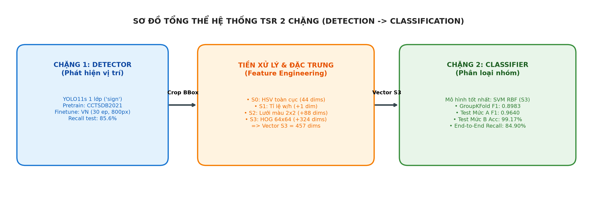
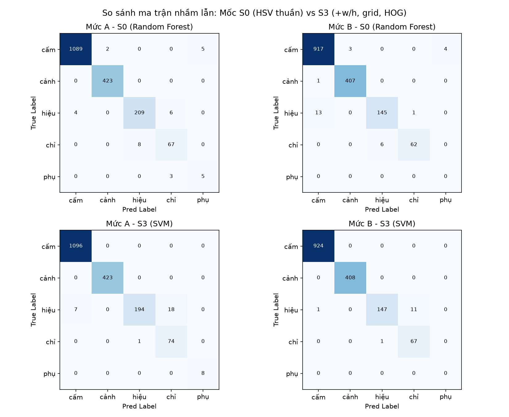
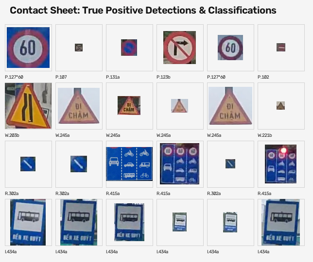

# Nhận Diện & Phân Loại Biển Báo Giao Thông Việt Nam (2-Stage Pipeline)

Chào bạn, đây là phần mã nguồn, tài liệu thực nghiệm và kết quả nghiên cứu độc lập của tôi về hướng tiếp cận **Pipeline 2 giai đoạn (Two-Stage Pipeline)** kết hợp giữa Học sâu và Thị giác máy tính truyền thống cho bài toán nhận diện biển báo giao thông Việt Nam (QCVN 41:2019).

---

## 1. Tôi làm gì và vì sao lại chọn hướng đi này?

Trong khi pipeline của bạn tập trung vào mạng nơ-ron tích chập (End-to-End CNN / LeNet-5), hướng đi của tôi tiếp cận bài toán theo góc độ **Module hóa 2 giai đoạn độc lập**:

```text
[Ảnh đường phố] ──> [Giai đoạn 1: Detector YOLO11s (1 lớp)] ──> [Crop biển báo]
                                                                      │
[Nhãn 5 nhóm QCVN 41] <── [Giai đoạn 2: Classifier SVM (RBF)] <───────┘
                          (Màu sắc HSV + Lưới không gian + Kết cấu HOG)
```

### Vì sao chọn kiến trúc này?
1. **Phân tách trách nhiệm (Decoupling)**: 
   - Định vị vật thể (Detection) là thế mạnh của YOLO (xử lý tốt biển kích thước khác nhau trên cảnh rộng).
   - Phân loại biển báo giao thông (Classification) có đặc thù rất mạnh về **màu sắc quy chuẩn** (đỏ = cấm, vàng = cảnh báo, xanh lam = hiệu lệnh/chỉ dẫn) và **hình học viền** (tròn, tam giác, chữ nhật).
2. **Tối ưu tài nguyên & Tốc độ**: 
   - Thay vì dùng một mạng CNN lớn phân loại hàng chục lớp, giai đoạn 2 chỉ trích xuất các đặc trưng toán học truyền thống (HSV + HOG) và chạy bộ phân loại **SVM (RBF kernel)**. Tốc độ suy luận cực nhanh trên CPU (~0.6 ms/crop với SVM, ~0.02 ms/crop với Boosting), hoàn toàn không cần GPU ở khâu phân loại.



---

## 2. Kết quả thực nghiệm cốt lõi

Toàn bộ thực nghiệm được đánh giá trên tập kiểm thử **Test VN độc lập (550 ảnh)** chia theo **khối video liên tục (Block Split)** để triệt tiêu hoàn toàn rò rỉ dữ liệu (Data Leakage = 0%).

### 2.1. Bộ phát hiện (YOLO11s Detector - Single Class)
- **Huấn luyện**: Pretrain 30 epochs trên CCTSDB (Trung Quốc), finetune 30 epochs trên tập Train VN (`imgsz=800`).
- **Hiệu năng Test (550 ảnh)**: mAP50 đạt **83.60%**, mAP50-95 đạt **60.10%**.
- **Khả năng bắt trúng (conf=0.25, IoU>=0.5)**: Bắt được **1.559 / 1.821 biển GT** (**Recall = 85.61%**, tỷ lệ bỏ sót 14.39% đối với 5 nhóm chính thức đã loại trừ Camera). Nhóm Cảnh báo bắt trúng 96.45%, Chỉ dẫn 90.67%, Cấm 84.31%, Hiệu lệnh 72.60%, Phụ 0.00% (8/8 biển phụ ở xa bị bỏ sót).

### 2.2. Bộ phân loại 5 nhóm (SVM RBF trên đặc trưng S3: HSV + Grid + Geometry + HOG)
Đánh giá phân lập ở 3 mức độ minh bạch:

| Mức đánh giá | Tập dữ liệu đầu vào | Accuracy | Macro-F1 (5 nhóm) | Major 4 F1 | Ghi chú & Ý nghĩa |
| :--- | :--- | :---: | :---: | :---: | :--- |
| **Mức (A)** | Bbox Ground-Truth sạch (1.821 biển, đã bỏ Camera) | **98.57%** | **0.9640** | **0.9551** | Cận trên lý thuyết của bộ phân loại khi tách biệt detector |
| **Mức (A')** | Bbox Ground-Truth của 1.559 biển mà YOLO bắt trúng | **99.29%** | **0.9738** | **0.9634** | Đánh giá trên tập mẫu phát hiện thành công |
| **Mức (B)** | Bbox thực tế do YOLO phát hiện sinh ra (1.559 box) | **99.17%** | **0.9687** | **0.9609** | Ghép nối tự động thực tế (**End-to-End Recall = 84.90%**) |

> *Ghi chú ngữ cảnh:* Con số `0.9687` ở Mức B (SVM) ngẫu nhiên trùng khớp về mặt làm tròn với điểm Test Mức A của kNN (0.9687). Hai chỉ số này thuộc 2 ngữ cảnh khác nhau và đều là kết quả thực nghiệm thật.

### 2.3. Hai biểu đồ và hình ảnh trực quan then chốt

| Ma trận nhầm lẫn: S0 (chỉ dùng màu) vs S3 (bổ sung HOG) | Minh họa một số biển báo nhận diện đúng (True Positives) |
|:---:|:---:|
|  |  |
| *(Nhóm Hiệu lệnh & Chỉ dẫn cùng có màu xanh lam, chỉ phân tách được khi HOG nhận biết viền tròn vs chữ nhật)* | *(Các mẫu crop thực tế được hệ thống phát hiện và phân loại đúng cả 4 nhóm)* |

---

## 3. Lộ trình đọc tài liệu đề xuất

Để nắm bắt nhanh và toàn diện, bạn nên xem theo thứ tự:
1. **[`README.md`](README.md)** (tài liệu này): Nắm tổng quan kiến trúc và kết quả.
2. **[`notebooks/tsr_walkthrough.ipynb`](notebooks/tsr_walkthrough.ipynb)**: Chạy thử walkthrough tương tác với visual charts, data tables và code mẫu kiểm tra trực tiếp.
3. **[`docs/JOURNEY.md`](docs/JOURNEY.md)**: Đọc nhật ký chi tiết 2 tuần thực nghiệm (từ CCTSDB, phát hiện data leakage, đến bài toán trôi màu và cách HOG giải quyết nhầm lẫn).
4. **[`docs/SPLIT_NOTES.md`](docs/SPLIT_NOTES.md)**: Phân tích kỹ thuật về hiện tượng rò rỉ dữ liệu giữa Random Split và Block Split.
5. **[`docs/YOLO_DETECT.md`](docs/YOLO_DETECT.md)**: Chi tiết về detector YOLO11s, các kịch bản bắt trúng và phân tích 14.39% biển bỏ sót.

---

## 4. Hướng dẫn tải Weights để tái lập kết quả

Toàn bộ weights của hệ thống được lưu trữ tại Google Drive:
👉 Xem chi tiết đường dẫn tải và mã băm SHA-256 đối soát tại: **[`WEIGHTS.md`](WEIGHTS.md)**.
*(Bao gồm `vn_s_best.pt` cho YOLO và `stage2_best.joblib` cho Classifier S3).*

---

## 5. Khác biệt kỹ thuật với pipeline của bạn & Đề xuất so sánh công bằng

| Tiêu chí | Pipeline của bạn | Pipeline của tôi |
| :--- | :--- | :--- |
| **Không gian nhãn** | **4 nhóm** (`Bien_Cam`, `Bien_Nguy_Hiem`, `Bien_Hieu_Lenh`, `Bien_Chi_Dan`), loại bỏ biển phụ và lớp chưa xác định. | **5 nhóm** (thêm nhóm `phụ`, gộp `B.8a` vào cấm, loại Camera khỏi classifier). |
| **Chiến lược chia Split** | Random Split theo ảnh (`random.shuffle` 70/15/15). Đo đạc thực tế có **46.84%** số cặp frame kề nhau ($s, s+1$) nằm ở 2 tập khác nhau. | Block Split theo khối video liên tục (100 frame/khối, gap=5 frame). Đo đạc thực tế **0.00%** cặp frame kề nhau vi phạm ranh giới. |
| **Phương pháp phân loại** | Deep Learning (Enhanced LeNet-5). | Feature Engineering truyền thống (HSV + Lưới không gian + Hình học + HOG) kết hợp SVM (RBF) / Boosting. |

### Đề xuất so sánh công bằng:
Hai phương pháp hiện đang chạy trên 2 bộ split khác nhau và không gian nhãn khác nhau nên chưa thể đối đầu trực tiếp con số Accuracy:
- **Đề xuất**: Chúng ta nên **dùng chung 1 bộ split chuẩn hóa chia theo khối video (Block Split, 0% rò rỉ)** và đánh giá trên cùng **4 nhóm chính**. Khi đó, chúng ta sẽ đo đạc được chính xác năng lực tổng quát hóa thực tế của cả hai phương pháp (Deep Learning vs Truyền thống) trên các cung đường mới.

---

## 6. Các hạn chế chính của giải pháp hiện tại

1. **Biển kích thước nhỏ & biển phụ**: Detector YOLO11s bỏ sót 14.39% biển test, tập trung vào các biển ở cự ly xa (< 24px) và nhóm biển phụ (bỏ sót 8/8 biển phụ). Hướng khắc phục: Tăng resolution input lên 1024 hoặc áp dụng SAHI (Slicing Aided Hyper Inference).
2. **Độ nhạy thời tiết & trôi màu**: Dù đặc trưng kết cấu HOG đã tăng cường độ bền vững, không gian màu HSV vẫn có thể bị dao động trong điều kiện ban đêm thiếu sáng hoặc sương mù đậm.
3. **Thực nghiệm trên 1 seed cố định**: Các kết quả báo cáo hiện tại được đo trên 1 seed cố định (seed=42). Cần chạy lặp qua nhiều seed ngẫu nhiên khác nhau để tính khoảng tin cậy thống kê hoàn chỉnh hơn.