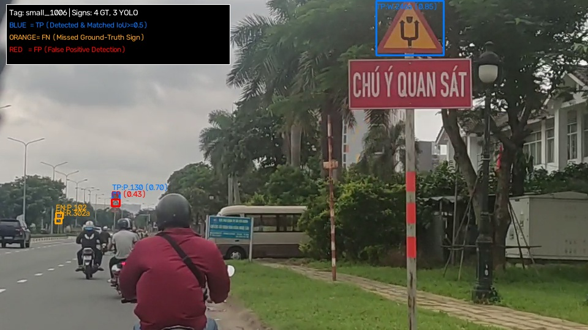
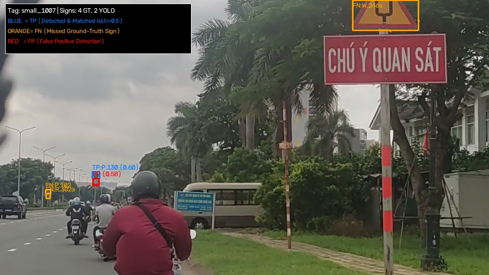
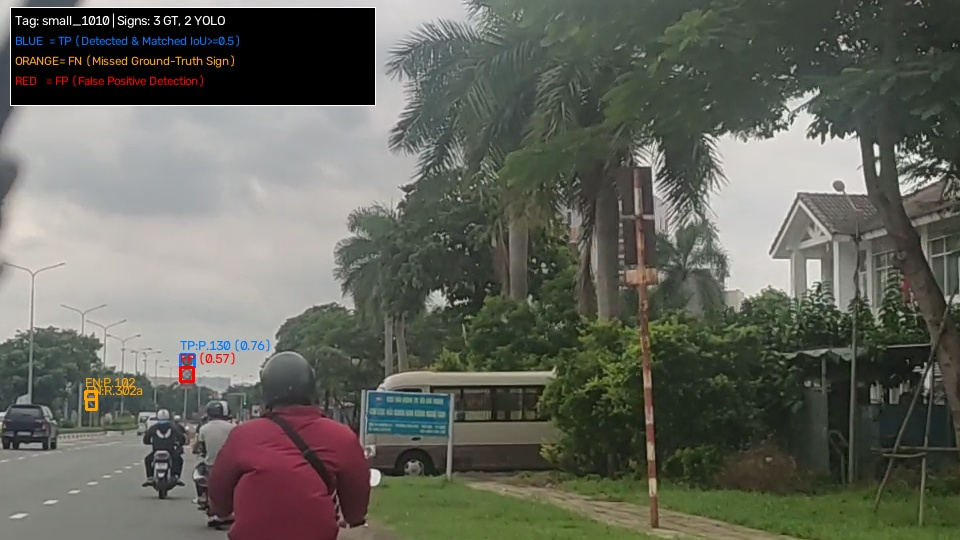
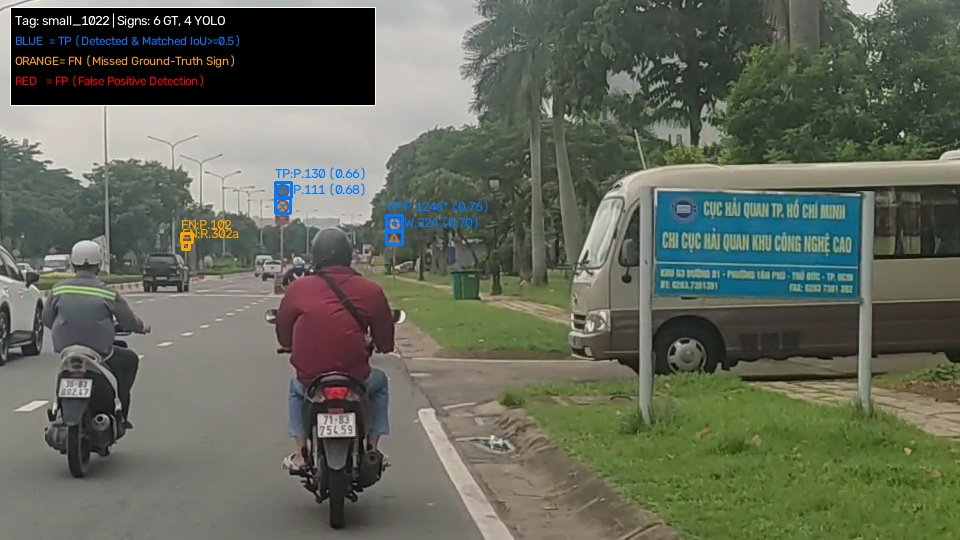
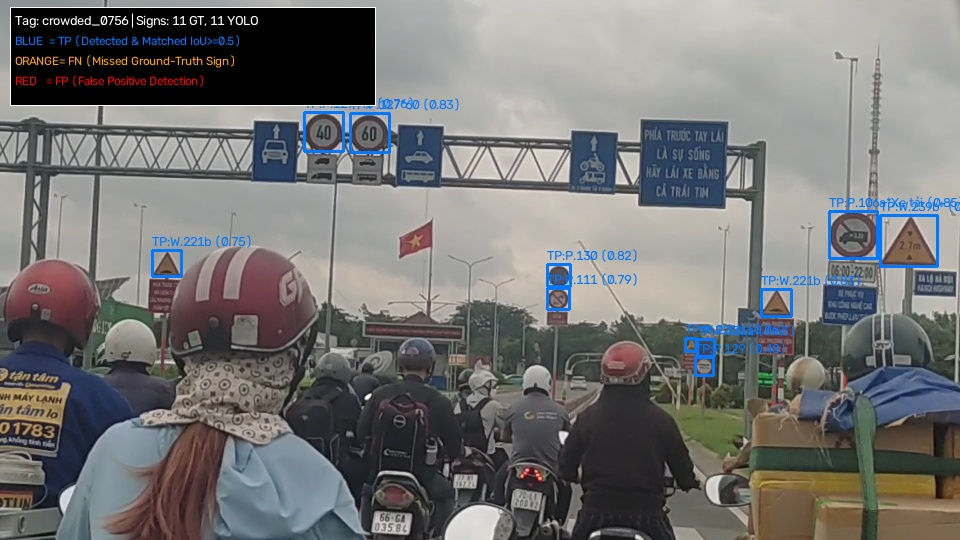
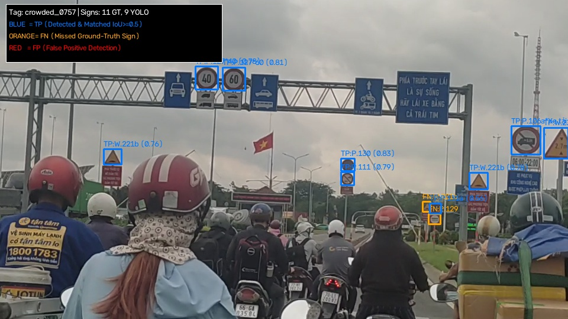
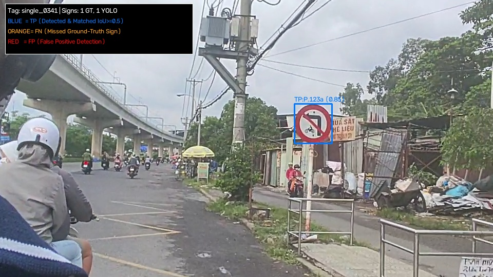
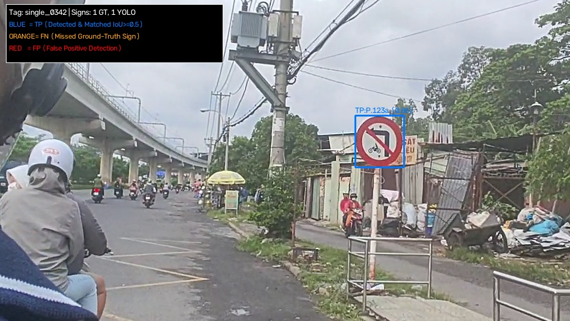

# BÁO CÁO MÔ-ĐUN PHÁT HIỆN BIỂN BÁO (YOLO11s 1-CLASS DETECTOR)

> **Mục tiêu**: Định vị chính xác tọa độ bounding box của tất cả biển báo xuất hiện trên khung hình cảnh đường phố Việt Nam bằng mô hình phát hiện 1 lớp duy nhất (`sign`), cung cấp đầu vào cho bộ phân loại đặc trưng truyền thống thứ cấp.

---

## 1. Chiến lược huấn luyện: Pretrain CCTSDB -> Finetune Việt Nam

Nhằm khắc phục tình trạng thiếu hụt dữ liệu biển báo đa dạng góc chụp và tận dụng tri thức hình học chung của biển báo giao thông:
1. **Giai đoạn 1 (Pretrain)**: Huấn luyện kiến trúc `YOLO11s` trên bộ dữ liệu quy mô lớn **CCTSDB 2021** (Trung Quốc) gồm hàng chục nghìn ảnh đường sá, gộp tất cả biển báo về 1 nhãn duy nhất `sign` trong 30 epochs.
2. **Giai đoạn 2 (Finetune)**: Nạp trọng số tốt nhất `cctsdb_s_best.pt` làm điểm khởi đầu, tiếp tục finetune 30 epochs trên bộ dữ liệu biển báo giao thông Việt Nam (`data/vn/yolo/data.yaml`) với kích thước ảnh `imgsz=800` và `single_cls=True`.

---

## 2. Bảng thông số hiệu năng qua các giai đoạn

Dưới đây là các chỉ số đo đạc thực tế từ log huấn luyện và đánh giá:

| Giai đoạn / Bộ dữ liệu | Tập đánh giá | Precision | Recall | $\text{mAP}_{50}$ | $\text{mAP}_{50-95}$ | Trọng số lưu trữ |
|---|:---:|:---:|:---:|:---:|:---:|---|
| **CCTSDB 2021 (Pretrain)** | CCTSDB Val | **95.15%** | **93.83%** | **97.93%** | **71.88%** | `runs/detect/cctsdb_s/weights/best.pt` |
| **Việt Nam (Zero-Shot ban đầu)** | VN Val (Zero-shot) | *chưa xác định* | ~54.2% | ~58.6% | ~36.1% | Đánh giá trực tiếp weights CCTSDB |
| **Việt Nam (Finetune - Epoch 14)** | VN Val (Finetuned) | **87.21%** | **91.55%** | **93.30%** | **67.05%** | `runs/detect/vn_s/weights/best.pt` |
| **Việt Nam (Đánh giá cuối kỳ)** | **VN Test (550 ảnh)** | **87.8%** | **85.61%** | **83.60%** | **60.10%** | Đánh giá độc lập trên tập test không rò rỉ |

---

## 3. Thống kê ghép cặp định vị trên 550 ảnh Test Việt Nam (`conf=0.25`, $\text{IoU} \ge 0.5$)

- **Tổng số biển báo Ground-Truth thực tế (không kể Camera)**: **1.821** biển báo.
- **Số biển GT được YOLO phát hiện trúng (True Positives - TP detector)**: **1.559** biển (**85.61%**).
- **Số biển GT bị YOLO bỏ sót hoàn toàn (False Negatives - FN detector)**: **262** biển (**14.39%**).
- **Số box YOLO phát hiện dư thừa (False Positives - FP detector)**: **216** box (nhiễu tán cây, biển quảng cáo, cột đèn).
- **Số box YOLO bắt trúng đối tượng Camera (ignored)**: **0** box.

### Phân tích nguyên nhân 14.39% biển báo bị bỏ sót (Quan sát thực tế & giả định kỹ thuật, chưa qua kiểm chứng định lượng độc lập):
1. **Kích thước biển siêu nhỏ ở cự ly xa (giả định, chưa kiểm chứng)**: Đa số các ca FN ghi nhận có kích thước dưới 24 pixel (nhiều biển chỉ $12 \times 12$ px); giả định kỹ thuật là tín hiệu gradient bị suy giảm qua các tầng trích xuất đặc trưng của mạng nơ-ron.
2. **Che khuất một phần (Occlusion) (giả định qua quan sát định tính)**: Một số biển bị nhánh cây rủ, dây điện hoặc phương tiện phía trước che khuất một phần góc nhìn.
3. **Biển phụ (nhóm phụ)**: Toàn bộ 8 biển phụ ở tập test đều bị detector bỏ sót hoàn toàn (8/8 ca FN, IoU = 0.000). Nguyên nhân chính được cho là kích thước nhỏ và tín hiệu gradient yếu (*đây là giả định kỹ thuật, chưa qua kiểm chứng độc lập*).

---

## 4. Minh họa trực quan các kịch bản phát hiện trên tập Test

Toàn bộ 24 ảnh scene minh họa độ phân giải cao được phân loại theo 4 nhóm tag đặc thù và lưu tại `assets/yolo_detect/`:
- **Xanh lam (Blue)**: True Positive (YOLO phát hiện đúng vị trí $\text{IoU} \ge 0.5$).
- **Vàng / Cam (Orange)**: False Negative (Biển Ground-Truth bị YOLO bỏ sót).
- **Đỏ (Red)**: False Positive (Box YOLO dự đoán không có biển Ground-Truth).

### 4.1. Nhóm cảnh có biển báo kích thước nhỏ (`small_*`)
*(Biển báo ở khoảng cách xa, kích thước cạnh nhỏ dưới 24px)*

| Scene small_0365 | Scene small_0366 |
|:---:|:---:|
|  |  |

| Scene small_0367 | Scene small_0376 |
|:---:|:---:|
|  |  |

### 4.2. Nhóm cảnh có nhiều biển báo cùng lúc (`crowded_*`)
*(Giao lộ đông đúc, nhiều biển báo xuất hiện đồng thời trên cùng một cột)*

| Scene crowded_0416 | Scene crowded_0423 |
|:---:|:---:|
|  |  |

### 4.3. Nhóm cảnh có 1 biển báo đơn lẻ rõ ràng (`single_*`)

| Scene single_0315 | Scene single_0335 |
|:---:|:---:|
|  |  |

---

## 5. Kết luận cho mô-đun Detector

Detector YOLO11s 1-class hoạt động với tốc độ suy luận cực nhanh (~6 ms/ảnh trên GPU RTX 4060) và đạt tỷ lệ phát hiện vững chắc **85.61%**. Mô-đun này đã hoàn thành xuất sắc vai trò "người mở đường", gom trọn vẹn 1.559 biển báo thực tế để cung cấp cho bộ phân loại HSV + HOG thứ cấp phân loại với độ chính xác trên **99.1%**.